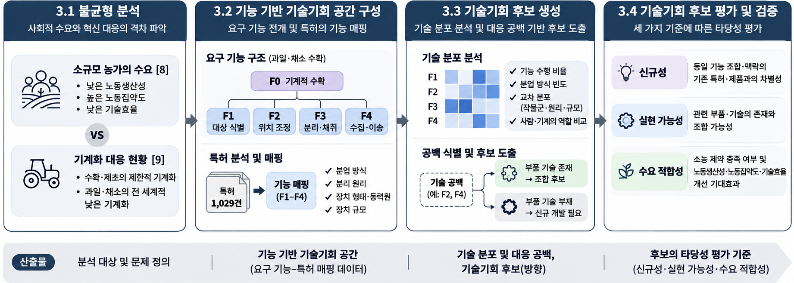

# 확장초록 — 기경학회 동계학술대회 (2026-11-14)
<!-- empirics: Gemma4 31B v5 (Mac Studio); §4 only differs from extended-abstract(11.14).md -->

## 제목

Discovering Underrepresented Innovation Opportunities

## 부제

A Needs-Driven Framework for Technology Opportunity Discovery toward the Sustainable Development Goals

국문 가제: 사회적 수요가 기술개발에 충분히 반영되지 않은 영역에서 기술기회를 발굴하는 방법

## 초록

지속가능발전목표(SDGs)는 사회적 필요가 큰 문제를 제시하지만, 기술 혁신의 방향은 구매력, 수익성, 연구개발 역량, 의제 설정 권한 등에 영향을 받아 사회적 수요와 기술개발 활동 사이에 불균형이 발생할 수 있다. 기존 기술기회 발굴(Technology Opportunity Discovery, TOD) 연구는 주로 기술적 공백, 성장 가능성 및 기술 간 융합을 중심으로 새로운 기회를 탐색해 왔으나, 이러한 접근만으로는 사회적 수요가 기술개발에 충분히 반영되지 않은 영역을 식별하기 어렵다. 본 연구는 이러한 영역을 UIO(Underrepresented Innovation Opportunities)로 개념화하고, 이를 대상으로 기술기회를 발굴하는 방법론을 제안한다.

제안하는 방법론은 네 단계로 구성된다. 첫째, 사회적 필요와 혁신 대응 사이의 불균형을 파악한다. 둘째, 수요·요구 기능·기술 메커니즘·적용 맥락으로 기회 공간을 구성한다. 셋째, 논문과 특허의 지식을 결합하여 기술기회 후보를 생성한다. 넷째, 신규성·실현 가능성·수요 적합성을 독립된 기준으로 검증한다. 특히 사회적 수요를 요구 기능으로 구체화하고, 이를 특허에 기술된 기능과 연결하여 기존 기술의 대응 수준을 분석한다.

사례 연구에서는 Chiarella 등(2023)이 소규모 농가에서 확인한 낮은 노동생산성, 높은 노동집약도, 낮은 기술효율을 주요 수요로 설정한다. FAO 보고서를 근거로 파종·수확·저장 작업의 요구 기능을 도출하고, 자본 부족, 소규모 농지, 기술 접근성 부족을 적용 제약조건으로 고려한다. 이를 통해 소농의 수요에 비해 기술적 대응이 부족한 영역을 식별하고, 기존 기술의 기능과 해결수단을 활용하여 기술기회 후보를 탐색한다.

본 연구는 기술적 공백과 성장 가능성 중심의 TOD를 수요와 기술개발 활동 사이의 불균형을 고려하는 방향으로 확장하고, 요구 기능과 특허의 기술적 대응을 연결하여 기술기회 후보를 도출하는 분석 절차를 제시한다. 실무적으로는 사회적 수요를 고려한 공공 R&D 투자 우선순위 설정과 기업 및 연구기관의 기술개발 기회 탐색을 지원할 것으로 기대한다.

---

## 1. 서론 (Introduction)

### 1.1 사회적 수요와 기술혁신의 불균형

지속가능발전목표(SDGs)는 식량, 보건, 기후변화 등 사회적 필요가 큰 문제를 주요 국제 의제로 제시하고 있다. 그러나 기술혁신의 방향이 반드시 사회적 수요의 크기에 따라 결정되는 것은 아니다. Dosi(1982)[1]는 기술 패러다임이 기술개발에서 해결해야 할 문제와 활용 가능한 지식의 범위를 규정하며, 기술발전은 이러한 패러다임 내에서 일정한 궤적을 따라 진행된다고 설명하였다. 일단 기술발전의 궤적이 형성되면 연구개발은 기존의 방향을 따라 지속되는 경향이 있으며, 이 과정에서 새로운 사회적 수요가 기술개발의 주요 과제로 충분히 반영되지 못할 수 있다.

이러한 불균형은 혁신정책 연구에서도 논의되어 왔다. Weber and Rohracher (2012)[2]는 장기적인 사회기술 전환을 저해하는 요인으로 수요 표명 실패(demand articulation failure)와 방향성 실패(directionality failure)를 제시하였다. 전자는 사용자의 수요를 파악하고 혁신 과정에 반영하는 체계가 부족한 상황을, 후자는 다양한 혁신 주체의 활동을 공동의 목표와 방향으로 조정하지 못하는 상황을 의미한다. Schot and Steinmueller(2018)[3]는 혁신정책을 연구개발 지원, 국가혁신시스템, 전환적 변화의 세 가지 프레임으로 구분하고, 전환적 변화에서 혁신의 방향성과 이해관계자 참여를 강조하였다. 이는 사회적 수요와 기술개발 간 불균형이 혁신체계의 구조적 특성과 관련되어 있음을 시사한다.

사회적 수요와 연구개발 활동 간 불균형을 실증적으로 분석하려는 시도도 이루어져 왔다. 보건 분야에서는 질병 부담을 나타내는 장애보정생존연수(DALY)와 논문 및 연구비의 분포를 비교하여, 질병 부담에 비해 연구개발 활동이 상대적으로 부족한 영역을 분석하였다 (Yegros-Yegros et al., 2020[4]; Schmallenbach et al., 2025[5]). 다만 질병 부담이 크다는 사실만으로 연구개발 투자가 부족하다고 판단할 수는 없다. 미국 국립학술원 (National Academies of Sciences, Engineering, and Medicine, 2025[6])은 기존 치료법으로 해결되지 않는 질병 부담과 미충족 의료 수요 등을 함께 고려할 필요가 있다고 지적하였다.

식량·농업 분야에서도 사회적 수요와 관련된 문제가 지속되고 있다. UN이 제시한 지속가능발전목표의 목표 2(SDG 2)는 영양부족과 식량불안정 해소뿐 아니라 소규모 생산자의 노동생산성과 소득 향상(세부목표 2.3)을 주요 과제로 제시하고 있다. 그러나 FAO(2025)[7]는 관련 지표의 개선이 정체되는 등 목표 달성이 지연되고 있다고 보고하였다. 이는 국제적으로 사회적 필요가 확인되고 있음에도 관련 문제가 충분히 해결되지 않고 있음을 보여준다. 이러한 특성을 고려하여 본 연구는 농업·식량 분야를 사회적 수요와 기술개발 간 불균형을 분석하기 위한 연구 대상으로 선정한다.

### 1.2 연구 목적 및 연구질문

본 연구는 사회적 수요에 비해 기술개발이 충분히 이루어지지 않은 영역을 UIO(Underrepresented Innovation Opportunities)로 개념화하고, 해당 영역에서 기술기회 후보를 도출하는 방법론을 제안한다.

기존 기술기회 발굴(Technology Opportunity Discovery, TOD) 연구는 주로 특허와 학술문헌을 분석하여 기술적 공백, 성장 가능성 및 기술 간 융합 기회를 탐색해 왔다. 본 연구는 이러한 접근을 확장하여 사회적 수요와 기술개발 활동 간 불균형을 분석의 출발점으로 설정한다. 구체적으로 사회적 수요를 기술적으로 해결해야 할 요구 기능으로 전환하고, 이를 특허에 나타난 기술 기능과 비교함으로써 기존 기술의 대응 수준을 분석한다. 나아가 기능 조합과 적용 맥락을 고려하여 새로운 기술기회 후보를 도출하고자 한다.

이를 위한 핵심 연구질문은 다음과 같다.

**RQ. 사회적 수요가 확인되지만 기술개발에 충분히 반영되지 않은 영역을 어떻게 식별하고, 해당 영역에서 새로운 기술기회 후보를 어떻게 도출할 수 있는가?**

이를 구체화하기 위한 세부 연구질문은 다음과 같다.

**RQ1.** 사회적 수요를 기술적으로 해결해야 할 요구 기능으로 어떻게 전환할 수 있는가?

**RQ2.** 요구 기능과 특허에 기술된 기능 간의 충족 관계를 어떻게 정의하고 측정할 수 있는가?

**RQ3.** 기능 조합과 적용 맥락을 고려하여 기존 기술개발이 충분히 대응하지 못한 영역에서 새로운 기술기회 후보를 어떻게 도출할 수 있는가?

구체적인 적용 사례로 소규모 농가의 농업기계화 문제를 분석한다. 소규모 농가의 낮은 노동생산성, 높은 노동집약도 및 낮은 기술효율(Chiarella et al., 2023[8])과 과일·채소 수확 작업의 낮은 기계화 수준(FAO, 2022[9])에 주목한다. 이를 바탕으로 사회적 수요를 요구 기능으로 구체화하고, 관련 특허의 기술 기능과 비교하여 새로운 기술기회를 탐색한다.

---

## 2. 이론적 배경 (Theoretical Background)

### 2.1 기술기회 발굴(TOD)의 주요 접근법

기술기회 발굴(Technology Opportunity Discovery, TOD)은 기존 기술정보를 분석하여 새로운 기술개발 가능성을 탐색하는 연구 분야이다. 초기 연구는 특허와 학술문헌의 계량적 분석을 통해 신흥 기술과 기술변화의 방향을 파악하는 데 초점을 두었다(Porter and Detampel, 1995[10]). 이후 특허 데이터의 구조적·의미적 관계를 활용하여 기술적 공백과 새로운 기술 조합을 식별하는 방향으로 발전하였다.

Yoon and Park(2005)[11]은 특허 키워드와 형태분석을 결합하여 기술 요소의 새로운 조합을 탐색하였으며, Yoon et al.(2007)[12]은 이를 기술로드맵 수립에 활용하였다. Lee et al.(2009)[13]은 특허 지도를 활용하여 기술적 공백을 식별하였고, Son et al.(2012)[14]과 Teng et al.(2021)[15]은 생성지형도(GTM)를 통해 특허 분포가 희박한 영역을 탐색하였다. Lee et al.(2014)[16]은 신규성 탐지 기법을 활용하여 기존 기술과 차별화되는 기술기회를 분석하였다.

기술 간 관계를 활용하는 연구도 발전하였다. Curran and Leker(2010)[17], Lee et al.(2015)[18], Park and Geum(2022)[19], Liu et al.(2023)[20]은 기술 간 인용·의미적 관계와 링크예측 등을 활용하여 새로운 기술 융합 가능성을 탐색하였다. 한편, Shin and Lee(2013)[21]는 기업의 기술역량을 고려한 기술기회 탐색을, Kim and Shin(2018)[22]과 Hwang and Shin(2019)[23]은 기술발전 궤적과 파생 경로를 활용한 기회 탐색을 다루었다. Oh, Lee and Shin(2020)[24]은 신흥 기술기회의 모니터링을 위한 지표를 제안하였다.

이러한 연구들은 기술기회를 기존 기술 요소의 새로운 조합, 기술적 공백 또는 기술 간 잠재적 관계를 통해 식별한다는 공통점이 있다.

### 2.2 기능 기반 기술기회 발굴과 연구 공백

기술기회를 제품이나 기술분류가 아닌 기능 단위에서 탐색하려는 연구도 이루어져 왔다. Yoon et al.(2015)[25]은 기존 기술과 제품의 기능을 활용한 기술기회 발굴 방법론을 제안하였다. Choi et al.(2012)[26], Guo et al.(2016)[27], Wang et al.(2017)[28]은 특허 문장에서 주어–동작–대상(Subject–Action–Object, SAO) 구조를 추출하여 기술의 기능적 관계를 분석하고, 이를 기술기회 탐색과 기술로드맵 수립에 활용하였다.

기능 기반 접근은 서로 다른 제품이나 기술분야에 속하더라도 유사한 기능을 수행하는 기술을 비교할 수 있다는 장점이 있다. 그러나 기존 연구는 주로 특허에 나타난 기술 기능을 추출하고 이들 사이의 관계를 분석하는 데 초점을 두었다. 사회적 수요에서 요구 기능을 도출하고, 이를 기존 기술의 기능과 비교하여 수요 충족 수준을 분석하는 접근은 상대적으로 제한적이다.

또한 기술적 공백이 존재한다는 사실만으로 새로운 기술개발의 필요성을 판단하기는 어렵다. 동일한 기능이라도 적용 환경과 사용자의 제약조건에 따라 적합한 기술적 해결 방식이 달라질 수 있기 때문이다. 예를 들어 대규모 농가를 위한 완전 자동화 기술과 소규모 농가를 위한 부분 기계화 기술은 모두 수확 기능을 수행하지만, 요구되는 비용, 장비 규모 및 작업 방식에서 차이가 있다.

따라서 본 연구는 기존 기능 기반 TOD를 확장하여 사회적 수요에서 도출한 요구 기능과 특허의 기술 기능을 비교하고, 기능 조합과 적용 맥락을 고려하여 새로운 기술기회를 탐색하고자 한다.

---

## 3. 연구 방법론 (Research Methodology)

본 연구는 사회적 수요에 기반한 기술기회 발굴을 위해 4단계 분석 프레임워크를 제안한다. 프레임워크는 ① 사회적 수요와 혁신 대응의 불균형 분석, ② 기능 기반 기술기회 공간 구성, ③ 기술기회 후보 생성, ④ 기술기회 후보 평가 및 검증으로 구성된다. 그림 1은 각 단계의 주요 분석 절차와 산출물 및 단계 간 연계 관계를 나타낸다.

그림 1. 사회적 수요 기반 기술기회 발굴 프레임워크

### 3.1 사회적 수요와 혁신 대응의 불균형 분석

본 연구는 소규모 농가의 생산성 및 노동 조건에 관한 실증연구와 국제기구의 농업기계화 현황 분석을 바탕으로 사회적 수요와 기술개발 간 불균형을 파악한다.

Chiarella et al. (2023)[8]은 FAO, 세계은행 및 IFAD의 농촌생계정보시스템(RuLIS) 가구조사 자료를 활용하여 농장 규모와 생산성 간 관계를 분석하였다. 분석 결과, 소규모 농가일수록 노동생산성(작업일당 산출)과 기술효율(효율 경계 대비 산출)은 낮고, 노동집약도(ha당 작업일)는 높은 것으로 나타났다. 본 연구는 이 세 지표를 소규모 농가의 주요 사회적 수요를 정의하는 근거로 활용한다.

한편, FAO (2022)[9]는 농업 자동화 및 기계화의 발전에도 불구하고 수확과 제초 등 일부 농작업의 기계화 수준이 제한적이라고 지적하였다. 특히 콤바인과 정치식 탈곡기 등 주요 농업기계는 곡물 생산을 중심으로 발전해 왔으며, 과일·채소 생산은 전 세계적으로 기계화 수준이 매우 낮은 것으로 보고하였다.

이러한 결과는 소규모 농가의 노동생산성 향상과 노동집약도 감소에 대한 수요가 존재하는 반면, 이를 해결하기 위한 기계화 기술의 발전은 작물과 작업 유형에 따라 불균등하게 이루어졌음을 시사한다. 이에 본 연구는 과일·채소 수확 작업을 분석 대상으로 선정하고, 후속 단계에서 요구 기능과 특허의 기술 기능을 비교하여 기술개발의 대응 수준을 구체적으로 분석한다.

### 3.2 기능 기반 기술기회 공간 구성

본 단계에서는 앞서 확인한 사회적 수요를 기술적으로 해결 가능한 요구 기능으로 구체화하고, 관련 특허의 기술 기능을 연결하여 기술기회 공간을 구성한다.

**첫째, 분석 대상 기술과 특허 데이터를 선정한다.** 소규모 농가의 노동집약도 감소를 위한 기술적 과제로 과일·채소의 수작업 수확을 기계적으로 대체하거나 보조하는 기능을 설정한다. 적용 맥락에는 소규모 농가의 자본 부족, 소규모 농지 및 기술 접근성 제약을 반영한다.

특허 데이터는 파종·수확·저장(수확 후 취급 및 이송 포함) 기술 분야의 미국 출원 특허 패밀리 약 20,564건(2004~2023)을 모집단으로 구성하였다. 이 가운데 과일·채소 수확 관련 CPC인 A01D46(따기·털기), A01D45(채소 관련 하위 그룹), A01D13–33(뿌리작물 캐기), A01D51(지면 수확물 수집) 등을 기준으로 약 1,044건을 선정하였다. 최종적으로 Google Patents에서 명세서 원문을 확보한 1,029건을 분석에 활용한다. 분석 단위는 개별 특허이다.

**둘째, 사회적 수요를 요구 기능으로 전개한다.** 과일·채소의 기계적 수확을 상위 기능(F0)으로 정의하고, 이를 하위 기능으로 분해한다(표 1). 기능 전개에는 Pahl et al. (2007)[29]의 기능 구조화 방법과 Hirtz et al. (2002)[30]의 표준 기능 어휘를 참고하였다. 이때 기능은 기술이 수행해야 할 동작으로 정의하고, 카메라나 칼날과 같은 구체적인 기술 수단은 기능을 구현하는 메커니즘으로 구분한다.

표 1. 과일·채소 기계적 수확의 요구 기능

| ID | 요구 기능 | 기능적 역할 |
|---|---|---|
| F0 | 과일·채소의 기계적 수확 | 상위 요구 기능 |
| F1 | 수확 대상 식별 | 수확 대상의 식별 및 정보 제공(신호) |
| F2 | 수확 위치 조정 | 작물 분리·채취를 위한 위치 확보(에너지) |
| F3 | 작물 분리·채취 | 수확 대상의 직접적인 분리 및 채취 |
| F4 | 수확물 수집·이송 | 분리·채취된 수확물의 수집 및 전달(물질) |

각 기술은 F1–F4의 모든 기능을 수행할 필요가 없으며, 기계가 담당하는 기능의 조합(예: F3 단독, F2·F3·F4, F1·F2·F3·F4)에 따라 사람과 기계의 역할이 달라질 수 있다. 본 연구에서는 이러한 기능 수행의 조합을 **분업 방식**으로 정의한다. 또한 핵심 수확 기능인 F3를 직접 수행하는 특허를 수확 장치로, 그 외 관련 기능을 수행하는 특허(예: 센서, 그리퍼, 수확 헤드)를 부품 기술로 구분한다.

기술기회 공간은 이러한 분업 방식을 중심으로 분리 원리(절단·진동·훑기·당김·파기 등), 장치 형태(손 도구·밀거나 끄는 장치·작업자 플랫폼·트랙터 부착형·자주식 수확기·이동 로봇 등), 동력원(인력·배터리·내연기관·트랙터 PTO·유압 등) 및 장치 규모(소농형·작업자 플랫폼·이동 로봇·대규모형 등)를 결합하여 구성한다. 장치 규모는 형태와 동력원을 바탕으로 분류한다. 예를 들어 손 도구나 밀거나 끄는 장치이면서 트랙터 동력을 쓰지 않으면 소농형으로, 트랙터 부착형·자주식 수확기이거나 트랙터 PTO·유압을 쓰면 대규모형으로 구분한다.

**셋째, 특허의 기술 기능을 추출하고 요구 기능에 매핑한다.** 이를 위해 LLM을 활용한 2단계 분석 절차를 적용한다. 입력 데이터는 특허의 제목, 독립 청구항 및 상세한 설명으로 구성하며, 로컬 모델의 문맥 처리 범위를 고려하여 입력 길이를 약 13,000자로 제한한다. 독립 청구항은 발명의 기술적 범위를 확인하는 데 활용하고, 상세한 설명에서는 기술의 동작, 수행 주체, 적용 작물 및 해결 과제를 추출한다.

먼저, 개별 특허에서 동작, 구성 부품, 해결 과제, 기술적 효과, 대상 작물, 장치 형태 및 동력원을 추출하여 구조화된 특허 카드를 생성한다. 기능 추출에는 Hirtz et al. (2002)[30]의 표준 동작 어휘를 활용하고, 추출 결과의 근거가 되는 명세서 문장을 함께 기록한다. 독립 청구항에 대한 참조 정보는 별도의 코드 기반 검증을 통해 확인한다.

이후 추출된 기술 기능을 F1–F4의 요구 기능과 비교하여 직접 수행, 지원, 언급 없음의 세 가지 관계로 분류한다. 기능 수행 주체는 동력원을 기준으로 판정하며, 인력으로 작동하는 수동 도구의 동작은 사람의 수행 기능으로 처리한다. 또한 식용 과일·채소의 수확 기술 여부를 판정하여 공업용 작물, 솎기 및 잔재 처리, 수확 후 선별·적재 기술은 분석 범위에서 제외한다.

이상의 과정을 통해 개별 특허를 요구 기능, 분업 방식, 기술 메커니즘 및 적용 규모에 따라 분류한다. 이를 바탕으로 요구 기능별 기존 기술의 대응 수준을 비교할 수 있는 기능 기반 기술기회 공간을 구축한다.

### 3.3 기술기회 후보 생성

본 단계에서는 구축된 기술기회 공간에서 기존 기술의 분포와 대응 공백을 분석하고, 특허 및 학술문헌의 기술 지식을 활용하여 새로운 기술기회 후보를 도출한다.

**첫째, 기능별 기술 대응 수준과 공백을 분석한다.** 분석 범위에 포함된 특허를 대상으로 F1–F4의 기능 수행 관계와 기계 수행 비율을 산출하고, 수확 장치의 분업 방식별 특허 빈도를 분석한다. 이어서 분업 방식과 작물군, 분리 원리, 장치 형태 및 장치 규모의 교차 분포를 비교한다. 특히 소농형과 대규모형 기술에서 기계가 수행하는 기능과 사람에게 남아 있는 기능을 비교하여 기술개발의 편중 여부를 파악한다.

이를 통해 특정 작물이나 분리 원리에 기술개발이 집중된 영역, 일부 기능의 기계화가 제한된 영역, 대규모 농가용 기술은 존재하지만 소농형 기술의 대응이 부족한 영역을 식별한다. 특히 F2(수확 위치 조정)와 F4(수확물 수집·이송) 등의 기능이 소농형 기술에서 상대적으로 부족한지를 분석한다.

**둘째, 기술적 대응 공백을 바탕으로 기술기회 후보를 생성한다.** 동일한 작물군과 분리 원리에서 기존 수확 장치가 수행하지 못하는 하위 기능을 식별하고, 해당 기능을 수행하는 부품 기술의 존재 여부를 탐색한다. 관련 부품 특허가 존재하는 경우에는 기존 기술의 기능적 조합을 통한 기술기회 후보로 분류한다. 반면 대응 가능한 부품 기술이 확인되지 않는 경우에는 신규 기술개발이 필요한 공백으로 구분한다. 학술문헌은 미해결 기술 과제와 구현 가능한 해결 원리를 확인하고, 기술 조합의 가능성을 검토하는 데 활용한다.

현재 연구에서는 특허의 기능 매핑과 기술 분포 분석을 통해 대응 공백을 탐색하였으며, 구체적인 기술 조합을 통한 후보 생성은 후속 연구 단계에서 수행할 예정이다. 본 확장초록에서는 예비 분석에서 확인된 기술 분포의 특징과 이를 바탕으로 도출한 기술기회 방향을 제시한다.

### 3.4 기술기회 후보 평가 및 검증

도출된 기술기회 후보는 신규성, 실현 가능성 및 수요 적합성의 세 가지 기준에 따라 평가한다(표 2). 각 기준은 서로 다른 평가 차원을 나타내므로 독립적으로 검토한다.

표 2. 기술기회 후보 평가 기준

| 평가 기준 | 주요 평가 내용 |
|---|---|
| 신규성 | 동일한 기능 조합과 적용 맥락을 갖는 기존 특허·제품과의 차별성 |
| 실현 가능성 | 관련 부품 및 기술의 존재 여부와 기능적 조합 가능성 |
| 수요 적합성 | 소농의 자본·농지·기술 접근성 제약 충족 여부와 노동생산성·노동집약도·기술효율 개선에 대한 기대 기여 |

아울러 LLM 기반 특허 기능 매핑의 신뢰성을 확보하기 위해 파일럿 분석 및 표본 수작업 검증을 수행한다. 검증 과정에서 확인된 기능 분류 오류와 매핑의 순서 편향 등은 프롬프트 개선 및 결과 집계 과정에서 보정한다.

기술기회 후보에 대한 정량적 평가와 현장 적용을 통한 효과 검증은 후속 연구에서 수행할 예정이다.

---

## 4. 실증 분석 (Empirical Application)

본 절에서는 명세서 원문을 확보한 특허 1,029건을 대상으로 기능 수행, 분업 방식 및 장치 규모의 분포를 분석한다. 먼저 수확 기술의 기능적 구성과 기술개발의 주요 패턴을 확인하고, 이를 바탕으로 소규모 농가의 기술적 수요에 비해 기존 기술의 대응이 부족한 영역을 탐색한다.

### 4.1 기능·분업·규모의 분포와 패턴

#### (1) 분석 범위와 수확 장치·부품

전체 1,029건 중 식용 과일·채소 수확 기술에 해당하는 특허는 574건(55.8%)으로 나타났다. 나머지 455건은 비수확 작업, 곡물·사료·잔디 수확, 공업용 작물, 수확 후 취급, 견과류 수확 등 분석 범위에 해당하지 않는 기술로 분류되었다(표 3).

표 3. 분석 범위 판정 (전체 1,029건)

| 범위 분류 | 건수 | 비율 |
|---|---:|---:|
| 식용 과일·채소 수확 (범위 안) | 574 | 55.8% |
| 솎기·잔재 처리 등 비수확 작업 | 218 | 21.2% |
| 곡물·사료·잔디 수확 | 65 | 6.3% |
| 공업용 작물 | 64 | 6.2% |
| 수확 후 선별·적재 등 취급 | 57 | 5.5% |
| 견과류만 수확 | 30 | 2.9% |
| 불명확 | 21 | 2.0% |

분석 범위에 포함된 574건 중 수확 장치는 324건(56.4%), 부품 기술은 233건(40.6%)이며, F1–F4의 어느 기능에도 대응하지 않는 특허는 17건(3.0%)이었다(표 4). 이후 기능 수행 분석에는 574건을, 분업 방식과 장치 규모 분석에는 수확 장치 324건을 사용하였다.

표 4. 수확 장치·부품 기술 (범위 안 574건)

| 구분 | 건수 | 비율 |
|---|---:|---:|
| 수확 장치 (F3를 직접 수행) | 324 | 56.4% |
| 부품 기술 | 233 | 40.6% |
| 대응 없음 | 17 | 3.0% |

CPC 그룹별로는 따기·털기 기술(A01D46)이 426건으로 가장 많았으며, 이 가운데 수확 장치 249건과 부품 기술 167건이 포함되었다. CPC 그룹은 복수 분류가 가능하므로 중복 집계하였다.

#### (2) F1–F4 기능 수행 관계와 기계 수행

574건의 특허에서 F1–F4 요구 기능별 직접 수행, 지원 및 언급 없음의 분포를 분석하였다(표 5). 직접 수행 비율은 F4(수확물 수집·이송) 58.4%와 F3(작물 분리·채취) 56.4%가 가장 높았으며, F2(수확 위치 조정) 47.7%, F1(수확 대상 식별) 22.8% 순이었다.

표 5. F1–F4 기능 수행 관계 (범위 안 574건)

| 요구 기능 | 직접 수행 | 지원 | 언급 없음 | 기계 수행 |
|---|---|---|---|---:|
| F1 수확 대상 식별 | 131 (22.8%) | 1 (0.2%) | 442 (77.0%) | 131 |
| F2 수확 위치 조정 | 274 (47.7%) | 9 (1.6%) | 291 (50.7%) | 242 |
| F3 작물 분리·채취 | 324 (56.4%) | 3 (0.5%) | 247 (43.0%) | 306 |
| F4 수확물 수집·이송 | 335 (58.4%) | 0 (0.0%) | 239 (41.6%) | 302 |

기계 수행 건수는 F3 306건, F4 302건, F2 242건, F1 131건 순이었다. 이는 기존 수확 기술에서 작물 분리와 수집·이송의 기계 수행이 상대적으로 널리 나타나는 반면, 수확 대상 식별은 상대적으로 제한적임을 보여준다.

기계 수행에는 직접 수행과 지원 관계를 모두 포함하되, 수행 주체가 발명 장치 또는 외부 기계인 경우를 집계하였다.

#### (3) 분업 방식 (수확 장치 324건)

수확 장치 324건의 분업 방식을 분석한 결과, F3·F4를 기계가 담당하는 조합이 75건(23.1%)으로 가장 많았다. 이어 F2·F3·F4 55건(17.0%), F3 단독 44건(13.6%), F2·F3 및 F1·F2·F3가 각 43건(13.3%) 순이었다(표 6). 상위 네 조합은 전체의 67.0%를 차지한다.

표 6. 분업 방식 분포 (수확 장치 324건)

| 분업 방식 | 건수 | 비율 |
|---|---:|---:|
| F3·F4 | 75 | 23.1% |
| F2·F3·F4 | 55 | 17.0% |
| F3 | 44 | 13.6% |
| F2·F3 | 43 | 13.3% |
| F1·F2·F3 | 43 | 13.3% |
| F1·F2·F3·F4 | 20 | 6.2% |
| 기계 없음 | 20 | 6.2% |
| F1·F3 | 12 | 3.7% |
| F1·F3·F4 | 11 | 3.4% |
| F2 | 1 | 0.3% |

반면 F1·F2·F3·F4 전체를 기계가 담당하는 경우는 20건(6.2%)에 그쳤고, F3 또는 F3·F4만 담당하는 조합은 합계 119건(36.7%)으로 상대적으로 흔했다. 기계 수행 기능이 없는 20건 중 16건은 손 도구에 해당하였다.

작물 분리 원리는 절단 108건과 진동 55건에 집중되어 있었다. 장치 형태에서는 자주식 수확기 112건, 부품 109건, 손 도구 31건이 주요 유형으로 나타났다.

이러한 결과는 기존 수확 기술이 핵심 수확·수집 기능 중심의 부분 기계화와 복수 기능 조합에 고루 분포하며, 네 기능을 모두 기계화한 완전 통합형은 상대적으로 적다는 점을 시사한다.

#### (4) 장치 규모와 분업의 연관

수확 장치 324건을 장치 규모에 따라 구분한 결과, 대규모형 154건, 불명 116건, 소농형 31건, 이동 로봇 22건, 작업자 플랫폼 1건으로 나타났다.

분업 방식과 기술 속성 간 연관성의 강도를 크래머 V로 측정하고, 통계적 유의성을 2,000회 순열검정으로 평가하였다(표 7). 분석 결과, 장치 규모(V=0.50)와 장치 형태(V=0.42)가 가장 높은 연관성을 보였으며, 두 변수 모두 통계적으로 유의하였다(p<0.001). 작물군을 고려한 조건부 검정에서도 유의성이 유지되었다(각각 p<0.001).

표 7. 분업 방식과 기술 속성 간 연관성 (수확 장치)

| 속성 | 건수 | 크래머 V | p | 작물군 조건부 p |
|---|---:|---:|---:|---:|
| 장치 규모 | 208 | 0.50 | 0.000 | 0.000 (167건) |
| 장치 형태 | 200 | 0.42 | 0.000 | 0.000 (159건) |
| 작물군 | 249 | 0.27 | 0.000 | – |
| 분리 원리 | 255 | 0.26 | 0.001 | 0.130 (198건) |
| 출원 시기 | 324 | 0.22 | 0.020 | 0.064 (249건) |

주: p=0.000은 원자료의 표시값이며, 본문에서는 p<0.001로 표기하였다. 빈도 5건 미만의 분업 방식은 기타로 통합하였다.

작물군(V=0.27, p<0.001)과 출원 시기(V=0.22, p=0.020)도 유의한 연관성을 보였으며, 분리 원리(V=0.26, p=0.001) 역시 유의하였다. 다만 작물군 조건부에서는 분리 원리의 유의성이 유지되지 않았다(p=0.130). 이는 분업 방식이 장치 규모 및 형태와 상대적으로 더 뚜렷하게 연관되어 있음을 보여준다. 이에 따라 장치 규모별 기능 수행의 차이를 추가로 분석하여 소농형 기술에서 기능적 대응이 부족한 영역을 탐색하였다.

장치 규모별 기능 수행에서도 차이가 확인되었다(표 8). 소농형은 대규모형에 비해 F2(수확 위치 조정)의 기계 수행 비율이 58%p, F4(수확물 수집·이송)는 44%p 낮았다. F1의 차이도 30%p로 나타났다. 다만 소농형 표본이 31건으로 적어 해석에 주의가 필요하다.

표 8. 요구 기능별 기계 수행 비율 × 장치 규모 (수확 장치)

| 요구 기능 | 소농형 (31) | 작업자 플랫폼 (1) | 이동 로봇 (22) | 대규모형 (154) | 불명 (116) |
|---|---|---|---|---|---|
| F1 수확 대상 식별 | 0 (0%) | 0 (0%) | 17 (77%) | 46 (30%) | 23 (20%) |
| F2 수확 위치 조정 | 0 (0%) | 1 (100%) | 17 (77%) | 90 (58%) | 54 (47%) |
| F3 작물 분리·채취 | 15 (48%) | 1 (100%) | 22 (100%) | 154 (100%) | 111 (96%) |
| F4 수확물 수집·이송 | 5 (16%) | 1 (100%) | 9 (41%) | 92 (60%) | 54 (47%) |

기계가 담당하는 기능 수 역시 소농형은 평균 0.6개, 대규모형은 2.5개로 차이를 보였다. F2·F3·F4 조합의 64%, F1·F2·F3·F4 조합의 60%가 대규모형에 해당하였다. 노동·비용 문제를 제시한 비율은 소농형 16%, 대규모형 45%였다.

이는 소농형 기술에서 기계가 담당하는 기능의 범위가 대규모형보다 좁다는 점을 보여준다. 특히 F2와 F4의 기계 수행 격차는 소농형 수확 기술에서 기능적 보완 가능성을 탐색할 필요가 있는 영역으로 나타났다. 다만 장치 규모 분류에서 불명이 116건으로 많아, 규모 격차 해석에는 장치 형태·동력 판정의 추가 검토가 필요하다.

### 4.2 기술기회 방향과 공백

4.1절의 분석 결과를 바탕으로 기존 수확 기술의 기능적 구성과 장치 규모에 따른 기술 대응의 차이를 검토하였다. 본 연구에서는 소규모 농가의 노동생산성·노동집약도·기술효율 개선에 기여할 가능성이 있으면서, 자본·농지·기술 접근성 제약을 고려할 수 있는 영역을 UIO 후보로 탐색한다. de Morais et al. (2026)[31] 역시 혼농임업 기계화 기술의 소농 적합성을 검토하여 기술의 존재와 실제 적용 가능성을 구분할 필요가 있음을 제시하였다.

분석 결과, 완전 통합형 기계화의 상대적 희소성, 소농형의 기능별 기계 수행 격차, 장치 규모에 따른 기술 공백이라는 세 가지 기회 방향이 도출되었다(표 9).

표 9. 실증 분석을 통해 도출한 기술기회 방향

| 기술기회 유형 | 주요 실증 근거 | 기술기회 방향 |
|---|---|---|
| 완전 통합형의 상대적 희소성 | F1·F2·F3·F4 20건(6.2%); F3·F4 75건, F3 44건 | 부분 기계화는 흔하나, 식별·위치조정까지 묶인 소형 통합형 탐색 |
| 소농형 기능 격차 | F2: 소농형 0%, 대규모형 58%; F4: 16%, 60% | 수확 위치 조정 및 수확물 수집·이송 기능 보완 |
| 장치 규모 공백 | 잎·줄기·꽃채소 F2·F3·F4: 대규모형 11건, 소농형 0건 | 기존 기능 조합의 소농형 재설계 |

주: 제시된 기술기회 방향은 특허 분포에서 도출한 탐색적 후보로, 기술적 실현 가능성이나 수요 적합성이 검증된 결과는 아니다.

#### (1) 완전 통합형 대비 부분 기계화의 분포

수확 장치 324건 중 F3만 기계가 담당하는 특허는 44건(13.6%), F3·F4를 담당하는 특허는 75건(23.1%)으로, 두 조합을 합하면 119건(36.7%)에 이른다. 반면 네 기능을 모두 기계가 담당하는 조합은 20건(6.2%)에 그쳤다. 세 가지 이상의 기능을 기계가 담당하는 조합은 109건(33.6%)이었다.

이는 기존 수확 기술이 핵심 수확·수집 기능 중심의 부분 기계화에도 상당수 대응하고 있음을 보여준다. 소규모 농가에서는 완전 자동화보다 노동 부담이 큰 기능을 우선적으로 기계화하는 방식이 자본 및 농지 제약에 적합할 수 있다. 따라서 이미 흔한 부분 기계화 구성을 소형·저비용 형태로 재설계하는 방향과, 상대적으로 드문 완전 통합형을 소농 제약에 맞게 축소하는 방향을 함께 검토할 수 있다.

#### (2) 소농형에서 상대적으로 부족한 F2·F4

소농형의 F2(수확 위치 조정) 기계 수행 비율은 0%로 대규모형의 58%보다 낮았으며, F4(수확물 수집·이송)는 소농형 16%, 대규모형 60%로 차이를 보였다(표 8).

이러한 차이는 소농형 수확 장치에서 수확 위치 조정과 수확물 수집·이송에 사람의 작업이 상대적으로 많이 남아 있을 가능성을 보여준다. 따라서 소형 장치에 적용할 수 있는 위치 조정 보조 기술과 수확물 수집·이송 기술을 기능적 보완의 우선 검토 대상으로 설정할 수 있다.

분석 범위에 포함된 부품 기술 233건은 이러한 기능을 보완하기 위한 후보 기술 자원으로 활용할 수 있다. 다만 실제 조합 가능성을 판단하려면 기존 수확 장치의 부족한 기능과 부품 기술 간 추가적인 매칭이 필요하다. 또한 소농형 표본이 31건이고 장치 규모 불명이 116건으로 많아, 기능 격차에 대한 해석에는 장치 형태·동력 판정의 재검토가 필요하다.

#### (3) 규모 공백: 대규모형만 있고 소농형이 없는 영역

동일한 작물군과 분업 방식에서 대규모형·이동 로봇·작업자 플랫폼 기술은 존재하지만 소농형 특허가 확인되지 않는 조합을 규모 공백으로 구분하였다(표 10).

대표적으로 잎·줄기·꽃채소의 F2·F3·F4 조합은 대규모형 특허가 11건 존재하지만 소농형은 확인되지 않았다. 나무 과일의 F2·F3·F4 조합 역시 대규모형 9건에 비해 소농형은 0건이었다. 열매채소의 F1·F2·F3 조합에서는 대규모형 8건과 이동 로봇 4건이 확인되었으나 소농형은 없었다.

표 10. 작물군 × 분업 방식별 장치 규모 공백

| 작물군 | 분업 방식 | 소농형 | 플랫폼 | 로봇 | 대규모형 | 불명 |
|---|---|---:|---:|---:|---:|---:|
| 잎·줄기·꽃채소 | F2·F3·F4 | 0 | 0 | 0 | 11 | 1 |
| 나무 과일 | F2·F3·F4 | 0 | 1 | 0 | 9 | 2 |
| 열매채소 | F1·F2·F3 | 0 | 0 | 4 | 8 | 1 |
| 나무 과일 | F1·F2·F3·F4 | 0 | 0 | 3 | 8 | 0 |
| 덩굴·관목 과일 | F3·F4 | 0 | 0 | 0 | 6 | 9 |
| 뿌리·땅속 작물 | F2·F3·F4 | 0 | 0 | 0 | 6 | 3 |
| 잎·줄기·꽃채소 | F1·F2·F3 | 0 | 0 | 0 | 6 | 1 |
| 열매채소 | F1·F2·F3·F4 | 0 | 0 | 1 | 5 | 1 |
| 견과 | F2·F3 | 0 | 0 | 1 | 4 | 4 |
| 뿌리·땅속 작물 | F2·F3 | 0 | 0 | 0 | 4 | 3 |
| 나무 과일 | F1·F3 | 0 | 0 | 2 | 4 | 1 |
| 덩굴·관목 과일 | F2·F3·F4 | 0 | 0 | 0 | 5 | 2 |

이러한 결과는 특정 작물군에서 이미 개발된 기능 조합이 소농형 장치에서는 확인되지 않는다는 점을 보여준다. 따라서 기존 대규모형 기술의 기능적 구성을 유지하면서 장치 규모, 동력 및 구동 방식을 소농 환경에 맞게 변경하는 기술적 재설계를 기회 방향으로 검토할 수 있다.

다만 소농형 특허가 확인되지 않았다는 사실만으로 기술 수요나 실현 가능성이 입증되는 것은 아니다. 각 조합의 소농 적용 가능성과 경제성은 별도로 평가해야 한다.

#### (4) 후속: 기술기회 후보 생성·평가

이상의 분석을 통해 기존 기술의 기능적 구성과 장치 규모에 따른 대응 차이에서 세 가지 기술기회 방향을 도출하였다.

후속 연구에서는 각 영역에서 부족한 기능을 식별하고, 이를 보완할 수 있는 부품 기술을 탐색한다. 관련 기술이 존재하는 경우에는 기존 기술의 기능적 조합을 통한 후보로, 대응 기술이 확인되지 않는 경우에는 신규 기술개발이 필요한 공백으로 구분할 예정이다.

도출된 후보는 신규성, 실현 가능성 및 수요 적합성을 기준으로 평가한다. 본 확장초록의 실증 범위는 특허의 기능 매핑과 기술 분포 및 대응 공백 분석까지이며, 구체적인 기술 조합과 후보 평가는 후속 연구에서 수행한다.

---

## 5. 논의 및 결론 (Discussion and Conclusion)

본 연구는 사회적 수요가 기술개발에 충분히 반영되지 않은 영역을 UIO로 정의하고, 이를 대상으로 기술기회를 발굴하는 방법론을 제안하였다. 기존 TOD가 기술적 공백과 성장·융합 가능성을 중심으로 기회를 탐색했다면, 본 연구는 사회적 수요와 기술적 대응 간 불균형을 새로운 탐색 기준으로 제시한다.

### 5.1 이론적·방법론적 기여

첫째, **TOD의 탐색 대상을 기존 기술의 발전 가능성에서 사회적 수요에 대한 기술적 대응이 부족한 영역으로 확장**한다. 기술개발이 활발한 영역을 중심으로 탐색하는 기존 접근은 이미 형성된 기술개발 방향을 재생산할 수 있다. UIO는 이러한 편중으로 인해 간과될 수 있는 기술기회를 식별하기 위한 보완적 관점을 제공한다.

둘째, 사회적 수요를 요구 기능으로 구체화하고 이를 특허의 기술 기능과 연결하여 기술적 대응 수준을 분석하는 절차를 제시한다. 특히 개별 기능뿐 아니라 **기능 조합, 수행 주체 및 적용 규모**를 함께 고려함으로써 기존 기술의 재조합과 적용 맥락의 전환에서 새로운 기술기회를 탐색할 수 있도록 한다.

### 5.2 기술혁신 정책 및 실무적 시사점

공공 R&D 관점에서는 사회적 수요에 비해 기술적 대응이 부족한 영역을 식별하여 연구개발 우선순위 설정에 활용할 수 있다. 이는 기술의 성장 가능성뿐 아니라 사회적 필요와 기술개발의 불균형을 함께 고려하는 의사결정을 지원한다.

기업과 연구기관은 기존 기술의 성능 향상이나 완전 자동화 외에도, 특정 사용자의 제약조건에 맞춘 **부분 기계화, 기능 보완 및 기존 기술의 재조합**을 기술개발 기회로 탐색할 수 있다. 특히 기술이 이미 존재하더라도 적용 규모와 사용 환경이 달라 활용이 어려운 영역에서 새로운 개발 방향을 모색할 수 있다.

### 5.3 연구의 한계와 향후 연구

본 연구는 사회적 수요와 특허 기반 기술개발 활동을 동일한 척도로 직접 비교하지 못하였으며, 기능별 기술 대응 수준을 통해 잠재적 불균형을 탐색하였다. 또한 LLM 기반 기능 매핑의 오류 가능성과 요구 기능에 대한 전문가 검증의 한계가 존재한다. 특허 분포의 공백만으로 실제 수요나 기술적 실현 가능성을 입증하기도 어렵다.

향후 연구에서는 기능 매핑의 신뢰성과 기능 전개의 타당성을 검증하고, 기존 기술의 기능적 조합을 통해 구체적인 기술기회 후보를 생성할 예정이다. 이후 신규성, 실현 가능성 및 수요 적합성을 평가하여 제안 방법론의 유효성을 검토하고자 한다.

종합하면, 본 연구는 **기술이 어디로 발전하고 있는가뿐 아니라, 사회적으로 필요한 기술이 어디에서 충분히 개발되지 않고 있는가**를 탐색하는 TOD 접근을 제안한다. 이를 통해 기술기회 발굴을 수요 중심의 기술혁신 의사결정과 연결하는 가능성을 제시한다.

---

## 참고문헌 (References)

[1] Dosi, G. (1982) ‘Technological paradigms and technological trajectories: A suggested interpretation of the determinants and directions of technical change’, *Research Policy*, 11(3), pp. 147–162. https://doi.org/10.1016/0048-7333(82)90016-6

[2] Weber, K.M. and Rohracher, H. (2012) ‘Legitimizing research, technology and innovation policies for transformative change: Combining insights from innovation systems and multi-level perspective in a comprehensive “failures” framework’, *Research Policy*, 41(6), pp. 1037–1047. https://doi.org/10.1016/j.respol.2011.10.015

[3] Schot, J. and Steinmueller, W.E. (2018) ‘Three frames for innovation policy: R&D, systems of innovation and transformative change’, *Research Policy*, 47(9), pp. 1554–1567. https://doi.org/10.1016/j.respol.2018.08.011

[4] Yegros-Yegros, A., van de Klippe, W., Abad-García, M.F. and Rafols, I. (2020) ‘Exploring why global health needs are unmet by research efforts: the potential influences of geography, industry and publication incentives’, *Health Research Policy and Systems*, 18, 47. https://doi.org/10.1186/s12961-020-00560-6

[5] Schmallenbach, L., Bley, M., Bärnighausen, T.W., Sugimoto, C.R., Lerchenmüller, C. and Lerchenmueller, M.J. (2025) ‘Global distribution of research efforts, disease burden, and impact of US public funding withdrawal’, *Nature Medicine*, 31(9), pp. 3101–3109. https://doi.org/10.1038/s41591-025-03923-0

[6] National Academies of Sciences, Engineering, and Medicine (2025) *Aligning investments in therapeutic development with therapeutic need: Closing the gap*. Washington, DC: National Academies Press. https://doi.org/10.17226/29157

[7] Food and Agriculture Organization of the United Nations (2025) *Tracking progress on food and agriculture-related SDG indicators 2025*. Rome: FAO. https://doi.org/10.4060/cd5832en

[8] Chiarella, C., Meyfroidt, P., Abeygunawardane, D. and Conforti, P. (2023) ‘Balancing the trade-offs between land productivity, labor productivity and labor intensity’, *Ambio*, 52(10), pp. 1618–1634. https://doi.org/10.1007/s13280-023-01887-4

[9] Food and Agriculture Organization of the United Nations (2022) *The State of Food and Agriculture 2022: Leveraging automation in agriculture for transforming agrifood systems*. Rome: FAO. https://doi.org/10.4060/cb9479en

[10] Porter, A.L. and Detampel, M.J. (1995) ‘Technology opportunities analysis’, *Technological Forecasting and Social Change*, 49(3), pp. 237–255. https://doi.org/10.1016/0040-1625(95)00022-3

[11] Yoon, B. and Park, Y. (2005) ‘A systematic approach for identifying technology opportunities: Keyword-based morphology analysis’, *Technological Forecasting and Social Change*, 72(2), pp. 145–160. https://doi.org/10.1016/j.techfore.2004.08.011

[12] Yoon, B., Phaal, R. and Probert, D. (2007) ‘Morphology analysis for technology roadmapping: application of text mining’, *R&D Management*, 38(1), pp. 51–68. https://doi.org/10.1111/j.1467-9310.2007.00493.x

[13] Lee, S., Yoon, B. and Park, Y. (2009) ‘An approach to discovering new technology opportunities: Keyword-based patent map approach’, *Technovation*, 29(6–7), pp. 481–497. https://doi.org/10.1016/j.technovation.2008.10.006

[14] Son, C., Suh, Y., Jeon, J. and Park, Y. (2012) ‘Development of a GTM-based patent map for identifying patent vacuums’, *Expert Systems with Applications*, 39(3), pp. 2489–2500. https://doi.org/10.1016/j.eswa.2011.08.101

[15] Teng, F., Sun, Y., Chen, F., Qin, A. and Zhang, X. (2021) ‘Technology opportunity discovery of proton exchange membrane fuel cells based on generative topographic mapping’, *Technological Forecasting and Social Change*, 169, 120859. https://doi.org/10.1016/j.techfore.2021.120859

[16] Lee, C., Kang, B. and Shin, J. (2014) ‘Novelty-focused patent mapping for technology opportunity analysis’, *Technological Forecasting and Social Change*, 90, pp. 355–365. https://doi.org/10.1016/j.techfore.2014.05.010

[17] Curran, C.-S. and Leker, J. (2010) ‘Patent indicators for monitoring convergence – examples from NFF and ICT’, *Technological Forecasting and Social Change*, 78(2), pp. 256–273. https://doi.org/10.1016/j.techfore.2010.06.021

[18] Lee, W.S., Han, E.J. and Sohn, S.Y. (2015) ‘Predicting the pattern of technology convergence using big-data technology on large-scale triadic patents’, *Technological Forecasting and Social Change*, 100, pp. 317–329. https://doi.org/10.1016/j.techfore.2015.07.022

[19] Park, M. and Geum, Y. (2022) ‘Two-stage technology opportunity discovery for firm-level decision making: GCN-based link-prediction approach’, *Technological Forecasting and Social Change*, 183, 121934. https://doi.org/10.1016/j.techfore.2022.121934

[20] Liu, Z., Feng, J. and Uden, L. (2023) ‘Technology opportunity analysis using hierarchical semantic networks and dual link prediction’, *Technovation*, 128, 102872. https://doi.org/10.1016/j.technovation.2023.102872

[21] Shin, J. and Lee, H. (2013) ‘Low-risk opportunity recognition from mature technologies for SMEs’, *Journal of Engineering and Technology Management*, 30(4), pp. 402–418. https://doi.org/10.1016/j.jengtecman.2013.09.002

[22] Kim, J. and Shin, J. (2018) ‘Mapping extended technological trajectories: integration of main path, derivative paths, and technology junctures’, *Scientometrics*, 116(3), pp. 1439–1459. https://doi.org/10.1007/s11192-018-2834-3

[23] Hwang, S. and Shin, J. (2019) ‘Extending technological trajectories to latest technological changes by overcoming time lags’, *Technological Forecasting and Social Change*, 143, pp. 142–153. https://doi.org/10.1016/j.techfore.2019.04.013

[24] Oh, E., Lee, Y. and Shin, J. (2020) ‘Identifying monitoring indicators for emerging technological opportunities’, *26th International Association for Management of Technology Conference (IAMOT) Proceedings*, pp. 1102–1116.

[25] Yoon, J., Park, H., Seo, W., Lee, J.-M., Coh, B. and Kim, J. (2015) ‘Technology opportunity discovery (TOD) from existing technologies and products: A function-based TOD framework’, *Technological Forecasting and Social Change*, 100, pp. 153–167. https://doi.org/10.1016/j.techfore.2015.04.012

[26] Choi, S., Park, H., Kang, D., Lee, J.Y. and Kim, K. (2012) ‘An SAO-based text mining approach to building a technology tree for technology planning’, *Expert Systems with Applications*, 39(13), pp. 11443–11455. https://doi.org/10.1016/j.eswa.2012.04.014

[27] Guo, J., Wang, X., Li, Q. and Zhu, D. (2016) ‘Subject–action–object-based morphology analysis for determining the direction of technological change’, *Technological Forecasting and Social Change*, 105, pp. 27–40. https://doi.org/10.1016/j.techfore.2016.01.028

[28] Wang, X., Ma, P., Huang, Y., Guo, J., Zhu, D., Porter, A.L. and Wang, Z. (2017) ‘Combining SAO semantic analysis and morphology analysis to identify technology opportunities’, *Scientometrics*, 111(1), pp. 3–24. https://doi.org/10.1007/s11192-017-2260-y

[29] Pahl, G., Beitz, W., Feldhusen, J. and Grote, K.-H. (2007) *Engineering Design: A Systematic Approach*. Berlin: Springer. https://doi.org/10.1007/978-1-84628-319-2

[30] Hirtz, J., Stone, R.B., McAdams, D.A., Szykman, S. and Wood, K.L. (2002) ‘A functional basis for engineering design: Reconciling and evolving previous efforts’, *Research in Engineering Design*, 13, pp. 65–82. https://doi.org/10.1007/s00163-001-0008-3

[31] de Morais, G.F., Han, D., Freire, A.M., Santos, A.V.A., de Araújo, W.L., Galvão, C.B., Garcia, A.P. and Albiero, D. (2026) ‘Mechanization in agroforestry systems: a systematic review of technologies for improving operational capacity among family farmers’, *Frontiers in Sustainable Food Systems*, 10, 1983415. https://doi.org/10.3389/fsufs.2026.1983415
