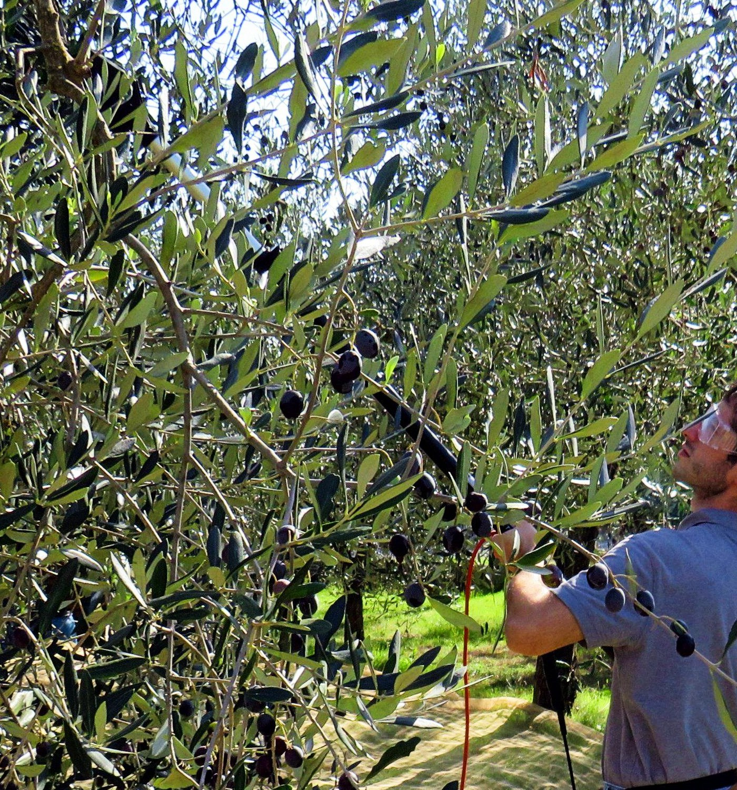

# 확장초록 — 기경학회 동계학술대회

> 상태: 초안(2026-11-13 기준).
> 일정: 2026년 12월 초. 제출 항목은 연구질문, 방법, 데이터, 예상 결과, 시사점이다.
> 바탕 문서: [concept.md](concept.md), [method.md](method.md), [case-agri.md](case-agri.md).
> 사례는 아직 지도교수와 확정하지 않았다. 수확 자동화는 결과를 보이기 위한 예시다.
> 선행연구 노트: `03_literature/transformative_innovation_policy.md`. 소농의 노동생산성·노동집약도·기술효율 근거 논문 노트: `03_literature/Balancing the trade-offs between land productivity, labor productivity and labor intensity.md`.

## 제목

Discovering Underrepresented Innovation Opportunities

## 부제

A Needs-Driven Framework for Technology Opportunity Discovery toward the Sustainable Development Goals

국문 가제: 사회적 수요가 기술개발에 충분히 반영되지 않은 영역에서 기술기회를 발굴하는 방법

## 초록

지속가능발전목표(SDGs)는 사회적 필요가 큰 문제를 제시하지만, 기술 혁신의 실제 방향은 구매력, 수익성, 연구개발 역량, 의제 설정 권한에 따라 정해진다. 그 결과 사회적 수요가 있어도 기술개발 의제에 충분히 반영되지 않는 영역이 생긴다. 본 연구는 이 영역을 UIO(Underrepresented Innovation Opportunities)로 개념화하고, 이 영역에서 새로운 기술기회를 발굴하는 방법론을 제안한다.

방법은 네 단계다. 사회적 필요와 혁신 대응 사이의 불균형을 측정하고, 수요·요구 기능·기술 메커니즘·적용 맥락으로 기회 공간을 구성하며, 논문과 특허의 지식을 결합해 후보를 만들고, 신규성·실현 가능성·수요 적합성을 각각 독립된 기준으로 검증한다.

사례의 수요는 Chiarella 등(2023)이 소농에서 확인한 세 가지 결과다. 소농은 노동생산성이 낮고, 노동집약도가 높으며, 기술효율(technical efficiency)이 낮다. 이 세 문제를 해결할 수 있으나 기존 기술혁신이 충분히 다루지 않은 영역을 UIO로 보고, 그 안에서 기술기회를 찾는다. 요구 기능은 FAO 보고서를 근거로 파종·수확·저장 작업별로 도출하며, 제약조건은 자본 부족, 소규모 농지, 기술 접근성 부족이다.

## 1. 연구질문

사회적 수요는 확인되지만 기술개발 의제에 충분히 반영되지 않은 영역을 어떻게 찾고, 그 영역에서 기술기회 후보를 어떻게 도출할 것인가?

세부 질문은 아직 확정하지 않았다. 현재 후보는 다음과 같다.

- 사회적 수요로부터 도출된 요구 기능과 특허에 기술된 기능 사이의 충족 관계를 어떻게 정의하고 측정할 것인가?

## 2. 방법

1. 사회적 필요와 혁신 대응 사이의 불균형을 정의하고 측정한다.
2. 수요, 요구 기능, 기술 메커니즘, 적용 맥락으로 기회 공간을 구성한다. 요구 기능의 하위 분해는 4절에서 다룬다.
3. 논문과 특허의 과학·기술 지식을 결합해 후보를 만든다.
4. 신규성, 실현 가능성, 수요 적합성을 서로 독립된 기준으로 검증한다.

## 3. 데이터

수요는 Chiarella 등(2023)에서 가져온다. 이 논문은 FAO·세계은행·IFAD의 RuLIS 가구 조사 자료로, 농장 규모가 작을수록 노동생산성과 기술효율은 낮고 노동집약도는 높다고 추정했다. 자료는 FAO 등이 구축했지만, 세 결과의 근거는 이 논문의 분석이다. 특허 데이터는 우선 미국 관할 파종·수확·저장 특허 패밀리 20,564건(`05_data/agri/Planting_harvesting_storage_US.csv`)을 쓴다.

세 수요는 다음과 같다.

1. **노동생산성을 높인다.** 노동생산성은 작업일당 산출로, 토지생산성을 노동집약도로 나눈 값이다. 따라서 면적당 산출이 높아도 면적당 투입 노동이 더 많으면 낮아진다. 농장 규모가 클수록 높다.
2. **노동집약도를 낮춘다.** 노동집약도는 ha당 연간 작업일이다. 0.2–1 ha 농장의 중앙값은 연 886일/ha, 20 ha 초과 농장은 18일/ha다. 비교한 모든 나라에서 규모가 클수록 낮았다.
3. **기술효율을 높인다.** 기술효율은 같은 투입으로 가장 효율적인 농장이 내는 산출 대비 그 농장의 산출이다. 면적당 산출은 작은 농장이 더 높을 수 있지만, 투입 대비 효율 경계에 더 가까운 쪽은 큰 농장이다.

출처: Chiarella, C., Meyfroidt, P., Abeygunawardane, D. and Conforti, P. 2023. Balancing the trade-offs between land productivity, labor productivity and labor intensity. *Ambio*. [https://doi.org/10.1007/s13280-023-01887-4](https://doi.org/10.1007/s13280-023-01887-4).

요구 기능은 세 수요를 파종·수확·저장 작업에서 특허가 청구할 수 있는 동작으로 옮긴 것이다. '보고서 원문' 열은 FAO 보고서의 문장이고, '요구 기능' 열은 그 문장에서만 뽑은 동작이다. FAO 보고서에는 '기술효율'이라는 용어가 없으므로, 기술효율 행에는 같은 투입으로 산출을 효율 경계에 가깝게 하는 동작만 골랐다.

| 수요 | 적용 영역 | 보고서 원문 | 요구 기능 | 출처 |
|---|---|---|---|---|
| 노동집약도를 낮춘다 | Planting | “However, adoption of tractors has stalled in sub-Saharan Africa in past decades, and light hand-held tools remain the main type of equipment used.” “In Ethiopia, farmers using a two-wheel tractor in wheat production reduced the costs of the essential operations of seeding, harvesting and threshing by 46 percent, 65 percent and 48 percent, respectively, compared with traditional technologies using manual tools or animal traction (see figure).” | 손 도구 파종을 소형 동력으로 대체, 파종 비용 절감 | FAO(2022), 요약; 2장 Box 8 |
| 노동집약도를 낮춘다 | Harvesting | “Across the world, mechanization continues to be limited for a range of operations including harvesting and weeding. Furthermore, although combine harvesters and stationary threshers are on the rise in various countries, they can only be used for harvesting cereals. With very few exceptions, fruit and vegetable production is scarcely mechanized across the globe.” | 수확·제초의 기계화 확대, 곡물 외 과일·채소의 손 수확 대체 | FAO(2022), 2장 |
| 노동집약도를 낮춘다 | Storage | “Until recently, automation in agriculture was largely about replacing draught animals and human labour with motorized equipment in a multitude of agricultural operations including land preparation, weeding, harvesting, irrigation, animal milking and feeding, and on-farm handling operations, such as threshing and milling.” “The use of small mechanical mills for extremely labour-intensive and tedious tasks, such as dehusking paddy or pounding grain into flour, also resulted in substantial gains in leisure time, especially for women.” | 탈곡·도정·제분 작업의 인력 대체 | FAO(2022), 2장 |
| 노동생산성을 높인다 | Planting | “This significantly eased the drudgery associated with agriculture and allowed farmers to perform tasks in a more timely manner.” “The average total revenue increased: from USD 1 964 for traditional practices to USD 2 567 for mechanized operations.” | 적기 파종, 동력화로 작업일당 수입 증가 | FAO(2022), 1–2장; 2장 Box 8 |
| 노동생산성을 높인다 | Harvesting | “Automation can also improve food safety, thanks to preservation and storage technologies, and make agricultural production more resilient, in particular to climate shocks, by allowing farmers to complete farming activities more rapidly and be more flexible in adapting activities to changing weather.” | 수확 작업 시간 단축, 날씨 변화에 맞춘 수확 시기 조정 | FAO(2022), 요약. 기계화로 작물 손상·손실을 줄인 인도 사례도 든다 |
| 노동생산성을 높인다 | Storage | “Beyond the farm, processing, preserving, storage and transport technologies can help reduce food loss and waste, enhance food safety and enable value addition, all of which are necessary for efficient agrifood systems capable of delivering healthy diets for all in a sustainable manner.” “Small producers struggle to set appropriate prices, meet quality specifications, aggregate volumes, access storage, arrange transport or comply with standards; buyers face traceability gaps, inconsistent supply and faulty documentation.” | 저장·보존으로 식품 손실 감소, 소생산자의 저장 시설 접근, 보존을 통한 부가가치 | FAO(2022), 1장; FAO(2025), 2.1.2 |
| 기술효율을 높인다 | Planting | “When embodied in agricultural machines, agricultural operations can be performed with greater precision, leading to further improvements in efficiency and productivity.” “Therefore, these technologies have the capacity to transform rural livelihoods and the associated agricultural landscape, including crop and livestock production, aquaculture, and forestry. In crop production, they can enhance the productivity of inputs such as seeds, fertilizers and water.” “Methodologies for manual, site-specific fertilizer application were developed a long time ago – variable rate technology (VRT) fertilizer for rice is one example, while a hand-held soil scanner is available in several low-income countries in Africa and Asia.” | 종자·비료·물 투입의 정밀도 향상, 위치별 시비 | FAO(2022), 요약; 2장 |
| 기술효율을 높인다 | Harvesting | “Agricultural automation. The use of machinery and equipment in agricultural operations to improve their diagnosis, decision-making or performing, reducing the drudgery of agricultural work and/or improving the timeliness, and potentially the precision, of agricultural operations.” | 수확 작업의 적시성·정밀도 향상 | FAO(2022), 용어집. 본문은 기계화로 작물 손상·손실이 줄어든다고 적는다 |
| 기술효율을 높인다 | Storage | “Beyond the farm, processing, preserving, storage and transport technologies can help reduce food loss and waste, enhance food safety and enable value addition, all of which are necessary for efficient agrifood systems capable of delivering healthy diets for all in a sustainable manner.” “The mapping effort focuses on six technology thematic areas critical to improving food security: 1) postharvest, reducing food loss and waste; 2) water management and saving technologies; 3) sustainable pest control and crop management; 4) e-commerce and market access, 5) fintech; and 6) green energy for farmers.” | 수확 후 손실·폐기 감소, 저장 중 식품 안전 유지 | FAO(2022), 1장; FAO(2024), 요약 |

표의 출처:

- FAO. 2022. *The State of Food and Agriculture 2022. Leveraging automation in agriculture for transforming agrifood systems.* [https://doi.org/10.4060/cb9479en](https://doi.org/10.4060/cb9479en).
- FAO. 2024. *Mapping affordable and transferrable climate-smart technologies for smallholder farmers.* 요약 보고서. [원문](https://openknowledge.fao.org/server/api/core/bitstreams/7265417a-43b8-4ba5-9939-5c8e21ddf6f9/content).
- FAO. 2025. *Digital agriculture and AI innovation roadmap.* [https://doi.org/10.4060/cd5956en](https://doi.org/10.4060/cd5956en).

## 4. 요구 기능의 체계적 분해(Functional Decomposition)

3절의 요구 기능은 FAO 문장에서 뽑은 상위 기능이다. 1절의 세부 질문은 이 기능과 특허에 기술된 기능 사이의 충족 관계를 묻는다. 상위 기능을 하위 기능으로 나누면, 특허가 기능 전체를 수행하는지 일부만 수행하는지를 같은 단위로 기록할 수 있다. 3절 표의 요구 기능은 모두 같은 절차로 분해하며, 이 절에서는 그중 한 칸을 예시로 보인다.

기능 분해는 시스템이 수행할 상위 기능을 하위 기능과 그 관계로 나타내는 공학설계 방법이다. Pahl, Beitz, Feldhusen, Grote(2007)의 기능 구조(functional structure)는 전체 기능을 하위 기능과 그 사이의 관계로 표현한다. Hirtz, Stone, McAdams, Szykman, Wood(2002)의 기능 기반(functional basis)은 기능을 표준화된 동작과 물질·에너지·신호의 흐름으로 표현한다. Ulrich와 Eppinger의 제품 개발 절차는 기능 구조를 구현 수단과 분리해 다룬다. 이 문헌들은 상위 요구 기능을 특정 제품 구조에 얽매이지 않는 하위 기능으로 전개하는 근거가 된다.

용어는 다음과 같이 쓴다. 기능은 시스템이 수행하는 동작이고, 구현 원리는 그 동작을 실현하는 기술 수단이다. 상위 기능과 하위 기능의 관계를 분해(decomposition), 기능과 기술 수단의 관계를 실현(realization)이라 한다. 하위 기능에는 동작만 적고, 카메라·로봇팔·절단날 같은 수단은 실현 관계로 따로 적는다. 같은 하위 기능도 여러 원리로 실현될 수 있다. 또 수행 경로마다 반드시 필요한 하위 기능과, 다른 수단이나 사람이 대신할 수 있는 하위 기능을 구분한다. 따라서 기능 구조에는 기능의 유무, 수행 주체, 기능 간 의존 관계, 대체 경로를 함께 기록한다.

절차는 다음 다섯 단계다. 4.1절 사례에는 1–3단계까지 적용했고, 4·5단계는 아직 수행하지 않았다. 4단계에서 참고할 공학 문헌은 `06_references/food-agriculture/harvest-functional-processes.md`에 정리했다.

| 단계 | 내용 | 산출 |
|---|---|---|
| 1. 상위 요구 기능 정의 | 3절의 수요와 FAO 문장을 수행 가능한 동작으로 적는다 | 상위 요구 기능 |
| 2. 기능 분석 | 동작, 대상, 입력·출력, 물질·에너지·신호의 흐름을 적는다 | 기능 명세 |
| 3. 하위 기능 분해 | 상위 기능을 이루는 세부 동작과 그 관계를 적고, 경로마다 필수 기능과 대체 가능한 기능을 구분한다 | 하위 기능 구조 |
| 4. 기술 문헌 기반 보완 | 공학설계 문헌과 해당 작업의 기술 자료를 바탕으로 누락·중복되거나 특정 기술에 치우친 기능을 수정한다 | 보완된 기능 구조 |
| 5. 전문가 검증 | 분해의 적절성, 완전성, 기술 중립성, 관계의 타당성을 평가한다 | 검증된 기능 구조 |

출처: Pahl, G., Beitz, W., Feldhusen, J. and Grote, K.-H. 2007. *Engineering Design: A Systematic Approach*. Springer. Hirtz, J., Stone, R. B., McAdams, D. A., Szykman, S. and Wood, K. L. 2002. A functional basis for engineering design: Reconciling and evolving previous efforts. *Research in Engineering Design* 13, 65–82. [https://doi.org/10.1007/s00163-001-0008-3](https://doi.org/10.1007/s00163-001-0008-3). Ulrich, K. T. and Eppinger, S. D. *Product Design and Development*. McGraw-Hill.

### 4.1 사례: 과일·채소를 기계적으로 수확한다

3절 표의 '노동집약도를 낮춘다 – Harvesting' 행에서 FAO는 수확·제초의 기계화가 제한적이고, 콤바인과 정치식 탈곡기는 곡물에만 쓰이며, 과일·채소 생산은 거의 기계화되지 않았다고 적는다. 이 사례는 분석 범위를 과일·채소 수확으로 한정하고, 제초와 생산 전반은 제외한다. 상위 기능은 다음과 같다.

**F0. 과일·채소를 기계적으로 수확한다** (Mechanically harvest fruits and vegetables). 수작업 수확을 기계 동작으로 대체하거나 기계로 보조한다.

입력은 식물체에 달린 과일·채소(물질), 분리에 드는 기계적 일(에너지), 대상의 위치와 상태(신호)이고, 출력은 식물체에서 분리되어 모인 수확물(물질)이다.

| ID | 하위 기능 | 동작과 흐름 | F0과의 관계 |
|---|---|---|---|
| F1 | 수확 대상 식별 (Identify harvestable produce) | 수확할 대상의 위치와 상태를 파악한다(신호) | F3가 작용할 대상을 정한다. 기계나 사람이 수행한다 |
| F2 | 수확 위치 조정 (Position harvesting mechanism) | 수확 장치를 대상 위치로 옮기거나 고정한다(에너지) | F3가 작용할 위치를 확보한다. 기계나 사람이 수행한다 |
| F3 | 작물 분리·채취 (Detach or pick produce) | 과일·채소에 기계적 힘을 가해 식물체에서 떼어 낸다(물질·에너지) | F0의 핵심 동작이다. 이 기능이 없으면 기계 수확이 성립하지 않는다 |
| F4 | 수확물 수집·이송 (Collect and transfer produce) | 분리된 수확물을 모으거나 다음 위치로 옮긴다(물질) | F3의 산출물을 다음 단계로 넘긴다. 용기·중력·사람 수거로 대체할 수 있다 |

모든 수확 장치가 네 기능을 다 갖출 필요는 없다. 아래 사진처럼 사람이 대상을 보고 도구를 대면 F1·F2는 사람이, F3는 기계가 수행하며, 이것도 기계가 수확을 보조하는 F0의 한 실현이다. 기계가 맡는 하위 기능의 조합을 분업 방식이라 하고, 나머지 기능은 사람이 맡는다. 따라서 일부 기능만 다루는 기술은 불완전한 기술이 아니라 다른 분업 방식이다. 다만 F3가 없으면 기계 수확이 성립하지 않는다. 그래서 F3를 직접 수행하는 기술은 그 자체로 하나의 분업 방식을 이루는 수확 장치로 보고, F3를 직접 수행하지 않는 기술은 부품 기술로 본다. 부품 기술은 혼자서는 기계 수확이 되지 않고, 수확 장치에 더해져 기계가 맡는 기능을 늘린다. 예를 들어 과일 위치를 영상으로 인식하는 장치를 전동 절단 도구에 더하면, 기계가 맡는 범위가 F3에서 F1·F3로 넓어진다.

이탈리아 토스카나의 전동 올리브 수확 갈퀴. 사람이 가지에 갈퀴를 대고(F1·F2), 기계가 열매를 털어 분리한다(F3). 원본 사진에서 이 동작이 보이도록 잘라 냈다. 출처: PROPOLI87, Wikimedia Commons, [CC BY-SA 4.0](https://creativecommons.org/licenses/by-sa/4.0). [파일](https://commons.wikimedia.org/wiki/File:Toscana_(Italy)_Raccolta_olive_con_abbacchiatore.jpg).

구현 원리는 기능과 분리해 다음과 같이 적는다.

| 하위 기능 | 실현 원리의 예 |
|---|---|
| F1. 수확 대상 식별 | 카메라 영상 인식, 센서, 작업자의 시각 |
| F2. 수확 위치 조정 | 로봇팔, 이동 기구, 작업자의 조작 |
| F3. 작물 분리·채취 | 절단, 비틀기, 당김, 진동 분리 |
| F4. 수확물 수집·이송 | 컨베이어, 수집 용기, 중력 이송, 사람 수거 |

특허와 대응시키는 단위는 수단이 아니라 F1–F4의 동작이다.

### 4.2 특허의 기술 기능과 연결

분석 단위는 제품이 아니라 특허 한 건이다. 3절의 특허 가운데 과일·채소 수확 CPC에 해당하는 1,044건을 대상으로 한다. 범위는 A01D46(따기·털기), A01D45의 채소 하위 그룹, A01D13–33(뿌리작물 캐기), A01D51(땅에 떨어진 작물 모으기)이다. 이 가운데 1,029건의 명세서 원문을 Google Patents에서 받았다. 제목과 초록에는 수확 동작과 그 수행 주체가 거의 드러나지 않으므로, LLM이 명세서 본문을 읽고 다음 두 단계로 구조화한다.

1. **특허 카드.** 본문에서 발명 대상, 발명이 쓰일 때 일어나는 동작과 그 수행 주체, 구성요소, 해결하려는 문제와 효과, 대상 작물, 형태·동력원 같은 사용 조건을 정해진 양식으로 뽑는다. 동작은 Hirtz 등(2002)의 기능 기반 동사로만 적고, 항목마다 근거가 된 본문 문단을 인용한다. 카드는 F1–F4와 무관하게 만든다.
2. **기능 매핑.** 카드를 보고 F1–F4 각각과의 관계를 판정한다. 관계는 세 가지다. 발명이 그 동작을 수행하면 '직접 수행', 동작을 수행하는 사람이나 기계를 도우면 '지원', 어느 쪽도 아니면 '언급 없음'이다. 수행 주체는 동력원으로 판정하므로, 사람 힘으로 쓰는 손 도구의 동작은 사람이 수행한 것으로 본다. 같은 단계에서 특허가 식용 과일·채소의 수확용인지도 판정한다. 목화·사탕무 같은 공업용 작물, 솎기·잔재 처리 같은 수확 외 작업, 수확 뒤 적재·선별은 범위에서 뺀다.

수확 장치와 부품 기술의 구분, 분업 방식은 LLM에게 묻지 않고 매핑 결과에서 규칙으로 계산한다. 카드를 매핑과 따로 두는 이유는 기능 공간이 바뀌어도 원문을 다시 읽지 않고 매핑만 다시 하기 위해서다. LLM이 단 인용은 원문과 대조해 확인한다.

아래 표는 CPC 하위 그룹마다 한 건씩 고른 파일럿 8건에 로컬 7B 모델(Mistral)을 적용한 결과를 그대로 옮긴 것이다. 각 행이 특허 한 건이다. 괄호 안은 수행 주체다. 각 칸의 O·X는 원문을 직접 읽고 모델의 판정과 대조한 결과다. ?는 원문만으로 판단하기 어려운 칸이고, –는 범위 밖 특허라 채점하지 않은 칸이다. 구분과 분업 방식은 모델이 범위 밖으로 판정한 특허에도 같은 규칙을 적용해 계산했다.

| 특허 | 범위 | F1 대상 식별 | F2 위치 조정 | F3 분리·채취 | F4 수집·이송 | 구분 | 분업 방식 또는 역할 | 비고 |
|---|---|---|---|---|---|---|---|---|
| US20110252760A1 Machine for automatically harvesting fruit cultivated in rows | 범위 안 O | 직접 수행(기계) O | 언급 없음 X | 직접 수행(기계) O | 직접 수행(기계) O | 수확 장치 O | 기계가 F1·F3·F4 X | 과일을 찾아 따고 옮기는 일을 모두 하는 수확 로봇이다. 로봇팔이 과일 쪽으로 움직이는 동작을 놓쳤다. |
| US20190239432A1 Hydraulic-powered fruit tree harvesting vehicle | 범위 안 O | 직접 수행(기계) X | 직접 수행(기계) X | 직접 수행(기계) X | 직접 수행(기계) O | 수확 장치 X | 기계가 F1–F4 X | 작업자를 태워 나무 높이로 올려 주는 차량이고, 과일은 사람이 보고 딴다. 사람이 하는 일을 기계가 한다고 봤다. |
| US20230081931A1 Harvesting method and harvesting device | 범위 안 O | 직접 수행(기계) O | 언급 없음 X | 언급 없음 X | 언급 없음 ? | 부품 기술 X | F1을 기계가 수행 X | 토마토를 찾아가 따는 수확 장치다. 찾는 동작만 잡고 따는 동작을 놓쳐 부품 기술로 분류됐다. |
| US20140260150A1 Synchronized shaker head | 범위 밖(사유: 견과 전용) X | 직접 수행(기계) X | 직접 수행(기계) O | 언급 없음 X | 언급 없음 O | 부품 기술 X | 기계가 F1·F2 X | 수확기에 다는 털기 헤드로, 과일과 견과 모두에 쓴다. 청구된 발명은 헤드와 구동부뿐이고 수집 장치는 수확기 쪽에 있다. 털어 떨어뜨리는 핵심 동작을 놓쳤다. |
| US9913427B2 Harvesting system for harvesting stemmed plants having elongated stems and including bulbous growth disposed at the top of the stems | 범위 밖(사유: 견과 전용) X | 직접 수행(기계) X | 직접 수행(기계) O | 직접 수행(기계) O | 언급 없음 X | 수확 장치 O | 기계가 F1·F2·F3 X | 라피니를 베어 모으는 채소 수확기다. 기능 판정은 절반이 맞았지만 범위 분류에서 견과로 잘못 빠졌다. |
| US20110258978A1 Pole mounted fruit-thinning device | 범위 안 X | 직접 수행(사람) – | 직접 수행(사람) – | 직접 수행(기계) – | 직접 수행(기계) – | 수확 장치 – | 기계가 F3·F4, 사람이 F1·F2 – | 사람이 장대에 달아 쓰는 열매 솎기 도구다. 모델은 솎기를 수확으로 봤고, 사람 힘으로 쓰는 도구의 동작을 기계 수행으로 봤다. 솎기는 수확 외 작업이라 범위 밖이다. |
| US8056644B2 Agricultural mechanized system for pulling-off and chopping stubs of cotton plants and similar agricultures | 범위 밖 O (사유: 견과 전용 X) | 직접 수행(기계) – | 지원(탑재 기계) – | 직접 수행(기계) – | 언급 없음 – | 수확 장치 – | 기계가 F1·F2·F3 – | 목화 그루터기를 뽑아 써는 기계다. 공업용 작물이자 수확 외 작업이라 범위 밖이다. |
| US20160242357A1 Beet crop heap divider apparatus | 범위 밖 O (사유: 곡물·사료·잔디 X) | 직접 수행(기계) – | 지원(기계) – | 언급 없음 – | 직접 수행(기계) – | 부품 기술 – | 기계가 F1·F2·F4 – | 수확해 쌓아 둔 사탕무 더미를 나누는 기계다. 공업용 작물이자 수확 뒤 작업이라 범위 밖이다. |

정리하면 범위 판정은 8건 중 5건이 맞았다. 범위 안 5건의 F1–F4 판정은 판단할 수 있는 19칸 중 9칸이 맞았다. 범위 안 특허 가운데 2건(털기 헤드, 라피니 수확기)을 범위 밖으로 잘못 뺐고, 기능 판정에서는 두 가지 오류가 반복됐다. 사람이 하는 동작을 기계가 한다고 보거나, 기계가 직접 하는 동작을 놓쳤다.

1,044건 전체에 대한 판정과 집계는 아직 하지 않았다. 현재 달성도는 두 층으로 나누어 센다.

- **기능 단위 달성도**: F1–F4 각각을 직접 수행하는 특허 수다. 수확 장치와 부품 기술을 모두 포함한다.
- **분업 방식 단위 달성도**: 수확 장치만 분업 방식별로 센다. 실제로 수확이 이루어지는 단위는 수확 장치이기 때문이다. 이 층에서 기술개발이 몰린 분업 방식과 비어 있는 분업 방식이 드러난다.

두 층을 나누는 이유는 기능 단위 달성도만 보면 달성도가 부풀려지기 때문이다. F1을 수행하는 특허가 많아도, 그 부품이 붙을 수확 장치가 없으면 F1을 기계로 옮길 수 없다.

부품 기술은 분업 방식 사이를 잇는 역할로 본다. 분업 방식을 기계가 맡는 기능이 늘어나는 단계로 놓으면, 수확 장치는 각 단계를 채우고 부품 기술은 한 단계에서 다음 단계로 넘어가게 한다. 예를 들어 F3만 하는 손 도구에 수집 장치(F4 부품)를 더하면 기계가 F3·F4를 하는 단계로 넘어간다. 그래서 부품 기술은 기계로 옮기는 하위 기능별로 따로 센다. '지원' 관계의 부품 기술은 기계가 맡는 기능을 늘리지는 않지만, 파지력 제어처럼 작물 손상과 손실을 줄인다. 이런 부품 기술은 노동집약도보다 기술효율 수요, 즉 3절 표의 '수확 작업의 적시성·정밀도 향상'에 연결한다.

사람이 맡는 기능이 많을수록 노동집약도는 높게 남으므로, 분업 방식마다 세 수요를 개선하는 정도가 다르다. 여기에 소농의 세 제약조건을 분업 방식별로 적용한다. 완전 자동 로봇은 노동을 크게 줄이지만 자본과 농지 규모 제약을 통과하기 어렵고, F3만 하는 손 도구는 제약은 통과하지만 노동이 많이 남을 것으로 예상된다. 제약을 통과하면서 노동도 충분히 줄이는 분업 방식에 특허가 비어 있으면 그 분업 방식이 UIO 후보가 된다. 비어 있는 분업 방식은 수확 장치 특허에 부품 기술 특허를 더하는 식으로 조합해 채우며, 이것이 2절 방법의 3단계인 후보 생성으로 이어진다.

## 5. 예상 결과

도출될 UIO 후보는 소농의 세 문제(낮은 노동생산성, 높은 노동집약도, 낮은 기술효율)를 함께 개선하면서 세 제약조건 안에서 작동하지만, 기존 기술혁신이 충분히 다루지 않은 기술이다. 수확 자동화를 예로 들면, 대농을 위한 해법은 대형 자동 수확기이지만 소농을 위한 후보는 저렴하고 좁은 농지에서 작동하며 유지보수가 쉬운 수확 장치다.

## 6. 시사점

같은 수확 자동화라도 농장 규모에 따라 필요한 기술이 다르다. 특허에 해당 기능이 있다는 것만으로는 소농의 수요가 충족되었다고 볼 수 없다. 기능 대응과 제약조건을 나누어 보아야, 기술은 이미 있는데도 소농에게는 비어 있는 기술기회를 찾을 수 있다.
