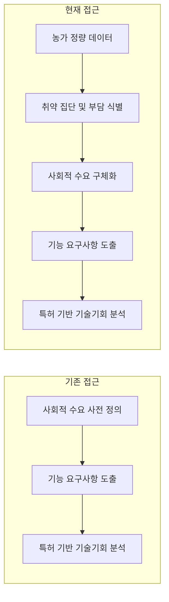
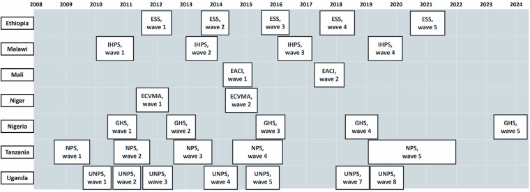
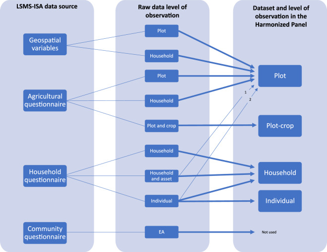
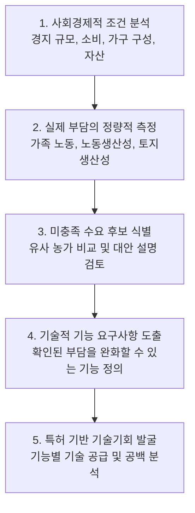

# 사회적 수요의 정량적 식별을 위한 데이터 기반 접근

Bentze, T., & Wollburg, P. (2025). A longitudinal cross-country dataset on agricultural productivity and welfare in Sub-Saharan Africa. *Scientific Data, 12*, 1843. https://doi.org/10.1038/s41597-025-05639-9

## 1. 연구 접근의 변화

기존 연구에서는 문헌을 통해 소농의 낮은 노동생산성과 높은 노동집약도를 주요 문제로 파악하고, 특히 수확 과정의 노동 부담을 사회적 수요로 설정하였다. 이후 해당 수요를 기술적 기능 요구사항으로 구체화하고, 관련 특허를 분석하여 기술기회를 탐색하였다. 즉, **사회적 수요를 사전에 정의한 후 이에 대응하는 기술을 탐색하는 접근**이었다.

현재는 실제 농가의 정량 데이터를 활용하여 사회적 수요를 보다 체계적으로 식별하는 방향으로 연구를 확장하고 있다. 농지 규모, 소비 수준, 가족 노동, 농업 생산성, 자산 등의 정보를 종합적으로 분석하여 사회경제적 제약과 노동 부담이 집중된 농가 집단을 식별하고, 이를 기술적 기능 요구사항 및 특허 분석으로 연결하고자 한다.

두 접근의 주요 차이는 다음과 같다.

| 구분 | 기존 접근: 수요 사전 정의 | 현재 접근: 데이터 기반 수요 식별 |
|---|---|---|
| 출발점 | 문헌에서 제시된 소농의 낮은 생산성과 높은 수확 노동 부담 | 실제 농가의 경지·소비·노동·생산·자산 정보 |
| 연구 절차 | 수요 정의 → 기능 요구사항 도출 → 특허 분석 | 취약 집단 식별 → 사회적 수요 구체화 → 기능 요구사항 도출 → 특허 분석 |
| 강점 | 명확한 수요를 바탕으로 기술 분석에 직접 연결 가능 | 수요가 집중된 집단과 부담의 특성을 정량적으로 제시 가능 |
| 한계 | 수요 선정의 객관적 근거와 다른 잠재적 수요에 대한 탐색이 제한적 | 지표 및 임계값 선정에 연구자의 판단이 필요하며, 관찰된 부담이 곧 기술 수요를 의미하지는 않음 |

이는 앞서 논의한 사회적 수요 영역(A)을 먼저 정의하고, 그 안에서 기술기회(B)를 탐색하는 접근과 연결된다. 현재 단계에서는 사회적 수요의 범위를 확정하기보다, **실증 데이터를 활용하여 수요의 대상과 특성을 체계적으로 규명할 수 있는 방법론적 기반을 마련하는 데 중점**을 두고 있다.

## 2. 데이터 출처 및 신뢰성

본 연구에서 활용하는 데이터는 세계은행(World Bank)의 **LSMS-ISA(Living Standards Measurement Study – Integrated Surveys on Agriculture)** 조사자료를 기반으로 한다.

LSMS-ISA는 세계은행 LSMS 팀의 지원 아래 각국 통계기관이 수행하는 가구 단위 조사로, 농업 생산활동과 가구의 생활수준을 종합적으로 파악하기 위해 구축되었다. 국가별 대표성을 고려하여 설계된 조사이며, 농업활동뿐 아니라 소비, 자산, 노동 등 농가의 사회경제적 특성을 함께 포함한다.

Bentze와 Wollburg(2025)는 이러한 원자료를 활용하여 사하라 이남 아프리카 7개국의 농업 생산성과 가구 복지 수준을 국가 및 조사시점 간 비교할 수 있는 데이터셋으로 구축하였다. 해당 데이터의 구축 방법과 활용 가능성은 Nature Portfolio의 학술지 *Scientific Data*에 발표되었으며, 관련 데이터와 코드, 변수 설명자료도 공개되어 있다.

**이 데이터의 주요 강점은 농업 생산활동과 농가의 사회경제적 조건을 연결하여 분석할 수 있다는 점**이다. 따라서 농업 생산성뿐 아니라 실제 농가가 경험하는 경제적 제약과 노동 부담을 함께 분석하는 데 활용할 수 있다.

## 3. 조사 지역, 기간 및 규모

데이터는 **사하라 이남 아프리카(Sub-Saharan Africa) 7개국**을 대상으로 한다.

조사 대상 국가는 에티오피아, 말라위, 말리, 니제르, 나이지리아, 탄자니아, 우간다이다. 원 논문에 따르면 이들 국가는 사하라 이남 아프리카 전체 인구의 약 39%, 빈곤 인구의 약 3분의 1을 차지한다.

조사기간은 2008~2024년이며, 국가별 조사 시작 시점과 기간에는 차이가 있다. 전체적으로 31개 조사 회차의 자료가 포함되어 있어 국가 간 비교뿐 아니라 시간에 따른 농가 특성의 변화도 분석할 수 있다.

국가별 조사기간은 에티오피아(2011–2022), 말라위(2010–2019), 말리(2014–2017), 니제르(2011–2014), 나이지리아(2010–2024), 탄자니아(2008–2021), 우간다(2008–2019)이다.

전체 데이터는 약 59,000가구, 20만 건 이상의 농업 필지 관측자료, 40만 건 이상의 개인 관측자료로 구성된다. 동일 가구를 여러 조사시점에 걸쳐 추적할 수 있는 패널 구조를 포함한다.

*그림 1. 국가별 LSMS-ISA 조사기간. 출처: Bentze & Wollburg(2025), Figure 1. CC BY-NC-ND 4.0, 원본 그대로 사용.*

## 4. 데이터 수집 및 통합 방식

본 데이터는 세계은행 LSMS-ISA를 통해 수집된 국가별 농업 및 가구 조사자료를 통합하여 구축되었다.

전체적인 데이터 구축 과정은 다음과 같다.

**세계은행 LSMS-ISA 원자료 → 국가·조사시점별 변수 및 단위 표준화 → 통합 데이터셋 구축 → 국가 간 비교 및 농가 단위 분석**

원자료는 농업활동, 가구 특성, 개인의 경제활동, 지역사회 및 위치 정보 등 다양한 조사 항목으로 구성되어 있다.

Bentze와 Wollburg(2025)는 국가별로 서로 다른 조사자료를 정리하고, 생산량, 노동, 소비, 자산 등의 주요 지표를 비교 가능한 형태로 표준화하였다. 이를 통해 작물·필지·가구·개인 수준의 네 가지 데이터셋을 구축하였다.

각 데이터셋은 공통 식별자를 통해 연결할 수 있으므로, 특정 농가의 경지 규모와 작물 생산, 노동 투입, 소비 수준 등을 종합적으로 분석할 수 있다. 또한 원자료와 연결할 수 있는 식별자가 제공되어 필요한 경우 추가 변수를 확보할 수 있다.

*그림 2. LSMS-ISA 원자료를 활용한 통합 데이터셋 구축 과정. 출처: Bentze & Wollburg(2025), Figure 2. CC BY-NC-ND 4.0, 원본 그대로 사용.*

## 5. 네 가지 데이터셋의 구성

통합 데이터는 분석 단위에 따라 네 가지 데이터셋으로 구성된다. 각 데이터셋은 서로 다른 수준의 정보를 제공하며, 이를 연결하면 농가의 사회경제적 조건과 농업 생산활동을 종합적으로 분석할 수 있다.

| 데이터셋 | 분석 단위 | 주요 정보 | 본 연구에서의 활용 |
|---|---|---|---|
| Plot-crop | 필지별 작물 | 작물 종류, 수확량 및 수확 가치, 종자·농약 사용, 작물 피해 | 작물별 생산 특성과 부담의 차이 분석 |
| Plot | 농업 필지 | 경작면적, 가족·고용 노동일, 트랙터·비료 사용, 면적당 생산성 | 노동집약도와 생산성, 농업 투입 구조 분석 |
| Household | 가구 | 가구원 수, 1인당 소비, 자산, 경제적 충격, 식생활 다양성 | 소농 및 경제적 취약 집단 식별 |
| Individual | 가구 구성원 | 연령, 교육 수준, 경제활동, 농업 종사 여부, 개인 노동시간 | 가구 구성과 노동력 특성 분석 |

네 가지 데이터셋은 가구, 필지 및 개인 식별자를 통해 연결된다. 예를 들어 가구의 소비 수준과 경지 규모를 파악한 후, 해당 가구가 경작하는 필지의 노동 투입 및 작물별 생산량을 함께 분석할 수 있다.

다만 필지 단위의 가족 노동일과 개인 단위의 노동시간은 조사 기준과 측정기간이 다르므로 직접 합산하거나 동일한 지표로 취급하지 않는다.

## 6. 데이터의 강점과 한계

### 주요 강점

- **실제 농가의 미시자료 활용:** 농업 생산과 생활수준을 동일한 조사체계에서 파악할 수 있어, 문헌에서 제시된 사회적 문제를 농가 단위에서 구체적으로 검토할 수 있다.
- **국가 간 및 시계열 비교:** 여러 국가와 조사시점에 걸쳐 비교 가능한 지표를 제공하며, 반복 관측된 농가의 특성 변화도 분석할 수 있다.
- **다층적 분석 가능:** 가구 수준의 경제적 조건뿐 아니라 필지 및 작물 수준의 생산과 노동 투입을 연결하여 분석할 수 있다.
- **재현성과 확장성:** 데이터와 분석 코드가 공개되어 있으며, 필요에 따라 세계은행 원자료와 연결하여 추가 분석을 수행할 수 있다.

### 주요 한계

- **조사 항목의 가용성 차이:** 국가와 조사시점에 따라 일부 변수의 조사 여부와 정의가 달라, 모든 지표를 동일한 조건에서 비교하기는 어렵다.
- **측정오차 및 결측:** 일부 변수는 농가의 자기보고에 의존하며, 경지면적 등에는 측정오차나 결측값 보정이 포함될 수 있다.
- **작업별 노동 정보의 부족:** 가족 노동일은 필지 단위의 농업 노동 투입을 나타내지만, 파종·제초·수확 등 개별 작업별 노동 부담을 직접 구분하기 어렵다. 또한 농가의 기술적 요구를 직접 조사한 자료는 아니다.
- **인과적 해석 및 일반화의 제약:** 관찰자료이므로 노동 부담의 원인을 특정 기술의 부재로 단정할 수 없으며, 분석 결과를 사하라 이남 아프리카 전체 또는 다른 개발도상국으로 일반화하는 데 주의가 필요하다.

따라서 이 데이터는 **사회적 수요의 후보를 정량적으로 식별하는 데 유용하지만, 구체적인 기술 수요와 그 원인을 확정하기 위해서는 추가적인 검증이 필요하다.**

## 7. UIO 연구에서의 활용 방향

본 데이터는 기존 특허 기반 기술기회 발굴 연구에서 사회적 수요를 정의하는 초기 단계에 활용할 수 있다.

핵심은 실제 농가의 사회경제적 조건과 농업활동을 분석하여 부담이 집중된 집단을 식별하고, 이를 기술적 요구사항으로 구체화하는 것이다.

기존 연구에서는 문헌을 바탕으로 사회적 수요를 사전에 설정하고 기능 요구사항을 도출하였다. 반면 현재 접근에서는 **실제 농가 데이터로 사회경제적 제약과 노동 부담을 분석한 후, 그 결과에 근거하여 사회적 수요를 구체화**하고자 한다.

이러한 접근은 사회적 수요를 선정하는 근거를 강화하고, 수요가 집중된 대상 집단과 그 특성을 보다 명확히 제시할 수 있다는 장점이 있다.

다만 관찰된 노동 부담을 곧바로 기술적 수요로 해석할 수는 없다. 경지 규모, 작물 특성, 가구 구성, 노동력 확보 방식 등 다양한 요인이 노동 투입에 영향을 미칠 수 있기 때문이다.

따라서 유사한 조건의 농가 간 비교와 대안 설명에 대한 검토를 통해 부담의 특성을 확인하고, 추가 근거를 바탕으로 기술적으로 완화할 수 있는 영역을 탐색할 필요가 있다.

이후 도출된 기능 요구사항은 기존에 구축한 기능–특허 연결 방법론과 결합하여 기술적 공급 수준과 잠재적 공백을 분석하는 데 활용할 수 있다.

## 8. 예비 분석 사례: 소농의 가족 노동 부담과 생산성

### 8.1. 분석 목적 및 대상

확보한 농가 데이터를 활용하여 사회적 수요를 정량적으로 식별할 수 있는지 확인하기 위해 예비 분석을 수행하였다.

분석에는 사하라 이남 아프리카 7개국의 비교 가능한 최근 조사자료에서 추출한 **15,957개 농업 가구**를 활용하였다.

이번 분석의 핵심 질문은 다음과 같다.

**"경제적으로 취약한 소농 중 가족 노동에 상대적으로 크게 의존하는 집단이 존재하며, 이들의 노동 투입과 농업 생산성은 다른 농가와 어떻게 다른가?"**

이를 위해 농지 규모, 소비 수준, 가족 노동 투입을 기준으로 목표집단을 식별하고, 유사한 조건의 다른 농가와 비교하였다.

### 8.2. 분석 대상 농가의 식별

다음 세 가지 조건을 모두 충족하는 농가를 목표집단으로 정의하였다.

1. **소규모 농가:** 해당 국가 농업 가구 중 경지 규모 하위 25%
2. **경제적 취약 농가:** 해당 국가 농업 가구 중 1인당 소비 수준 하위 40%
3. **가족 노동 부담이 높은 농가:** 경지 규모에 따른 일반적인 노동 투입 수준을 고려한 후에도 가족 노동집약도가 상위 25%에 해당하는 농가

이 기준에 따라 전체 15,957가구 중 **414가구(2.6%)**가 식별되었다.

비교를 위해 농지 규모와 소비 수준은 유사하지만 가족 노동 부담이 상대적으로 낮은 627가구를 별도로 선정하였다.

| 구분 | 목표집단 | 비교집단 |
|---|---:|---:|
| 농가 수 | 414가구 | 627가구 |
| 경지 규모 | 평균적으로 약 0.41ha | 평균적으로 약 0.42ha |
| 소비 수준 | 하위 40% | 하위 40% |
| 가족 노동 부담 | 상대적으로 높음 | 상대적으로 낮음 |

*경지 규모는 국가별 중앙값을 산출한 뒤 7개국에 동일한 가중치를 부여하여 평균한 값이다. 두 집단의 노동 부담 차이는 집단 선정 기준에 포함되어 있으므로 독립적인 분석 결과로 해석하지 않는다.*

### 8.3. 주요 분석 결과

**첫째, 가족 노동 투입과 농업 생산성 사이에 뚜렷한 차이가 관찰되었다.**

목표집단은 비슷한 규모와 소비 수준의 비교 농가보다 가족 노동을 훨씬 많이 투입하였다.

그러나 가족 노동 투입이 증가한 정도에 비해 면적당 수확 가치의 차이는 상대적으로 작았다. 그 결과 목표집단은 비교집단보다 토지생산성은 높지만 노동생산성은 낮은 특성을 보였다.

이러한 방향은 분석 대상 7개국 모두에서 관찰되었다.

구체적인 사례로 탄자니아의 분석 결과를 제시하면 다음과 같다.

| 주요 지표 | 목표집단 | 비교집단 |
|---|---:|---:|
| 경지 규모 | 0.25ha | 0.22ha |
| 가족 노동 투입 | 89일 | 11일 |
| 면적당 수확 가치 | 444달러/ha | 314달러/ha |
| 가족 노동일당 수확 가치 | 0.99달러/일 | 4.36달러/일 |

*각 수치는 해당 집단의 중앙값이다. 가족 노동일은 수확 작업만이 아니라 농업활동 전반의 노동 투입을 의미한다.*

탄자니아 사례에서 목표집단의 가족 노동 투입은 비교집단보다 약 8배 많지만, 면적당 수확 가치는 약 1.4배 높다. 반면 가족 노동일당 수확 가치는 약 4.4배 낮다.

이는 일부 소농이 높은 노동 투입을 통해 면적당 생산 가치를 높이고 있지만, 투입 노동에 비례하는 생산 가치의 증가가 나타나지는 않는다는 점을 보여준다.

다만 이러한 비교만으로 가족 노동을 줄여도 생산량을 유지할 수 있다고 결론 내릴 수는 없다.

**둘째, 트랙터·비료 사용이나 농산물 판매 여부만으로 높은 가족 노동 부담을 설명하기 어려웠다.**

목표집단과 비교집단 사이에서 트랙터 사용률은 전반적으로 낮았으며, 뚜렷하고 일관된 차이가 나타나지 않았다.

비료 사용과 농산물 판매 비중 역시 가족 노동 부담과 일관된 관계를 보이지 않았다.

고용 노동 사용에서는 일부 차이가 관찰되었으나, 국가별로 방향이 달랐다.

따라서 높은 가족 노동 부담을 단순히 기계화 부족이나 시장 접근성 부족의 결과로 해석하기는 어렵다.

**셋째, 농지 규모와 가구 구성은 가족 노동집약도와 밀접하게 관련되어 있었다.**

전체 농가를 대상으로 분석한 결과, 경지 규모가 클수록 면적당 가족 노동 투입은 감소하는 경향이 나타났다.

반면 가구원 수가 많을수록 면적당 가족 노동 투입은 증가하는 경향을 보였다.

이는 소농의 노동 부담을 이해할 때 농지 규모뿐 아니라 가구 내 노동력 구성도 함께 고려할 필요가 있음을 시사한다.

### 8.4. 사회적 수요 연구에 대한 시사점

이번 예비 분석은 사회적 수요를 사전에 특정하지 않고, 실제 농가 데이터를 활용하여 **경제적 취약성과 높은 노동 부담이 중첩된 집단을 식별할 수 있다는 가능성**을 보여준다.

특히 일부 소농에서는 높은 토지생산성과 낮은 노동생산성이 동시에 관찰되었다. 이는 농업 생산량을 늘리는 문제뿐 아니라, 생산활동에 필요한 가족 노동 부담을 완화하는 문제도 사회적 수요의 후보가 될 수 있음을 시사한다.

다만 현재 분석은 농업활동 전체의 노동 투입을 대상으로 하므로, 부담이 파종·재배관리·수확 등 어떤 작업에 집중되어 있는지는 확인할 수 없다.

또한 관찰된 노동 부담이 기술 부족에서 비롯되었는지, 새로운 기술을 통해 어느 정도 완화할 수 있는지도 추가 검증이 필요하다.

따라서 향후 연구에서는 **노동 부담이 집중되는 작업과 그 원인을 구체화하고, 이를 소농의 경제적·물리적 조건에 적합한 기술적 기능 요구사항으로 연결하는 과정**이 필요하다.

이러한 접근을 통해 데이터 기반 사회적 수요 식별 결과를 기존 특허 기반 기술기회 발굴 방법론과 연계하고자 한다.

## 9. 지도교수님께 논의드릴 사항

**1. 사회적 수요의 대상 집단과 선정 기준**

현재는 경지 규모, 소비 수준, 가족 노동 부담을 결합하여 취약 집단을 식별하고 있다. 사회적 수요의 대상을 이러한 조건이 중첩된 집단으로 한정할지, 소규모·저소비 농가 전체로 확대할지 검토가 필요하다. 아울러 집단 구분에 사용하는 지표와 임계값의 선정 근거를 어떻게 설정할지도 논의하고자 한다.

**2. 농업 노동 부담과 기술적 기능 요구사항의 연결**

현재 데이터에서는 전체 농업 노동 투입을 파악할 수 있지만, 수확 등 개별 작업의 노동 부담을 직접 구분하기 어렵다. 따라서 작업별 노동 자료를 추가로 확보해야 하는지, 아니면 현재의 노동 부담 분석을 바탕으로 기술적 기능 요구사항을 단계적으로 구체화할 수 있을지 논의하고자 한다.

**3. 관찰된 사회적 부담을 기술 수요로 전환하는 기준**

데이터에서 확인된 노동 부담이나 생산성 격차가 곧바로 미충족 기술 수요를 의미하지는 않는다. 따라서 사회적 문제의 중요성, 기존 기술의 대응 수준, 소농의 경제적·물리적 제약 등을 어떤 기준으로 평가하고, 어느 단계에서 특허 기반 기술기회 분석과 연결할지 검토하고자 한다.
