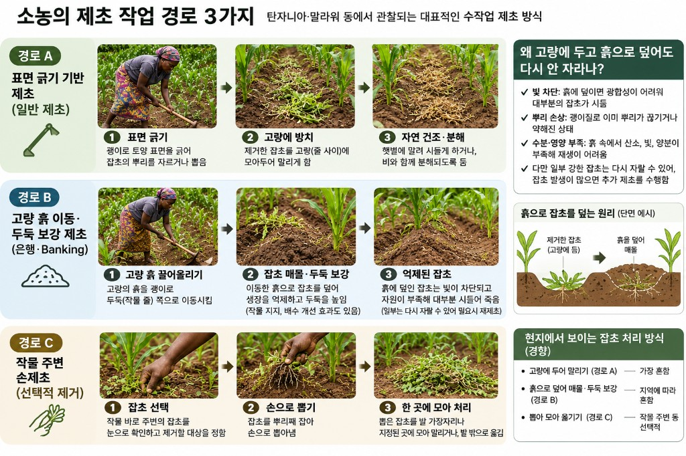

# 사하라 이남 아프리카 소농의 제초 작업 실태와 기술적 제약

> 조사 대상: 말라위 남부 팔롬베, 말라위 중부, 탄자니아 남부 및 남부 고원지대
> 정리일: 2026-11-23
> 문서 성격: 현장 작업 이해 및 기술기회 탐색을 위한 선행연구 검토

본 문서는 소농의 제초 작업이 실제로 어떻게 수행되는지, 얼마나 많은 노동이 필요한지, 기존 제초 기술에는 어떤 한계가 있는지를 문헌에 근거하여 정리한다. 기술적 기능 요구사항이나 미충족 기술기회를 확정하는 문서는 아니다.

관련 선행 노트: [crop_operations.md](crop_operations.md)
원본 자료 경로: [06_references/food-agriculture/labor/](../../../06_references/food-agriculture/labor/)

## 1. 조사 개요 및 핵심 발견

사하라 이남 아프리카의 소농에게 제초는 반복적이고 노동집약적인 농작업이다. 특히 말라위와 탄자니아의 전통적인 옥수수 재배에서는 손괭이(hand hoe)를 사용해 잡초를 제거하며, 제초 작업이 두둑 관리와 결합되어 수행되기도 한다.

검토한 문헌에서 확인되는 주요 사실은 다음과 같다.

- 제초는 단순한 잡초 제거가 아니다. 말라위에서는 괭이로 잡초의 뿌리를 끊는 첫 제초와 고랑의 흙을 이동시켜 잡초를 묻고 두둑을 보강하는 작업이 구분된다.
- 제초에는 상당한 노동이 필요하다. 말라위 팔롬베의 작업 달력은 제초와 두둑 보강에 총 80인일/ha를 배정하고, 탄자니아 남부 고원지대 문헌은 충분한 손괭이 제초에 300~400시간/ha가 필요하다고 보고한다.
- 실제 노동 투입은 충분한 제초에 필요한 수준에 미치지 못할 수 있다. 탄자니아 남부 고원지대에서는 실제 제초 투입이 대부분 130시간/ha 미만이며 작업이 늦어지는 것으로 보고되었다.
- 기존 기계 제초는 모든 작업을 대체하지 못한다. 축력 제초기는 노동 절감 가능성이 있지만 작물 포기 사이의 잡초를 제거하는 데 한계가 있다.
- 제초 노동은 일부 빈곤 농가의 생계 수단이기도 하다. 제초제 도입으로 고용 노동 수요가 줄어들면 다른 농가에서 제초 품팔이를 하던 가구의 소득과 식량 확보에 부정적인 영향을 미칠 수 있다.

따라서 제초의 기술적 미충족 수요를 이해하려면 노동량뿐 아니라 작업 방식, 작업 시기, 작물별 차이, 기존 기술의 한계, 노동 제공자의 경제적 위치를 함께 살펴볼 필요가 있다.

## 2. 현장에서 실제로 수행하는 제초 작업

### 2.1 말라위 팔롬베: 제초와 두둑 보강

Le Danvic(2009)의 Inter Aide 보고서는 말라위 남부 팔롬베(Phalombe) 지역의 농업체계를 조사하였다.

조사는 2009년 4~9월 팔롬베 구의 제나라 전통권역, 타마니 그룹빌리지에 속한 네 마을에서 진행되었다. 약 170명을 면담하였으며, 이 가운데 50개 농가에 대해서는 영농체계의 기술적·경제적 특성을 상세히 조사하였다.

보고서는 제초와 두둑 보강을 합친 작업을 가장 길고 힘든 농작업으로 설명한다. 이 작업은 다음과 같이 구분된다.

#### ① 첫 번째 제초: Kupalina

첫 제초는 중간 크기의 괭이로 두둑 표면을 긁어 잡초를 제거하는 작업이다.

- 도구: 중간 크기의 손괭이
- 작업 동작: 두둑 표면 긁기 및 잡초 뿌리 절단
- 잡초 처리: 제거한 잡초를 고랑에 남겨 말리고 분해되도록 함
- 작업 시기: 작물에 따라 12월 말~2월
- 작업상 제약: 제초가 늦어질수록 잡초가 성장하여 제거하기 어려워짐

여기서 중요한 점은 잡초를 반드시 밭 밖으로 운반하는 것이 아니라는 사실이다. 농민은 괭이로 잡초를 절단하고 고랑에 남겨 두는 방식을 사용한다.

#### ② 두둑 보강: Banking

Banking은 큰 괭이로 고랑의 흙을 두둑 위와 옆으로 이동시키는 작업이다.

- 도구: 큰 손괭이
- 작업 동작: 고랑의 흙을 퍼서 두둑에 쌓기
- 작업 시기: 1월 말~2월

보고서에서 설명한 목적은 세 가지다.

- 새로 발생한 작은 잡초를 흙으로 덮어 생장을 억제한다.
- 비에 씻겨 노출된 작물 뿌리를 다시 덮는다.
- 첫 제초에서 남겨 둔 잡초가 분해되어 생성된 유기물을 작물에 활용한다.

따라서 Banking은 단순한 잡초 제거가 아니라 잡초 억제와 두둑 유지·보강이 결합된 작업이다.

다만 잡초를 흙으로 덮는다고 해서 모든 잡초가 반드시 죽는 것은 아니다. 잡초의 종류, 성장 단계, 매몰 깊이 등에 따라 재생 가능성이 있으므로 실제 방제 효과는 별도로 검토해야 한다.

#### ③ 예외적 작업: 두 번째 제초

흰개미가 많은 비탈이나 모래땅에서는 잡초를 고랑에 남겨 두면 흰개미가 증가할 수 있다.

이러한 환경에서는 Banking 대신 두둑 위 작물 주변의 잡초를 다시 제거하는 두 번째 제초를 수행하기도 한다.

이는 토양과 해충 조건에 따라 작업 방식이 달라질 수 있음을 보여준다.

### 2.2 작물별 차이: 옥수수와 땅콩

동일한 지역에서도 작물에 따라 제초 방식이 달라진다.

| 구분 | 옥수수 | 땅콩 |
|---|---|---|
| 주요 도구 | 손괭이 | 손괭이 및 손 |
| 두둑 표면 | 괭이로 긁어 제초 | 작물 주변은 손으로 제초 |
| 고랑 | 잡초를 남기거나 흙을 이동 | 괭이 사용 |
| 두둑 보강 | 수행 | 뿌리 손상 우려로 수행하지 않음 |
| 제초 반복 | 첫 제초 및 Banking 중심 | 2~3회 제초 |

땅콩은 두둑 보강 과정에서 뿌리가 손상될 수 있어 옥수수와 동일한 방식으로 관리하지 않는다.

이 사례는 제초 기술의 적용 가능성을 검토할 때 작물의 생육 특성과 작업 공간을 함께 고려해야 함을 보여준다.

### 2.3 현장 작업을 동작 단위로 정리

팔롬베 조사에서 확인되는 작업을 동작 중심으로 정리하면 다음과 같다.

| 작업 유형 | 작업 순서 | 적용 사례 |
|---|---|---|
| A. 표면 제초 | 표면 긁기 → 잡초 뿌리 절단 → 고랑에 방치 | Kupalina |
| B. 흙 이동 및 매몰 | 고랑 흙 이동 → 잡초 매몰 → 두둑 보강 | Banking |
| C. 선택적 손 제초 | 작물 주변 잡초 선택 → 손으로 제거 | 땅콩 |

위 그림은 이 표의 세 경로를 동작 순서로 펼친 것이다. 경로 A는 kupalina, 경로 B는 banking, 경로 C는 땅콩에서 작물 주변을 손으로 뽑는 작업이다. 파일은 [figures/weeding-paths-abc.jpg](figures/weeding-paths-abc.jpg).

그림 오른쪽의 재생 억제 설명과 경로 C의 세 번째 칸(밭 밖으로 옮김)은 이 그림의 해설이다. Le Danvic(2009)은 잡초를 고랑에 남겨 말리는 것과 흙으로 덮는 목적을 적는다. 탄자니아 조사는 이 세 경로의 동작 순서를 적지 않는다.

A와 B는 잡초를 개별적으로 식별하고 하나씩 제거하는 과정이 아니다. 괭이를 사용해 일정 범위의 토양과 잡초를 함께 처리하는 작업이다.

반면 C는 작물 주변을 구분하여 상대적으로 정밀하게 수행하는 작업이다.

이러한 구분은 현장 작업을 이해하기 위한 것이며, 아직 기술적 기능 분류나 장치 설계 요구사항으로 확정된 것은 아니다.

**출처.** Le Danvic, A. S. (2009). *Analysis diagnosis of an agricultural region of Southern Malawi.* Inter Aide. Section 4.1.3 및 옥수수·땅콩 작업 달력.

- 로컬 PDF: [2009_interaide_phalombe-diagnosis.pdf](../../../06_references/food-agriculture/labor/2009_interaide_phalombe-diagnosis.pdf)
- 원문 PDF: [reseau-pratiques.org](https://reseau-pratiques.org/wp-content/uploads/2012/05/malawi_phalombe_diagnostic_agricole_nov2009.pdf)
- 현지 작업 명칭: kupalina

## 3. 제초 횟수와 작업 시기

### 3.1 탄자니아 남부: 실제 제초 횟수

Katinila et al.(1998)은 1995년 6~11월 탄자니아 남부 존의 옥수수 재배 농가 36곳을 조사하였다.

조사 농가의 평균 농장 면적은 6.5에이커(약 2.63ha)였으며, 조사 대상 농가 모두 손괭이로 제초하였다. 기계 제초나 화학 제초는 관찰되지 않았다.

제초 횟수는 다음과 같다.

| 제초 횟수 | 농가 비율 |
|---|---|
| 1회 | 9% |
| 2회 | 44% |
| 3회 | 44% |
| 4회 | 3% |

조사 농가의 88%가 재배 기간 중 2~3회 제초한 것으로 보고되었다.

이는 제초가 일회성 작업이 아니라 재배 기간 중 반복적으로 수행되는 작업임을 보여준다.

다만 표본이 36농가에 불과하고 평균 농장 면적이 약 2.63ha이므로, 이 결과를 0.2~1ha 규모의 소농 집단이나 탄자니아 전체 농가에 일반화할 수는 없다.

**출처.** Katinila, N., Verkuijl, H., Mwangi, W., Anandajayasekeram, P., & Moshi, A. J. (1998). *Adoption of Maize Production Technologies in Southern Tanzania.* CIMMYT. Section 4.3.5.

- 로컬 PDF: [1998_katinila_maize-southern-tanzania.pdf](../../../06_references/food-agriculture/labor/1998_katinila_maize-southern-tanzania.pdf)
- CIMMYT 저장소: [hdl.handle.net/10883/967](https://hdl.handle.net/10883/967)

### 3.2 탄자니아 음베야: 실제 제초 시작 시점

Loewen-Rudgers et al.(2000)은 탄자니아 음베야(Mbeya) 지역에서 축력 제초기를 시험하면서 11개 마을의 농민 약 300명에게 제초 시작 시점을 비공식적으로 질문하였다.

| 제초를 시작하는 옥수수 높이 | 응답 비율 |
|---|---|
| 약 15cm | 10% |
| 약 30cm | 60% |
| 45cm 이상 | 30% |

이 결과는 일부 농가가 옥수수가 상당히 성장한 이후에 제초를 시작한다는 점을 보여준다.

같은 문헌에서는 축력 제초기가 잡초 높이 30cm 수준에서 잘 작동하지 않는다고 설명한다.

다만 옥수수 높이에 대한 응답과 잡초 높이에 대한 장치 성능 설명은 서로 다른 지표이므로 직접적으로 동일시해서는 안 된다.

또한 해당 응답은 구조화된 대표 표본조사가 아니라 비공식 질문 결과다.

**출처.** Loewen-Rudgers, L., Rempel, E., Harder, J., & Klassen Harder, K. (2000). Constraints to the adoption of animal traction weeding technology in Mbeya Region, Tanzania. In Starkey, P. & Simalenga, T. (Eds.), *Animal power for weed control.* ATNESA / CTA. ISBN 92-9081-136-6.

- 로컬 PDF: [2000_loewen-rudgers_mbeya-weeding.pdf](../../../06_references/food-agriculture/labor/2000_loewen-rudgers_mbeya-weeding.pdf)
- FAO 수록: [같은 제목의 글](https://www.fao.org/4/x5455b/x5455b2c.htm)

### 3.3 권장 제초 시기와 실제 작업의 차이

IITA의 탄자니아 소농 대상 옥수수 재배 매뉴얼은 다음과 같은 제초 시기를 권고한다.

| 작업 | 권장 시기 | 비고 |
|---|---|---|
| 첫 제초 | 파종 후 3~4주 | 초기 잡초 관리 |
| 두 번째 제초 | 파종 후 6~8주 | 재발생 잡초 제거 |
| 세 번째 제초 | 파종 후 10~12주 | 잡초가 많은 경우 추가 수행 |

매뉴얼은 괭이 또는 컷라스, 기계 제초기, 발아 후 제초제 등을 제초 방법으로 소개한다.

또한 제초가 늦어지면 조건에 따라 수량이 50~90% 감소할 수 있다고 설명한다.

이 수치는 지연 제초의 잠재적 피해를 설명하는 매뉴얼의 수치이지, 조사 대상 농가에서 실제 관찰된 평균 수확 손실이 아니다.

말라위 팔롬베 보고서 역시 제초와 두둑 보강이 2주 지연되면 수확 손실이 커질 수 있다고 설명한다.

따라서 제초는 총 노동 투입량뿐 아니라 작물이 성장하는 특정 시점에 노동력을 확보해야 하는 시간 제약을 갖는다.

**출처.** Baijukya, F., Sabula, L., Mruma, S., Mzee, F., Mtoka, E., Masigo, J., Ndunguru, A., & Swai, E. (2020). *Maize production manual for smallholder farmers in Tanzania.* IITA.

- 로컬 PDF: [2020_baijukya_iita-maize-manual-tanzania.pdf](../../../06_references/food-agriculture/labor/2020_baijukya_iita-maize-manual-tanzania.pdf)
- CGSpace 원문: [hdl.handle.net/10568/109806](https://hdl.handle.net/10568/109806)

## 4. 제초 노동 부담과 기존 기계화의 한계

### 4.1 충분한 제초에 필요한 노동과 실제 투입

탄자니아 남부 고원지대의 제초 연구는 손괭이를 이용한 제초 노동에 대해 다음과 같이 보고한다.

| 지표 | 보고된 수치 | 의미 |
|---|---|---|
| 충분한 손괭이 제초에 필요한 노동 | 300~400시간/ha | 적절한 제초를 위한 소요량 |
| 전체 농작업 중 제초 노동 비중 | 40~50% | 제초의 노동집약성 |
| 실제 농가의 제초 노동 투입 | 대부분 130시간/ha 미만 | 관찰된 노동 투입 수준 |

여기서 300~400시간/ha와 130시간/ha 미만은 동일한 의미의 통계가 아니다.

전자는 충분한 제초를 위한 소요량이고, 후자는 실제 농가의 투입량이다. 따라서 두 수치를 빼서 특정 농가의 노동 부족분으로 확정할 수 없다.

그럼에도 이 결과는 중요한 문제를 제기한다.

농민이 제초의 필요성을 알고 있더라도 충분한 노동력을 적절한 시기에 투입하지 못할 가능성이 있다는 것이다.

이러한 제약은 가족 노동력의 가용성, 다른 농작업과의 시간 경쟁, 고용 노동 비용 등과 관련될 수 있지만, 각각의 원인과 영향은 추가적인 실증 검토가 필요하다.

### 4.2 축력 제초기의 노동 절감 가능성

같은 문헌에서는 축력 제초기가 손괭이 대비 노동을 40~80% 절감할 수 있다고 설명한다.

다만 이 절감 범위는 해당 연구팀의 단일 시험에서 직접 산출한 결과가 아니라 Starkey(1981), UAC(1988, 1992) 등의 선행자료를 인용한 수치다.

축력 제초기는 동물의 힘으로 제초 도구를 이동시키므로 손괭이 작업의 일부를 대체할 수 있다.

그러나 연구팀의 옥수수 시험에서는 중요한 한계가 확인되었다.

제초기를 사용한 후에도 작물 포기 사이의 잡초가 남았으며, 이 잡초가 수량에 영향을 미쳤다.

따라서 포기 사이의 잡초를 처리하기 위해 손괭이나 제초제를 추가로 사용해야 했다.

이는 제초 기계화가 일부 작업의 노동을 줄이더라도 모든 제초 작업을 완전히 대체하지 못할 수 있음을 보여준다.

### 4.3 기존 제초 방식의 비교

| 방식 | 기대 효과 | 확인된 한계 |
|---|---|---|
| 손괭이 | 두둑 및 작물 주변 작업 가능 | 높은 노동 투입, 반복 작업 |
| 축력 제초기 | 노동 절감 가능 | 작물 포기 사이 잡초가 남음 |
| 화학 제초제 | 제초 노동 및 고용 비용 절감 | 구입 비용과 사회경제적 영향 |
| 손을 이용한 선택적 제초 | 작물 주변의 세밀한 작업 가능 | 수작업 노동 필요 |

이 비교에서 확인되는 핵심은 기존 제초 기술이 노동을 줄이는 데 기여할 수 있지만, 작물 주변의 세밀한 작업이나 두둑 관리까지 모두 대체한다고 볼 근거는 부족하다는 점이다.

또한 조사된 탄자니아 남부 36농가에서는 기계 제초가 관찰되지 않았으므로, 바퀴 달린 인력 제초기나 축력 제초기가 해당 지역 소농에게 널리 보급되어 있다고 해석해서는 안 된다.

**출처.** Shetto, R. M., Kwiligwa, E. M., Mkomwa, S., & Massunga, M. (2000). Weed control by draft animals: experiences in the Southern Highlands of Tanzania. In Starkey, P. & Simalenga, T. (Eds.), *Animal power for weed control.* ATNESA / CTA. ISBN 92-9081-136-6.

- 로컬 PDF: [2000_shetto_animal-weeding-southern-highlands.pdf](../../../06_references/food-agriculture/labor/2000_shetto_animal-weeding-southern-highlands.pdf)
- 노동 절감 범위의 원 인용: Starkey(1981), UAC(1988, 1992)

## 5. 제초 노동의 사회경제적 역할

### 5.1 자기 농지의 노동과 품팔이 노동

제초 노동을 줄이는 기술이 모든 농가에 동일한 혜택을 제공하는 것은 아니다.

말라위에서는 다른 농가의 밭에서 일하고 현금이나 식량을 받는 비공식 일용노동을 Ganyu라고 부른다.

Ganyu는 농업 노동시장의 일부이면서 식량이 부족한 농가의 생계 유지 수단이기도 하다.

따라서 제초 노동에는 두 가지 서로 다른 입장이 존재한다.

| 구분 | 제초 노동의 의미 | 노동 절감 기술 도입 시 가능한 영향 |
|---|---|---|
| 자기 농지를 경작하는 농가 | 생산을 위해 수행해야 하는 작업 | 노동 부담 및 고용 비용 감소 |
| 다른 농가에 노동을 제공하는 가구 | 현금 또는 식량을 확보하는 소득 활동 | 일자리 및 소득 감소 가능 |

이러한 구분은 제초 기술의 사회적 수요를 해석하는 데 중요하다.

### 5.2 말라위 중부의 제초제 도입과 고용 감소

Bouwman, Andersson, and Giller(2021)는 말라위 중부의 보존농업(Conservation Agriculture) 보급 지역에서 2016년 275가구를 조사하였다.

연구는 제초제 사용이 농가 간 노동 고용과 식량안보에 미치는 영향을 분석하였다.

주요 결과는 다음과 같다.

| 지표 | 조사 결과 |
|---|---|
| 비교 가구의 제초제 사용률 | 2005/06년 2% → 2015/16년 36% |
| 제초제 사용 전 고용 노동량 중앙값 | 72 노동일 |
| 제초제 사용 후 고용 노동량 중앙값 | 27 노동일 |
| 제초제 사용 가구의 제초·Banking 고용 감소 | 약 65% |
| 재배기 품팔이 가구 중 제초 관련 작업을 주된 일로 보고한 비율 | 87% |
| 품팔이를 구하지 못한 응답자 중 그 결과로 굶주렸다고 보고한 비율 | 57% |

제초제를 사용한 농가는 일반적으로 자산, 소득, 농장 면적 및 식량안보 수준이 더 높았다.

반면 다른 농가에 노동을 제공하는 가구는 상대적으로 자산과 소득이 적고 식량 사정이 좋지 않았다.

연구에서 마을 지도자들이 보고한 제초 및 Banking 고용 비용은 약 37,000말라위 콰차/ha였으며, 글리포세이트와 Harness를 사용하는 비용은 약 25,000콰차/ha였다.

이러한 비용 차이는 노동을 고용하던 농가가 제초제를 선택할 경제적 유인이 있음을 보여준다.

### 5.3 제초 노동과 계절적 식량 부족

말라위 중부에서는 1~2월에 식량 부족이 집중되는 경향이 있었다.

이 시기는 이전 수확물의 저장량이 줄어드는 반면 새로운 작물은 아직 수확하지 못하는 시기다. 동시에 제초와 두둑 보강이 중요한 농작업으로 수행되는 시기이기도 하다.

조사에서 식량 부족을 경험한 비교 가구의 70%는 옥수수가 떨어졌을 때 품팔이를 생계 대응 수단으로 활용했다고 응답하였다.

그러나 제초제 사용이 증가하면서 제초 노동을 고용하는 수요가 감소하였다.

그 결과 일부 빈곤 가구는 필요한 시기에 일자리를 구하지 못하고 식량 확보에도 어려움을 겪었다.

이 연구는 노동 절감 기술이 도입 농가에는 혜택을 제공하면서 노동을 판매하는 다른 가구에는 부정적인 영향을 미칠 수 있음을 보여준다.

다만 제초제 도입과 식량 부족 사이의 모든 관계를 실험적으로 확정한 연구는 아니며, 다른 경제적·환경적 요인도 함께 작용할 수 있다.

### 5.4 실제 제초 작업과의 연결

Bouwman et al.(2021)은 말라위 중부의 전통적인 제초 방식도 설명한다.

첫 제초에서는 괭이로 잡초를 제거하여 두둑 사이에 눕혀 놓고, 이후 Banking에서는 고랑의 흙을 두둑 옆으로 올리면서 잡초를 매몰한다.

이는 앞서 팔롬베에서 확인한 Kupalina 및 Banking과 유사한 작업 방식이다.

따라서 제초제 도입으로 감소한 고용 노동은 추상적인 '제초'가 아니라 실제로 괭이를 사용하여 잡초와 흙을 처리하는 농작업과 관련되어 있다.

**출처.** Bouwman, T. I., Andersson, J. A., & Giller, K. E. (2021). Herbicide Induced Hunger? Conservation Agriculture, Ganyu Labour and Rural Poverty in Central Malawi. *The Journal of Development Studies*, 57(2), 244–263.

- DOI 원문: [10.1080/00220388.2020.1786062](https://doi.org/10.1080/00220388.2020.1786062)
- 서지 키: `bouwman2021herbicide`
- BibTeX: [07_agri_tech_priority.bib](../../../03_literature/bib/07_agri_tech_priority.bib)

## 6. 종합: 제초 작업에서 확인되는 제약

검토한 문헌은 제초 노동이 많다는 사실뿐 아니라 그 노동이 발생하는 구체적인 작업과 제약을 보여준다.

| 구분 | 문헌에서 확인된 사실 | 연구상 의미 |
|---|---|---|
| 작업 구조 | 제초와 두둑 보강이 결합되어 수행됨 | 제초를 단일 제거 작업으로 취급하기 어려움 |
| 노동 부담 | 충분한 제초에 상당한 시간이 필요함 | 노동 절감 수요의 근거 |
| 작업 반복 | 재배 기간 중 2~3회 제초가 흔하게 관찰됨 | 반복 작업 부담 존재 |
| 시간 제약 | 제초 지연은 수확 손실을 유발할 수 있음 | 적기 작업의 중요성 |
| 실제 노동 투입 | 충분한 제초 소요량보다 낮은 투입 사례가 보고됨 | 노동력 제약 가능성 |
| 기계화 한계 | 축력 제초 후에도 포기 사이 잡초가 남음 | 부분 기계화의 미해결 작업 |
| 작물 차이 | 옥수수와 땅콩의 제초 방식이 다름 | 작물별 작업 조건 고려 필요 |
| 사회경제적 영향 | 제초 노동은 일부 빈곤 가구의 소득원 | 기술 도입 효과의 수혜자 구분 필요 |

이러한 결과를 종합하면, 소농의 제초 문제는 다음 세 가지 차원으로 구분할 수 있다.

첫째, 노동량의 문제다. 충분한 제초를 수행하기 위해 많은 노동이 필요하지만, 실제 농가에서는 필요한 노동을 모두 투입하기 어려울 수 있다.

둘째, 작업 수행의 문제다. 제초는 작물과 토양 조건에 따라 다른 동작을 요구하며, 기존 기계화 기술이 일부 작업을 해결하더라도 포기 사이 잡초 제거와 같은 작업은 남을 수 있다.

셋째, 기술 도입의 분배 효과 문제다. 노동 절감 기술은 자가 경작 농가의 부담을 줄이지만, 제초 품팔이에 의존하는 가구의 소득 기회를 감소시킬 수 있다.

## 7. TOD 연구에 대한 시사점

현재 TOD 연구는 사회적 수요가 존재하지만 기술개발 의제에 충분히 반영되지 않은 영역을 탐색하는 것을 목표로 한다.

제초 관련 문헌은 이러한 사회적 수요를 구체화하는 데 활용할 수 있다.

### 7.1 사회적 수요의 구체화

기존의 농가 단위 노동 투입 분석은 노동집약적인 집단을 식별하는 데 유용하다. 그러나 총 노동일수만으로 어떤 농작업에서 부담이 발생하는지, 해당 부담이 기술적으로 해결 가능한지를 판단하기는 어렵다.

제초 관련 현장조사는 노동 부담을 다음과 같이 구체화할 수 있음을 보여준다.

- 작업 대상: 잡초, 토양, 작물 주변 공간
- 작업 방식: 괭이질, 뿌리 절단, 흙 이동, 잡초 매몰, 손 제초
- 작업 조건: 작물 종류, 두둑 구조, 토양 조건, 잡초 성장 단계
- 시간 조건: 재배기 중 반복 수행 및 적기 작업 필요성
- 노동 조건: 가족 노동, 고용 노동, 품팔이 노동

이는 사회적 수요를 단순한 노동시간 지표에서 구체적인 현장 작업과 연결하는 데 필요한 정보다.

### 7.2 잠재적인 기술적 미충족 영역

현재 문헌에서 후속 검토가 필요한 영역은 다음과 같다.

| 잠재 영역 | 근거 | 추가 확인 사항 |
|---|---|---|
| 적기 제초 지원 | 충분한 노동 투입이 어려운 사례 | 실제 지연 원인과 규모 |
| 작물 포기 사이 제초 | 축력 제초기의 잔여 잡초 문제 | 기존 기술의 해결 수준 |
| 제초·두둑 보강 작업 | 말라위의 결합 작업 구조 | 작업별 노동량과 기술적 대체 가능성 |
| 작물별 선택적 제초 | 옥수수·땅콩의 작업 차이 | 작물별 기술 요구의 차이 |
| 저비용 노동 절감 | 제초제와 고용 노동의 비용 차이 | 소농의 실제 지불 능력 및 접근성 |

이 표는 특허 분석으로 확인된 기술 공백이 아니라, 현장 문헌에서 도출한 후속 기술 탐색 후보다.

따라서 특허 기반 기술기회 발굴 단계에서는 기존 기술의 분포, 기술적 해결 수준, 소농의 적용 제약을 추가로 분석해야 한다.

### 7.3 사회적 수요 분석에서 구분해야 할 집단

현재의 소농 노동집약 집단을 기술적 미충족 수요로 해석할 때는 최소한 다음 두 집단을 구분할 필요가 있다.

- 자기 농지의 제초 노동을 수행하면서 노동 절감이 필요한 농가
- 다른 농가의 제초 작업을 수행하여 소득을 확보하는 농가

특히 경지 규모가 작고 가족 노동 투입이 높은 가구가 노동을 고용하는 집단인지, 다른 농가에 노동을 제공하는 집단인지는 현재 검토한 자료만으로 구분할 수 없다.

향후 농가 단위 자료에서 자가 농업 노동, 고용 노동 사용, 농외·타 농가 노동 제공을 구분할 수 있는지 확인할 필요가 있다.

### 7.4 후속 연구 질문

현재 문헌 검토에서 도출할 수 있는 질문은 다음과 같다.

> 노동력 제약으로 적기에 충분한 제초를 수행하기 어려운 소농에게, 기존 제초 기술이 해결하지 못하는 작업은 무엇이며, 이를 해결할 기술적 대안은 존재하는가?

이를 검토하기 위해서는 다음 자료가 추가로 필요하다.

- 작물별 제초 작업의 세부 노동시간
- 제초 지연의 실제 원인과 생산성 영향
- 손괭이·축력·인력 기계·제초제의 적용 조건
- 작물 포기 사이 및 두둑 주변 제초의 기존 기술 수준
- 소농의 기술 접근성과 비용 제약
- 자가 노동과 타 농가 품팔이 노동의 구분

## 8. 자료 해석의 한계

본 문서의 조사 결과는 서로 다른 시기와 지역, 표본 및 조사방법에 기반한다. 따라서 수치를 통합하여 사하라 이남 아프리카 전체의 평균으로 해석해서는 안 된다.

| 자료 | 해석상 주의사항 |
|---|---|
| 팔롬베 80인일/ha | 네 마을의 영농 작업 달력과 소요 기준이며 말라위 전체의 관찰 평균이 아님 |
| 팔롬베 땅콩 90인일/ha | 특정 작물의 작업 달력 수치이며 다른 작물에 일반화할 수 없음 |
| 탄자니아 남부 36농가 | 평균 농장 면적이 6.5에이커로, 0.2~1ha 소농 집단을 직접 대표하지 않음 |
| 음베야 300농가 | 비공식 질문 결과이며 국가 대표 통계가 아님 |
| 300~400시간/ha | 충분한 제초에 필요한 소요량 |
| 130시간/ha 미만 | 실제 농가의 관찰 투입량으로, 위 수치와 직접적인 부족분 계산에 주의 필요 |
| 축력 제초기 40~80% 절감 | 해당 연구의 직접 실험 결과가 아닌 선행문헌 인용 범위 |
| IITA 제초 일정 | 농가의 실제 수행 기록이 아니라 기술 권고 |
| 말라위 중부 제초제 연구 | 보존농업 보급 지역의 조사이며 팔롬베 또는 7개국 소농의 평균이 아님 |

또한 제초 작업을 식별 → 위치 파악 → 제거 → 처리라는 단일 순서로 고정하는 것은 적절하지 않다.

실제 현장에서는 괭이로 토양을 긁거나 이동시키는 과정 자체가 잡초 제거와 억제 기능을 수행하며, 작물에 따라 작업 순서와 방법이 달라진다.

현재 문헌은 현장 작업의 구조와 제약을 이해하기 위한 근거이며, 특정 기술의 필요성이나 기술적 공백을 확정하는 근거로 사용해서는 안 된다.

## 9. 참고문헌 및 원본 자료

### [1] Le Danvic (2009) — 말라위 팔롬베 농업체계 진단

Le Danvic, A. S. (2009). *Analysis diagnosis of an agricultural region of Southern Malawi.* Inter Aide.

- 내용: 제초 동작, Banking, 작물별 차이, 작업 소요량
- 로컬 파일: [2009_interaide_phalombe-diagnosis.pdf](../../../06_references/food-agriculture/labor/2009_interaide_phalombe-diagnosis.pdf)
- 원문: [reseau-pratiques.org](https://reseau-pratiques.org/wp-content/uploads/2012/05/malawi_phalombe_diagnostic_agricole_nov2009.pdf)

### [2] Katinila et al. (1998) — 탄자니아 남부 옥수수 재배기술 조사

Katinila, N., Verkuijl, H., Mwangi, W., Anandajayasekeram, P., & Moshi, A. J. (1998). *Adoption of Maize Production Technologies in Southern Tanzania.* CIMMYT.

- 내용: 손괭이 사용, 제초 횟수, 농가 조사
- 로컬 파일: [1998_katinila_maize-southern-tanzania.pdf](../../../06_references/food-agriculture/labor/1998_katinila_maize-southern-tanzania.pdf)
- 원문: [hdl.handle.net/10883/967](https://hdl.handle.net/10883/967)

### [3] Loewen-Rudgers et al. (2000) — 탄자니아 음베야 제초 시점과 축력 제초

Loewen-Rudgers, L., Rempel, E., Harder, J., & Klassen Harder, K. (2000). Constraints to the adoption of animal traction weeding technology in Mbeya Region, Tanzania. In Starkey, P. & Simalenga, T. (Eds.), *Animal power for weed control.* ATNESA / CTA. ISBN 92-9081-136-6.

- 내용: 제초 시작 시점, 축력 제초기의 작동 조건
- 로컬 파일: [2000_loewen-rudgers_mbeya-weeding.pdf](../../../06_references/food-agriculture/labor/2000_loewen-rudgers_mbeya-weeding.pdf)
- FAO 수록: [같은 제목의 글](https://www.fao.org/4/x5455b/x5455b2c.htm)

### [4] Shetto et al. (2000) — 탄자니아 남부 고원지대의 제초 노동과 축력 제초

Shetto, R. M., Kwiligwa, E. M., Mkomwa, S., & Massunga, M. (2000). Weed control by draft animals: experiences in the Southern Highlands of Tanzania. In Starkey, P. & Simalenga, T. (Eds.), *Animal power for weed control.* ATNESA / CTA. ISBN 92-9081-136-6.

- 내용: 제초 노동시간, 노동 절감, 포기 사이 잔여 잡초
- 로컬 파일: [2000_shetto_animal-weeding-southern-highlands.pdf](../../../06_references/food-agriculture/labor/2000_shetto_animal-weeding-southern-highlands.pdf)
- 노동 절감 범위의 원 인용: Starkey(1981), UAC(1988, 1992)

### [5] Baijukya et al. (2020) — 탄자니아 소농 옥수수 재배 매뉴얼

Baijukya, F., Sabula, L., Mruma, S., Mzee, F., Mtoka, E., Masigo, J., Ndunguru, A., & Swai, E. (2020). *Maize production manual for smallholder farmers in Tanzania.* IITA.

- 내용: 권장 제초 시기, 제초 방법, 지연 시 수확 손실
- 로컬 파일: [2020_baijukya_iita-maize-manual-tanzania.pdf](../../../06_references/food-agriculture/labor/2020_baijukya_iita-maize-manual-tanzania.pdf)
- 원문: [hdl.handle.net/10568/109806](https://hdl.handle.net/10568/109806)

### [6] Bouwman et al. (2021) — 제초제 도입과 빈곤 농가의 식량안보

Bouwman, T. I., Andersson, J. A., & Giller, K. E. (2021). Herbicide Induced Hunger? Conservation Agriculture, Ganyu Labour and Rural Poverty in Central Malawi. *The Journal of Development Studies*, 57(2), 244–263.

- 내용: 제초제 도입, Ganyu 고용 감소, 식량 부족
- DOI: [10.1080/00220388.2020.1786062](https://doi.org/10.1080/00220388.2020.1786062)
- 서지 키: `bouwman2021herbicide`
- BibTeX: [07_agri_tech_priority.bib](../../../03_literature/bib/07_agri_tech_priority.bib)

## 문서의 결론

말라위와 탄자니아의 현장 문헌은 제초가 반복적이고 노동집약적이며, 작물·토양·작업 시기에 따라 수행 방식이 달라진다는 점을 보여준다. 또한 충분한 제초에 필요한 노동과 실제 투입 사이에 차이가 존재하고, 기존 기계화 기술이 모든 제초 작업을 대체하지 못하는 사례도 확인된다.

이러한 사실은 소농의 제초 노동을 기술적 미충족 수요의 후보로 검토할 근거를 제공한다.

그러나 제초 노동 절감의 필요성과 특정 기술의 미충족 상태는 동일한 개념이 아니다. 실제 기술기회를 주장하기 위해서는 현장 작업의 제약을 구체화한 후, 기존 기술과 특허가 해당 문제를 어느 정도 해결하고 있는지 별도로 검증해야 한다.

아울러 제초 노동이 일부 빈곤 가구의 소득원이기도 하다는 점에서, 기술 도입의 효과는 자가 경작 농가와 노동 제공 가구를 구분하여 해석할 필요가 있다.
