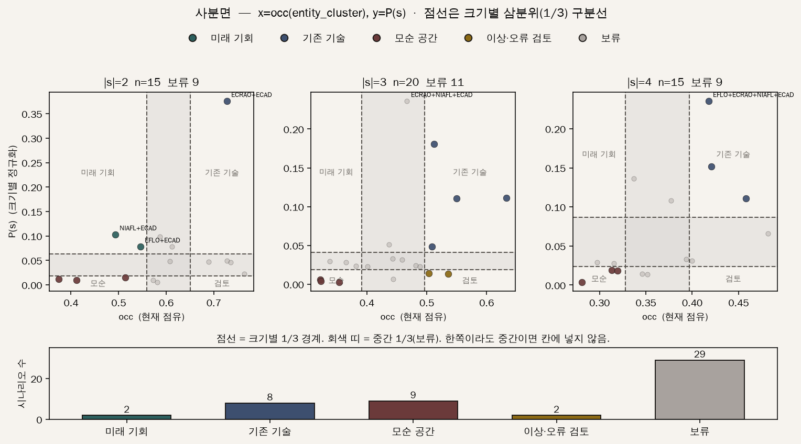

# 연구 방향 검토 자료 — 특허 기반 기술기회 발굴

> 2026년 10월 24일 연구 미팅

## 0. 요약

특허의 빈 곳에는 아직 시도되지 않았을 뿐인 기회와, 기술적으로 함께 성립하기 어려운 조합이 섞여 있습니다. 본 연구는 이 둘을 특허 데이터로 구분하고, 그 구분이 이후 출원된 특허로 확인되는지를 검증하려 합니다.

현재 Edge AI 특허로 파일럿을 진행했습니다. 지식그래프와 임베딩으로 기회 공간을 그리는 단계까지는 작동하지만, 시간에 따른 검증은 아직 성립하지 않았습니다. 이번 미팅에서는 연구 질문의 적절성과, 앞으로 어느 부분을 깊게 다룰지에 대한 판단을 부탁드리고자 합니다.

---

## 1. 연구 질문

**큰 질문.** 특허만으로 기술기회 후보를 도출할 때, 실현 가능한 기회와 성립하기 어려운 조합을 구분할 수 있는가. 그리고 그 구분은 이후의 특허로 확인되는가.

**세부 질문.**

1. **생성.** 특허에서 기회 공간을 어떻게 만드는가.
2. **거르기.** 그 공간에서 성립하기 어려운 후보를 특허 근거로 어떻게 걸러내는가.
3. **평가.** 남긴 후보와 걸러낸 후보가 이후 특허에서 실제로 갈리는지를 어떻게 확인하는가.

공간의 단위는 아직 정하지 않았습니다. 기술 요소의 조합일 수도(형태학적 셀), 임베딩 공간의 영역일 수도(벡터공간), 요소 사이의 관계(그래프의 링크)일 수도 있습니다. 세 질문을 같은 특허 데이터로 잇는 것이 본 연구의 범위입니다.

---

## 2. 문제의식

키워드 기반 형태분석([Yoon & Park, TFSC, 2005](https://doi.org/10.1016/j.techfore.2004.08.011)) 이후, 기술기회 연구는 “특허가 아직 없는 곳”을 기회 후보의 원천으로 삼아 왔습니다. 방법은 키워드에서 특허지도, 의미망, 링크 예측, 임베딩으로 바뀌었지만 이 출발점은 유지되었습니다.

이 출발점에서 세 가지 질문이 남습니다.

- 빈 곳 가운데 무엇이 아직 시도되지 않은 것이고, 무엇이 성립하기 어려워 비어 있는 것인가.
- 그 구분의 근거를 데이터로 남겨, 다시 분석해도 같은 결과가 나오게 할 수 있는가.
- 구분이 맞았는지를, 기회로 남긴 쪽과 버린 쪽 모두에서 확인할 수 있는가.

실무에서는 연구개발 기획 단계에서 검토할 후보 목록을 근거 있게 줄이는 의미가 있습니다. 선행연구가 이 세 질문을 어디까지 다뤘는지는 3절에서 흐름별로 살펴봅니다.

---

## 3. 선행연구 현황

세부 문헌 목록과 논문별 요약: [선행연구 정리](../03_literature/prior_research.md)

빈 곳을 그대로 기회로 둔 것은 초기 연구 일부입니다. 이후 연구 대부분은 빈 곳을 좁히는 장치를 두었습니다. 따라서 살펴볼 것은 “좁혔는가”가 아니라 **그 장치가 무엇을 판정했는가**입니다.

### 3.1 생성 — 빈 곳을 어떻게 좁혀 왔는가

| 좁히는 방식 | 대표 연구 | 내리는 판정 | 남는 문제 |
|---|---|---|---|
| 빈 조합을 그대로 기회로 둠 | [Keyword-based MA](https://doi.org/10.1016/j.techfore.2004.08.011) (TFSC, 2005), [DSSC 기회분석 모형](https://doi.org/10.1080/09537325.2013.850155) (TASM, 2013) | 특허가 없는 조합 또는 활동이 약한 구간이 기회입니다 | 성립하지 않는 조합도 기회 목록에 들어갑니다 |
| 매력도·실현 가능성 점수로 순위를 매김 | [MA + 컨조인트, 인용 기반 실현 가능성](https://doi.org/10.1109/tem.2007.900796) (IEEE TEM, 2007), [SAO 형태분석 8개 지표](https://doi.org/10.1016/j.techfore.2016.01.028) (TFSC, 2016), [SAO + MA 실현 가능성 점수](https://doi.org/10.1007/s11192-017-2260-y) (Scientometrics, 2017), [키워드 특허지도 공백 검사](https://doi.org/10.1016/j.technovation.2008.10.006) (Technovation, 2009) | 어느 빈 조합이 더 유망한가 | 순위가 낮다는 것이 성립하기 어렵다는 뜻인지는 판정하지 않습니다 |
| 기능·발상 원리로 확장함 | [기능 기반 TOD](https://doi.org/10.1016/j.techfore.2015.04.012) (TFSC, 2015), [MA + USIT](https://doi.org/10.3390/su12010136) (Sustainability, 2019) | 기능상 이어질 수 있는 경로가 기회입니다 | 규칙이 발상법이나 지식베이스에서 오고, 특허로 검사하지 않습니다 |
| 공백 대신 신규성을 봄 | [신규성 탐지](https://doi.org/10.1080/09537325.2012.748892) (TASM, 2013), [Novelty-focused patent mapping](https://doi.org/10.1016/j.techfore.2014.05.010) (TFSC, 2015), [SAO + 이상치 탐지](https://doi.org/10.1016/j.techfore.2023.122353) (TFSC, 2023) | 기존 분포에서 벗어난 특허가 기회 신호입니다 | 공백 해석의 모호함은 피하지만, 빈 곳 자체에는 판정을 붙이지 않습니다 |
| 기업 역량으로 범위를 줄임 | [중소기업 2단계 특허분석](https://doi.org/10.1007/s11192-013-1216-0) (Scientometrics, 2014), [내부 역량 연관규칙](https://doi.org/10.1016/j.techfore.2016.01.011) (TFSC, 2016), [GCN 2단계 기회발굴](https://doi.org/10.1016/j.techfore.2022.121934) (TFSC, 2022) | 이 기업이 할 수 있는 기회인가 | 기업 적합성을 보는 것이고, 기술 요소 사이의 양립성은 보지 않습니다 |

이 흐름은 빈 곳을 **더 유망한 순서로 정렬**하거나 **다른 신호로 대체**해 왔습니다. “이 조합은 성립하기 어렵다”는 판정을 명시적으로 내린 연구는 이 흐름에서 찾지 못했습니다.

그래프나 임베딩으로 빈 곳을 좁히는 연구도 있습니다. 표현이 정밀해졌을 뿐, 판정의 성격은 순위와 같습니다. 이 계열은 4절에서 차별성과 함께 다룹니다.

### 3.2 거르기 — 무엇으로 지워 왔는가

| 지우는 방식 | 대표 연구 | 내리는 판정 | 남는 문제 |
|---|---|---|---|
| 교차일관성으로 모순 쌍을 지움 | [Computer-aided MA](https://doi.org/10.1057/palgrave.jors.2602177) (JORS, 2006), [GMA + CCA](https://doi.org/10.1016/j.techfore.2017.05.016) (TFSC, 2017) | 이 쌍은 양립하지 않으므로 그 쌍을 포함한 조합을 지웁니다 | 부정 판정을 내리는 거의 유일한 계열입니다. 다만 판정은 전문가가 하고, 그 판정이 맞았는지는 다시 확인하지 않습니다 |
| 교차영향 점수로 조합을 남김 | [Cross-impact balances](https://doi.org/10.1016/j.techfore.2005.06.005) (TFSC, 2005) | 쌍마다 영향 점수를 동시에 만족하는 조합만 남깁니다 | 입력은 전문가입니다 |
| 연관규칙·점수로 아래를 자름 | [Triadic patent association rules](https://doi.org/10.1016/j.techfore.2015.07.022) (TFSC, 2015), 3.1절의 실현 가능성 점수 연구 | 같이 나타날 가능성이 크거나, 점수가 높은 조합만 남깁니다 | 데이터에서 근거를 얻지만, 기준선 아래에 놓인 조합이 성립하기 어렵다는 근거는 따로 없습니다 |
| 대표 시나리오만 남김 | [Reliable scenario set](https://doi.org/10.1016/j.ejor.2003.08.054) (EJOR, 2003), [Diverse plausible scenarios](https://doi.org/10.1016/j.futures.2015.12.003) (Futures, 2015) | 가능 공간이 클 때 대표만 고릅니다 | 제거 이후의 축소이지, 성립 여부를 판정하는 단계는 아닙니다 |

정리하면, **명시적 제거는 전문가 판단으로, 데이터 기반 거르기는 점수 순위로** 이루어져 왔습니다.

### 3.3 평가 — 무엇을 확인해 왔는가

| 확인하는 방식 | 대표 연구 | 확인한 대상 | 남는 문제 |
|---|---|---|---|
| 상위 조합의 이후 출현 | [SAO morphology, 8 indicators](https://doi.org/10.1016/j.techfore.2016.01.028) (TFSC, 2016) | 순위가 높았던 조합이 이후 특허에 나타났는가 | 버린 조합이 이후에도 비어 있었는지는 보지 않습니다 |
| 예측 격자의 이후 채움 | [GTM and link prediction](https://doi.org/10.1016/j.techfore.2018.01.019) (TFSC, 2018) | 링크로 고른 빈 칸이 이후 특허로 채워졌는가 | 고른 칸만 비교합니다 |
| 군집·유망 특허의 이후 성장 | [Patent citation clusters](https://doi.org/10.1007/s11192-012-0796-4) (Scientometrics, 2012), [Text-based link prediction](https://doi.org/10.1108/fs-03-2021-0078) (foresight, 2022) | 예측한 군집이나 특허가 이후에 커졌는가 | 대상이 칸이 아니고, 역시 고른 쪽만 봅니다 |
| 시나리오 품질 점검 | [Scenario uses and abuses](https://doi.org/10.1016/j.techfore.2010.06.007) (TFSC, 2010), [Traceability of scenarios](https://doi.org/10.1007/s40309-015-0077-6) (Eur. J. Futures Res., 2015), [SQAM](https://doi.org/10.1002/ffo2.205) (2024) | 관련성·일관성·개연성·추적 가능성이 있는가 | 대부분 워크숍 산출물의 항목이고, 특허 데이터에 계산식으로 붙인 경우는 드뭅니다 |
| 미래정보 누수 금지 | [Leakage in ML-based science](https://doi.org/10.1016/j.patter.2023.100804) (Patterns, 2023) | 학습에 이후 정보가 섞였는가 | 사후 검증의 조건이지, 기회 공간을 채점한 연구는 아닙니다 |

확인한 대상은 모두 **기회로 고른 쪽**입니다. 순위가 낮았거나 버린 조합이 이후에도 비어 있었는지는 보고하지 않았습니다.

### 3.4 정리 — 비어 있는 자리

1. 빈 곳에 대한 부정 판정은 전문가 기반 형태분석에만 있고, **특허 근거로 그 판정을 만든 연구**는 찾지 못했습니다.
2. 사후 검증은 기회 쪽의 적중만 보고, **버린 쪽이 계속 비어 있었는지**는 보지 않습니다.

최근의 지식그래프·임베딩 연구가 이 자리를 채웠는지는 4절에서 살펴봅니다.

---

## 4. 지식그래프·임베딩 연구와의 차별성

연구 계획서에 대해 “지식그래프·임베딩을 적용한 최근 논문과의 차별성을 명확히 하라”는 말씀을 주셨습니다. 이 절에서는 [선행연구 정리](../03_literature/prior_research.md)에 지식그래프·임베딩으로 둔 논문이 무엇을 바꿨는지, 무엇이 남아 있는지, 본 연구가 무엇을 더하는지를 정리합니다.

> 지식그래프와 임베딩은 기회 공간을 그리는 수단입니다. 본 연구의 기여는 그 공간에서 성립하기 어려운 후보를 특허 근거로 판정하고, 남긴 후보와 걸러낸 후보가 이후 특허에서 실제로 갈리는지를 검증하는 데 있습니다.

### 4.1 무엇이 바뀌었는가

선행연구 정리는 임베딩을 기회 공간의 단위가 아니라, 셀·영역·관계를 만들기 위한 **표현 도구**로 둡니다. 아래 논문이 그 도구를 특허에 적용한 최근 예입니다.

| 연도 | 학술지 | 연구 | 하는 일 |
|---:|---|---|---|
| 2019 | ESWA | [TechNet](https://doi.org/10.1016/j.eswa.2019.112995) | 특허에서 기술 용어와 용어 관계를 추출해 대규모 의미망을 만들고, 망의 거리로 유사 기술을 찾습니다 |
| 2021 | TFSC | [Transformer and graph embedding for patent landscaping](https://doi.org/10.1016/j.techfore.2021.121413) | 초록의 트랜스포머 임베딩과 분류 코드 그래프 임베딩을 합쳐, 랜드스케이프에 넣을 특허를 가려냅니다 |
| 2022 | TFSC | [Text-embedding patent similarity](https://doi.org/10.1016/j.techfore.2022.121559) | 특허 본문을 문장 임베딩으로 바꿔 전 특허 쌍의 유사도를 계산하고, 특허 전체를 하나의 기술 네트워크로 나타냅니다 |
| 2022 | TFSC | [GCN-based link-prediction approach](https://doi.org/10.1016/j.techfore.2022.121934) | 그래프 합성곱으로 아직 없는 기술 분류 링크를 예측한 뒤, 기업 포트폴리오에 맞는 기회만 남깁니다 |
| 2024 | TFSC | [PatentSBERTa](https://doi.org/10.1016/j.techfore.2024.123536) | 청구항을 문장 임베딩으로 바꿔 특허 사이 거리를 정의하고, 의미 검색과 분류 코드 부여에 씁니다 |
| 2026 | Scientometrics | [SAO representation learning](https://doi.org/10.1007/s11192-026-05578-1) | 주어-동작-대상 그래프를 임베딩해, 아직 없는 기술 삼항 관계를 기회로 예측합니다 |

TechNet, 랜드스케이프, 특허 유사도, PatentSBERTa는 용어·특허·청구항을 벡터나 그물로 바꿉니다. 바뀐 것은 키워드 사전 대신 거리로 비슷한 기술을 모을 수 있게 된 점입니다. GCN 연구와 SAO 표현학습은 그 표현 위에서 아직 없는 링크를 예측합니다. 어느 쪽이든 하는 일은 공간을 **더 정밀하게 그리는 것**입니다.

### 4.2 무엇이 남았고, 본 연구는 무엇을 더하는가

1. **가깝다는 것이 함께 구현할 수 있다는 뜻은 아닙니다.** TechNet, 특허 유사도 임베딩, PatentSBERTa는 거리와 유사도를 재고, 랜드스케이프 연구는 그 거리로 특허를 가려냅니다. 가까운 특허를 모아도 가능 공간이 되지는 않습니다.
   → 본 연구는 유사도와 별개로 양립 여부를 특허 증거로 판정합니다. 한 특허 안에 함께 나오면 양립의 증거로 두되, 함께 나온 적이 없다는 사실만으로는 성립하기 어렵다고 두지 않는 것이 출발점입니다. 구체적인 판정 근거는 아직 설계 단계입니다.
2. **링크를 예측하는 연구는 관측되지 않은 쌍을 음성으로 둡니다.** GCN 연구와 SAO 표현학습이 여기에 해당합니다. 점수가 낮다는 것은 “성립하기 어렵다”보다 “지금까지 관측되지 않았다”에 가깝습니다.
   → 본 연구는 관측되지 않은 쌍을 “아직 시도되지 않음”과 “성립하기 어려움”으로 나누는 단계를 따로 둡니다.
3. **어느 쪽도 버린 곳이 계속 비어 있었는지는 보지 않습니다.** 표현 연구는 기회 공간 자체를 채점하지 않고, 예측 연구는 이후에 생긴 연결을 맞혔는지만 봅니다. 3.3절의 특허 사후 검증도 같습니다.
   → 본 연구는 남긴 쪽의 실현율과 걸러낸 쪽의 침범률을 함께 봅니다.

이 세 가지는 본 연구의 파일럿에도 그대로 해당합니다(6.3절). 공간의 단위와 표현 방식은 바뀔 수 있고, 본 연구의 차별은 이 판정과 검증에 있습니다.

---

## 5. 교수님 연구와의 연속성

시기별 정리: [관련 연구 연표](../03_literature/shin_mot_research.md)

| 교수님 연구 | 다룬 문제 | 본 연구와 이어지는 지점 |
|---|---|---|
| [Novelty-focused patent mapping](https://doi.org/10.1016/j.techfore.2014.05.010) (TFSC, 2015) | 특허지도의 공백 해석이 직관적이고 모호합니다 | 이 연구는 공백 대신 신규 특허를 기회 신호로 삼아 모호함을 피했습니다. 본 연구는 공백 자체에 판정을 붙이는 방향으로 같은 문제를 다룹니다 |
| [Two-stage patent analysis for SMEs](https://doi.org/10.1007/s11192-013-1216-0) (Scientometrics, 2014) | 기업 역량에 맞는 기회만 골라야 합니다 | 후보를 실현 가능성으로 거른다는 관점이 본 연구의 거르기 단계와 같습니다. 본 연구는 기업 역량 대신 기술 요소 사이의 양립성을 기준으로 둡니다 |
| [TOD to R&D planning](https://doi.org/10.1016/j.techfore.2017.03.011) (TFSC, 2017) | 기회 정의가 넓어 연구개발 계획으로 쓰기 어렵습니다 | 넓은 후보를 근거 있게 줄인다는 목표가 같습니다 |
| [Extended technological trajectories](https://doi.org/10.1007/s11192-018-2834-3) (Scientometrics, 2018), [Overcoming time lags](https://doi.org/10.1016/j.techfore.2019.04.013) (TFSC, 2019) | 공개 시차와 인용 시차 때문에 최근 변화가 잘립니다 | 본 연구의 사후 검증은 과거 창으로 공간을 만들고 이후 창으로 채점하므로, 이 시차 문제를 설계에 직접 반영해야 합니다 |
| Monitoring indicators for emerging technological opportunities (IAMOT, 2020) | 신흥 기회를 시간에 따라 감시할 지표가 필요합니다 | 기회 공간을 주기적으로 갱신하는 장기 확장과 연결됩니다 |

---

## 6. 지금까지 진행한 내용

절차와 결과 상세: [파일럿 결과](../06_references/scenario_space_example.md) · 계획서 원문: [논문 연구 계획서](../06_references/thesis_research_plan.md)

### 6.1 데이터

- Edge AI 분야 특허 약 5만 건(2010–2025 출원)을 확보했습니다.
- 그중 약 1,500건은 LLM으로 문제–해결–효과(PSE)와 지식그래프를 추출했습니다. 파일럿 분석에는 1,412건(주로 2019–2024 출원)을 썼습니다.

### 6.2 파일럿

키워드 사전으로 기술 축을 미리 정하지 않고, 아래 순서로 진행했습니다.

1. PSE 텍스트, 지식그래프, CPC를 하나의 특허 벡터로 합칩니다.
2. 베이지안 가우시안 혼합모형으로 잠재 기술 그룹을 찾습니다. 유효 그룹은 6개였습니다.
3. 그룹 2–4개의 조합 50개를 시나리오로 둡니다.
4. 지식그래프로 학습한 결합 가능성과 현재 점유도를 두 축으로, 시나리오를 4분면에 배치합니다.

| 구분 | 개수 | 예 |
|---|---:|---|
| 기존 기술 | 8 | 자원할당 × 이상탐지. 이미 함께 쓰이고 결합 가능성도 높습니다 |
| 미래 기회 | 2 | 이상탐지 × 연합학습 계열. 아직 드물지만 결합 가능성이 높습니다 |
| 모순 | 9 | 점유도와 결합 가능성이 모두 낮습니다 |
| 검토 | 2 | 실제로는 함께 쓰이는데 결합 가능성은 낮게 나옵니다 |
| 보류 | 29 | 두 축 중 하나가 중간 구간입니다 |

### 6.3 확인한 한계

- **시간 검증이 성립하지 않았습니다.** 과거 창의 특허만으로 다시 만들면 한 창에서는 유효 그룹이 1개, 다른 창에서는 시나리오가 4개만 남아, 미래 기회가 실제로 채워졌는지 잴 수 없었습니다.
- **결합 가능성이 낮다는 것이 성립 불가능을 뜻한다는 근거가 아직 없습니다.** 결합 모형은 관측된 트리플과 교란한 트리플을 구분하도록 학습했기 때문에, 4.2절의 두 번째 한계를 그대로 안고 있습니다. 지금의 “모순”은 점수가 낮다는 뜻이지, 특허 근거로 확인된 판정이 아닙니다.
- **큰 그룹이 결과를 지배합니다.** 비중이 큰 두 그룹이 들어간 조합이 추세 때문에 위로 올라갑니다.

---

## 7. 향후 방향

현업 과제는 단기로, 이번 파일럿처럼 한 분야의 기회 공간을 재현 가능하게 만드는 일입니다. 학위논문은 그 위에서 장기로, 거르기와 평가의 방법론을 세우는 일로 생각하고 있습니다.

| 방향 | 내용 |
|---|---|
| A. 현 파이프라인 심화 | 5만 건으로 확대해 시간 검증을 성립시킵니다 |
| B. 거르기 단계에 집중 | 특허 근거로 성립하기 어려운 조합을 추정하는 방법을 핵심 기여로 둡니다 |
| C. 평가 틀에 집중 | 시차 보정, 대조군, 미래 정보 누수 방지를 갖춘 사후 검증 틀을 만듭니다 |
| D. 방향 재탐색 | 기술 궤적 위의 기회 공간처럼, 공간의 단위부터 다시 찾습니다 |

---

## 8. 여쭙고 싶은 것

1. 1절의 연구 질문과 범위가 박사논문으로 적절한지 여쭙고 싶습니다.
2. 7절의 방향 중 어느 쪽이 좋을지, 또는 다른 방향이 있을지 여쭙고 싶습니다.
3. “성립하기 어렵다”와 “맞았다”를 무엇으로 판정하는 것이 학술적으로 설득력이 있을지 여쭙고 싶습니다.
4. 다음 미팅까지 무엇을 준비하면 좋을지 여쭙고 싶습니다.

---

## 참고 자료

- [선행연구 정리](../03_literature/prior_research.md) — 생성·거르기·평가 세 흐름의 문헌 분류와 논문별 요약
- [관련 연구 연표](../03_literature/shin_mot_research.md) — 교수님 연구 중 기술기회·예측·궤적 관련 논문의 시기별 정리
- [파일럿 결과](../06_references/scenario_space_example.md) — Edge AI 특허 1,412건으로 수행한 시나리오 공간 파일럿의 절차와 결과
- [논문 연구 계획서](../06_references/thesis_research_plan.md) — 2026학년도 2학기 제출본
