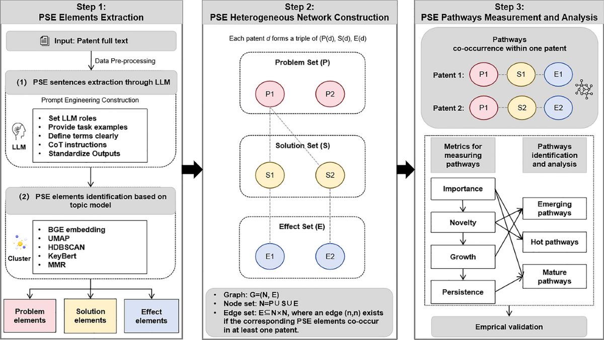
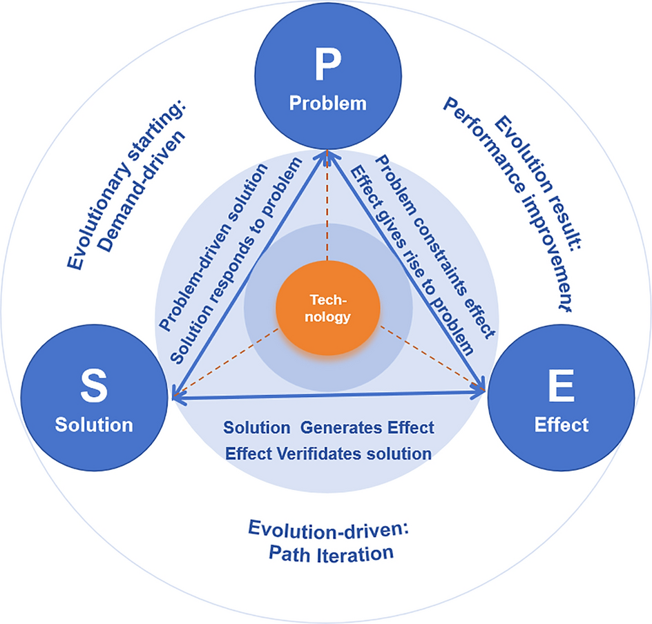
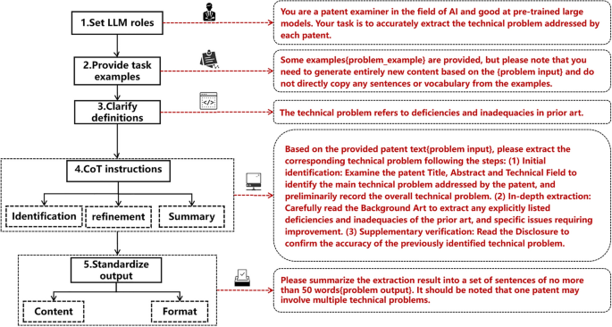
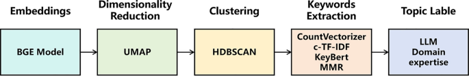
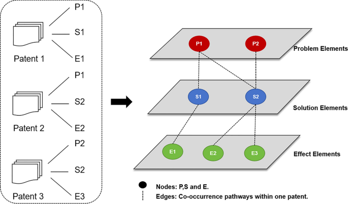
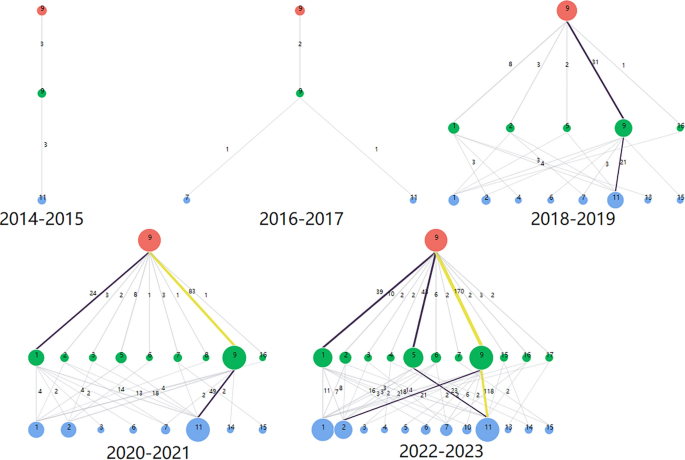
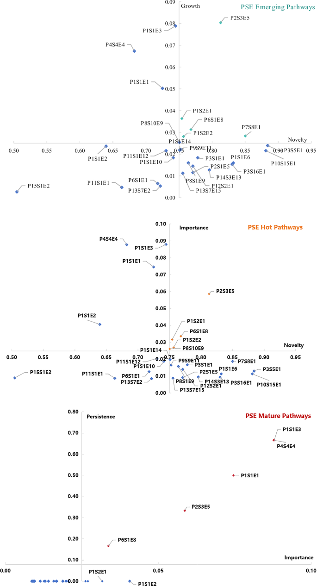

# PSE로 기술 진화를 읽는 절차

  

Zhao Zhanyi, Yang Ruiyu, Zhou Jian, Luo Jiatang, Zheng Lili, Lv Lucheng, Zhao Yajuan. *Scientometrics*, 2026년 10월 3일. 오픈액세스(CC BY 4.0).

  

[원문 10.1007/s11192-026-05820-w](https://link.springer.com/article/10.1007/s11192-026-05820-w)

## 목차

- [절차 한눈에](#glance)
- [개념](#frame)
- [데이터](#data)
- [문장 추출](#sent)
- [요소로 묶기](#topic)
- [경로 네트워크](#net)
- [지표](#metric)
- [사례](#case)
- [이 프로젝트에서](#ours)

이 논문은 특허 한 건을 키워드나 문법 삼항(SAO)이 아니라, 풀려는 문제(Problem), 그 해법(Solution), 그 결과(Effect)의 묶음으로 읽습니다. 같은 특허 안에 같이 나온 P–S–E를 하나의 경로로 두고, 그 경로가 떠오르는지, 뜨거운지, 자리 잡았는지를 특허 수로 가릅니다. 사례는 사전학습 대형 모델 특허 28,757건입니다. 문제 15개, 해법 17개, 효과 15개, 경로 952개가 나왔습니다.

## 절차는 세 단계다

입력은 특허 전문입니다. 출력은 떠오르는 경로, 뜨거운 경로, 자리 잡은 경로입니다.



1. **요소 추출.** 대형 언어모형으로 문제·해법·효과 문장을 뽑고, 토픽 모형으로 그 문장을 요소로 묶습니다.
2. **이종 네트워크.** 요소가 노드입니다. 한 특허 안에서 같이 나오면 간선입니다. 특허 하나는 (문제, 해법, 효과) 경로 하나입니다.
3. **경로 측정.** 중요도, 신규성, 성장, 지속으로 떠오르는 경로, 뜨거운 경로, 자리 잡은 경로를 나눕니다.

## 기술을 문제–해법–효과의 순환으로 둔다

출발은 수요입니다. 선행기술이 못 푸는 문제가 해법을 부르고, 해법이 효과를 만들고, 효과가 문제를 풀었는지 확인하면서 새 문제를 다시 드러냅니다. 이론 쪽 근거는 TRIZ의 모순–발명원리–이상해결이고, 실무 쪽 근거는 특허 명세서가 문제, 해법, 효과를 쓰게 되어 있다는 점입니다. 조작 정의는 중국 특허법 시행세칙을 따릅니다. 미국·유럽 명세서는 같은 세 단어를 강제하지 않아서, 다른 법역에는 아직 검증이 필요하다고 논문이 적습니다.



## 0. 특허를 모으고 부분으로 나눈다

검색일은 2024년 3월 20일입니다. incoPat와 Derwent Innovation에서 발명과 실용신안만 가져오고, 디자인 특허는 뺍니다. 제목·초록이 빈 19건과 민감어가 있는 4건을 뺀 뒤 28,757건이 남습니다. 그중 영어 특허 3,110건은 Google 번역으로 중국어로 맞춥니다. 전문은 제목, 초록, 독립항, 종속항, 기술분야, 배경기술, 발명의 내용, 도면 설명, 구체적 실시방식으로 나눕니다.

## 1. 역할에 맞는 문장만 뽑는다

특허의 모든 문단을 같은 입력으로 쓰지 않습니다. 문제, 해법, 효과가 주로 적히는 부분만 넣습니다. 추출 모형은 DeepSeek-V3입니다.

| 뽑는 것 | 넣는 칸 | 출력 길이 |
| --- | --- | --- |
| 문제 | 제목, 초록, 기술분야, 배경기술, 발명의 내용 | 50단어 안쪽의 문장 묶음. 특허 하나에 문제가 여러 개일 수 있음 |
| 해법 | 제목, 초록, 독립항, 발명의 내용 | 80단어 안쪽의 문장 하나. 특허 하나의 해법은 보통 하나 |
| 효과 | 제목, 초록, 발명의 내용 | 30단어 안쪽의 구 묶음. 효과가 여러 개일 수 있음 |

프롬프트는 다섯 단계입니다. 역할을 심사관으로 두고, 예시를 주되 예시를 베끼지 말게 하고, 문제·해법·효과의 뜻을 고정하고, 생각의 순서를 지정한 뒤, 길이와 형식을 고정합니다. 문제 문장의 생각 순서는 셋입니다. 제목·초록·기술분야에서 큰 문제를 잡고, 배경기술에서 선행기술의 결함을 읽고, 발명의 내용에서 그 문제를 다시 확인합니다.



품질은 특허 500건을 전문가 넷이 봤습니다. 경력 10년 이상의 인공지능·대형모델 심사 전문가입니다. 세 사람이 맞음·틀림·불확실로 판정하고, 의견이 갈리거나 불확실한 76건(표본의 15.2%, 처음 일치 84.8%)은 네 번째 전문가가 다시 봤습니다. 최종 정답률은 문제 98.8%, 해법 100%, 효과 98.2%입니다. 해법이 가장 높은 이유는 발명의 내용에 해법이 명시되기 때문입니다. 틀린 경우는 번역 잡음, 문제가 문장으로 안 쓰이고 효과를 뒤집어 읽어야 하는 경우, 효과가 실시예 여러 곳에 흩어진 경우입니다.

## 2. 문장을 요소로 묶는다

특허마다 문제 문장, 해법 문장, 효과 문장이 있습니다. 그걸 그대로 두지 않고 토픽으로 묶어서 요소 이름을 만듭니다. BERTopic 계열입니다.



1. BGE 임베딩으로 문장을 벡터로 만듭니다.
2. UMAP으로 차원을 줄입니다.
3. HDBSCAN으로 군집합니다. 잡음 점은 −1로 두고 요소 수에서 뺍니다.
4. CountVectorizer, c-TF-IDF, KeyBERT, MMR로 군집마다 키워드 라벨을 만듭니다.
5. 대형 언어모형과 분야 전문가가 원문 특허를 보며 라벨을 15단어 안쪽의 구로 다듬습니다. 문제 라벨은 원인을 남기고, 해법 라벨은 핵심 기술 특징을 남기고, 효과 라벨은 동사–목적어 구로 맞춥니다.

결과는 문제 15개, 해법 17개, 효과 15개입니다. 예: 문제 “Complex Medical Decoding Weakness”, 해법 “Multi-Scale Semantic-Prior Fusion”, 효과 “Medical Image Segmentation Optimization”.

## 3. 한 특허 안의 공출현으로 경로를 만든다

네트워크는 G = (N, E)입니다. 노드 N은 문제 집합, 해법 집합, 효과 집합의 합이고 세 집합은 서로 겹치지 않습니다. 간선은 서로 다른 종류의 노드 사이에만 있습니다. 문제–해법, 해법–효과, 문제–효과입니다. 한 특허 안에 그 요소가 같이 나오면 간선이 생깁니다.

특허 d는 삼항 (p(d), s(d), e(d)) 하나입니다. 그 특허의 경로는 p(d)s(d)e(d)입니다. 같은 삼항을 가진 특허를 모으면 통합 경로 PxiSyiEzi가 됩니다. 사례에서는 경로 952개가 나왔습니다.



## 4. 네 숫자로 경로를 나눈다

네 지표는 최솟값–최댓값으로 같은 범위에 맞춘 뒤 씁니다. 시간 창의 수를 T, 경로 i의 특허 수를 Qi라고 둡니다.

```
중요도 Ii = Qi / T 
그 창 전체에서 경로에 특허가 평균적으로 많을수록 중요하다.
```

```
신규성 Ni = (경로 i 특허의 출원연도 합) / Qi 
평균 출원연도가 늦을수록 새롭다.
```

```
성장 G = (가장 최근 해의 특허 수 − 가장 이른 해의 특허 수) / 가장 이른 해의 특허 수 
늘어나는 속도다.
```

```
지속 p = Yi / T 
Yi는 특허 수가 임계값 α를 넘는 해의 수다. α의 수치는 논문에 고정되어 있지 않다.
```

| 부르는 이름 | 같이 보는 지표 |
| --- | --- |
| 떠오르는 경로 (emerging) | 신규성, 성장 |
| 뜨거운 경로 (hot) | 신규성, 중요도 |
| 자리 잡은 경로 (mature) | 중요도, 지속 |

산포도의 원점은 두 축의 평균입니다. 그림에는 특허가 100건을 넘는 경로만 그렸습니다.

## 사례에서 절차가 보여 준 것

깊게 따라간 경로는 P9, 작은 차량 검출과 모형 중복입니다. 특허 457건이고, 최근 10년의 변화가 분명해서 골랐습니다. 시간 간격은 2년입니다. 빨간 점이 문제, 파란 점이 해법, 초록 점이 효과이고, 점 크기는 특허 수입니다. 선은 특허가 늘수록 보라에서 노랑으로 바뀝니다.



1. **2014–2015.** P9–S9–E11이 3건. 시각 정보와 단일 어텐션으로 기본 인식만 됩니다.
2. **2016–2017.** P9–S9–E7이 2건. 합성곱 신경망 같은 딥러닝이 들어옵니다.
3. **2018–2019.** P9–S9–E11이 45건으로 늘고, 어텐션이 경량 모형과 붙습니다. 효과는 번호판 인식에서 운전자 상태, 신호, 자율주행 제어로 넓어집니다. 다중모달과 복잡한 환경은 아직 남습니다.
4. **2020–2021.** 126건. 10건을 넘는 경로가 셋이고, 라이다·카메라·음성이 붙습니다.
5. **2022–2023.** 281건. 연합학습, 단말–클라우드 협업, 생성 모형이 붙고, 관심은 일반화·안전·프라이버시로 이동합니다.

논문은 이 궤적이 2025년 중국 자동차 기술 트렌드 보고(다중모달 대형 모형, 연산 최적화, 연합학습)와 맞다고 봅니다.



가장 떠오르고 동시에 가장 뜨거운 경로는 P2–S3–E5입니다. 복잡한 의료 영상 해독의 약점, 다중스케일 의미–사전 융합, 의료 영상 분할 개선. 신규성 0.82, 성장 0.08입니다.

가장 자리 잡은 경로는 둘입니다. P1–S1–E3(데이터·주석 부족, 사전학습–관계 공동추출, 텍스트 분류 일반화)는 특허 1,011건으로 가장 많습니다. P4–S4–E4(동적 음성 대비의 한계, 비지도 음성 어텐션, 음성인식 적응)도 같은 사분면에 있습니다. 문제–해법–효과가 안정되면 급진적 발명보다 점진적 발명이 늘어난다고 논문은 읽습니다.

## 논문이 스스로 남긴 한계

1. 해법 아래의 기술 특징·수단까지는 안 나눕니다. 다음에는 나무 구조의 분류를 만들겠다고 합니다.
2. 조작 기준이 중국 명세서입니다. 영어 특허는 번역해서 넣었고, USPTO·EPO 문체에는 따로 검증이 필요합니다.
3. 맞았다는 확인은 산업 보고서와의 정성 대조입니다. 기준 실험이나 정량 검증은 후속 과제라고 적혀 있습니다.

## 이 프로젝트에서 어디에 놓으면 되는가

> 참조가 되는 자리는 특허 문장에서 기술 요소를 뽑는 절차입니다. 키워드나 SAO 대신, 명세서의 어느 부분에서 문제·해법·효과 문장을 뽑고 그 문장을 군집하는 순서가 구체적으로 적혀 있습니다. 부록은 SAO가 한 문장의 문법 삼항인 데 비해 PSE는 전문의 의미 삼항이라고 비교합니다.
>
> 단위는 우리 지도와 다릅니다. 이 논문의 경로는 한 특허 안에서 같이 나온 문제–해법–효과입니다. 우리 지도의 칸은 기술 선택지를 하나씩 고른 조합이고, 그 칸을 아직 안 한 조합과 같이 쓸 수 없는 조합으로 나눕니다. 여기의 공출현은 같이 쓰인 증거까지이고, 안 나온 쌍을 금지로 지우지는 않습니다.
>
> 점수도 대상이 다릅니다. 여기의 신규성·성장·중요도·지속은 경로가 떠오르는지, 뜨거운지, 자리 잡았는지를 말합니다. 우리가 확인할 숫자는, 제약을 넣은 지도가 덜 헷갈리는지, 그리고 과거 특허만으로 그린 지도에서 가능한 칸은 나중에 채워지고 불가능한 칸은 비어 있는지입니다.

그림 1, 2, 3, 4, 5, 8, 9는 위 논문의 그림이며 CC BY 4.0으로 재사용할 수 있습니다. 이 파일은 그 그림을 안에 넣어서, 네트워크 없이도 절차를 따라갈 수 있게 만든 정리입니다.
