# 산출물을 어떻게 읽나

실행 후 `out/` 파일과, 그걸 보고 **말할 수 있는 문장 / 말하면 안 되는 문장**.

이번 실행(시드 42, n=400)의 그림과 해석은 **[results.md](results.md)** 에 모아 두었다.
PNG는 `../figures/`. 다시 그리려면 `conda activate scenario-space` 후 `python plot_results.py`.

아래 각 절에도 해당 그림을 붙여, 표만 보지 않게 했다.

## 00 샘플

| 파일 | 무엇인가 | 보면 알게 되는 것 |
|---|---|---|
| `data/patents.csv` | 400건, 제목·초록·CPC·인용 | 이 실험의 코퍼스. FL 슬라이스 아님 |
| `data/manifest.json` | 시드, 원본 건수, 초록 결측 | 같은 샘플을 다시 그릴 수 있는지 |

초록 없는 행은 샘플에 안 들어간다. 건수가 400이 아니면 `N_PATENTS` 또는 원본 경로를 본다.

이번 실행은 400행이 맞다. 다만 초록이 있어도 사전 문구가 없으면 이후 단계에서 `unmapped`가 된다 (311건). 그림은 다음 절.

## 01 행렬

| 파일 | 무엇인가 | 기대 |
|---|---|---|
| `01_vocab.csv` | 문구별 문서 빈도 | `docs_with_term=0` 문구는 이번 400건에 없음. 사전만 있고 관측이 없음 |
| `01_feature_matrix.csv` | 행=특허, 열=카운트+CPC | `n_keyword_hits=0` 이 많으면 EM 점유가 흐려짐 |
| `01_signatures.csv` | 키워드 존재 비트열 | missing-species 의 종 |
| `01_counts.npy` | 같은 카운트 행렬 | 이후 단계 입력 |

한 행을 골라 `n_keyword_types` 와 `origins` 를 본다. origins가 `power:low` 만이면
그 특허는 저전력 신호만 있는 것이다. 셀을 닫지 못한다.

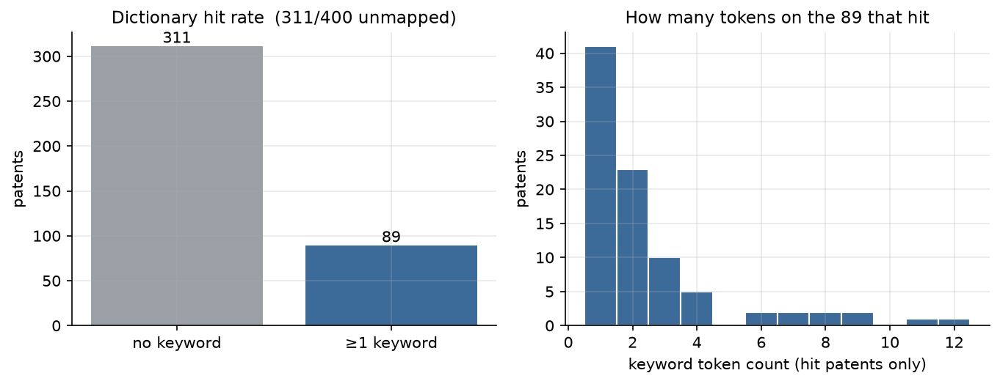

이번 실행: 키워드 1개 이상 **89/400**. 나머지 311은 행렬이 0행이다. 걸린 89건도 토큰은 대개 1~2개.

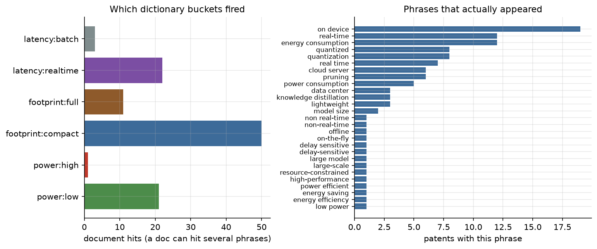

문구 79개 중 27개만 등장. `on device`, `energy consumption`, `real-time` 위쪽. **power:high 는 1건**. 고성능 칸이 비는 이유의 상당 부분이 여기 있다.

## 02 EM

| 파일 | 무엇인가 | 기대 |
|---|---|---|
| `02_em_loglik.csv` | 반복별 가능도 | 단조 증가 후 평평. 감소하면 버그 |
| `02_em_responsibilities.csv` | 특허 × 셀 확률 r | 주결과. `hard_cell`은 보조 |
| `02_em_occupancy.csv` | 셀별 기대 점유·하드 건수 | 어떤 칸에 질량이 모이는지 |
| `02_em_theta.csv` | 셀별 문구 확률 | 시드가 먹었으면 그 칸의 수준 문구가 큼 |

읽기 순서:

1. loglik이 올랐는가.
2. occupancy에서 한 칸이 400에 가까운가? 그렇다면 빈 문서 균등 또는 사전 붕괴.
3. responsibilities에서 `n_tokens=0` 행을 걸러 보고, 남은 행의 `hard_prob` 분포.

말하면 안 되는 것: “EM이 숨은 테마를 찾았다.” 테마는 사전에 있다.

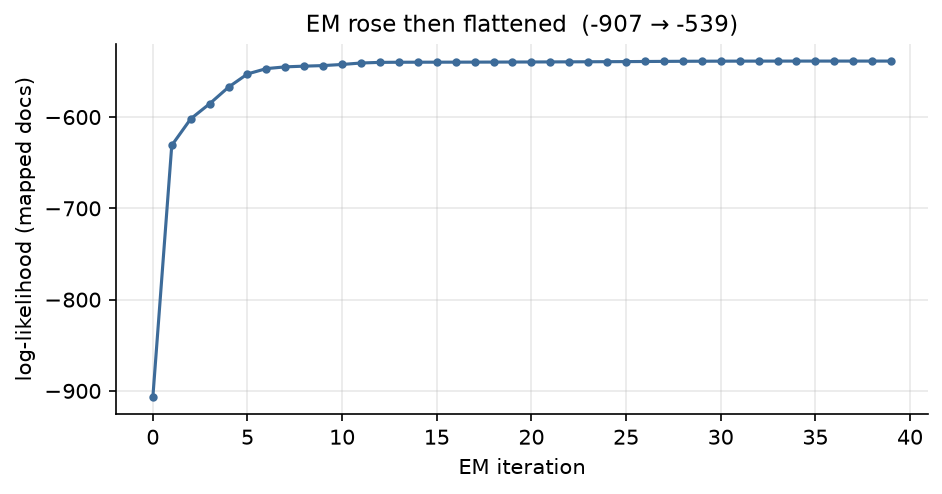

이번 실행: loglik **-907 → -539**, 단조 증가 후 평평. 구현은 버그로 안 보인다.

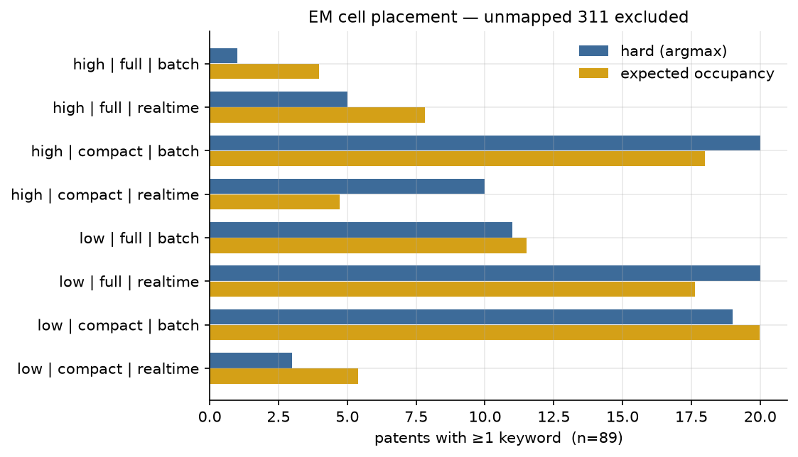

89건만. 하드가 많은 칸은 `low|compact|batch`, `low|full|realtime`, `high|compact|batch`. 한 칸에 400이 몰리지 않았다 (빈 문서를 하드에서 뺐기 때문).

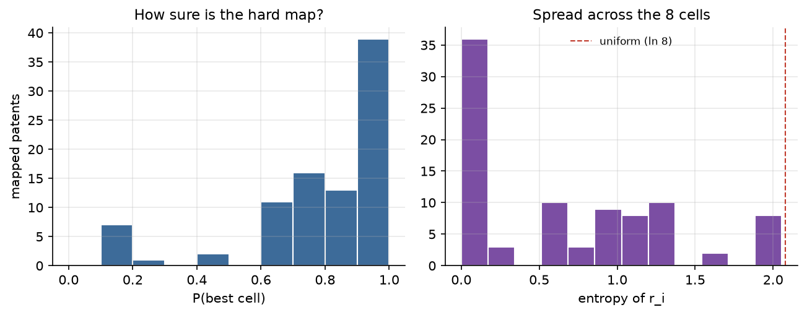

P(최선 칸) ≥ 0.9 인 행 39건, < 0.4 인 행 8건. 후자가 “여러 셀에 걸친 특허”다.

## 03 MCMC

| 파일 | 무엇인가 | 기대 |
|---|---|---|
| `03_admixture_q.csv` | 특허별 원천 비중 q | 토큰 있는 행만 해석 |
| `03_admixture_phi.csv` | 원천별 문구 분포 | power 원천에 에너지 문구가 남아 있는지 |
| `03_admixture_trace.csv` | 체인 요약 | burn-in 이후 횡보 |
| `03_constraint_posterior.csv` | 가설 쌍의 Beta 사후 | `n_both` 와 `P(rate<0.01)` |
| `03_feasible_samples.csv` | 가능 셀 드로우 | 금지 켜짐/꺼짐 |
| `03_cell_sample_freq.csv` | 셀 빈도 | 제약 반영 경험적 분포 |

제약 표 읽기:

- `n_both` 큼 → 그 쌍은 데이터에 자주 같이 나온다 → 금지 확률 낮음.
- `n_both` 0 이어도 “불가능”이 아님. 사전이 둘 다 못 잡았을 수 있다.

혼합 표 읽기:

- `n_tokens=0` 이면 q ≈ (1/3, 1/3, 1/3). 정보 없음.
- `top_origin` 은 셀 이름이 아니다.

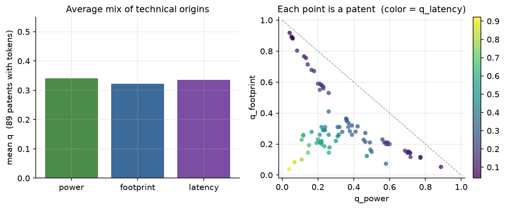

이번 실행: 평균 q는 세 원천이 약 1/3. 문헌별로는 갈린다 (`top_origin` power 36 / latency 32 / footprint 21).

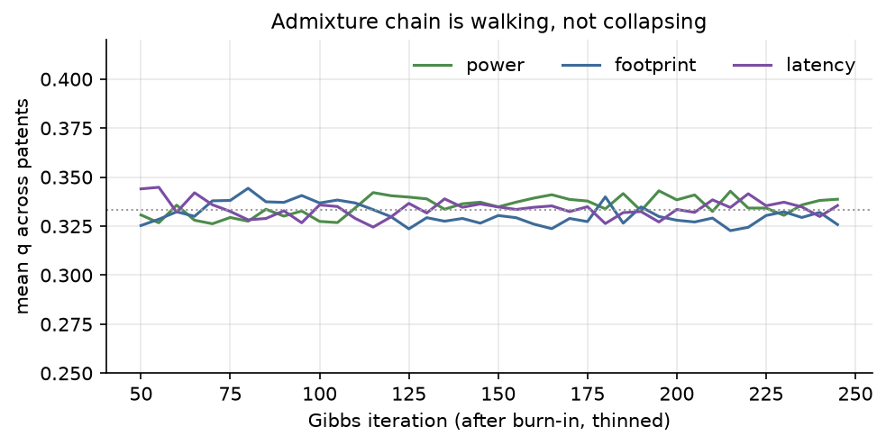

burn-in 이후 횡보. 한 원천 붕괴는 없다.

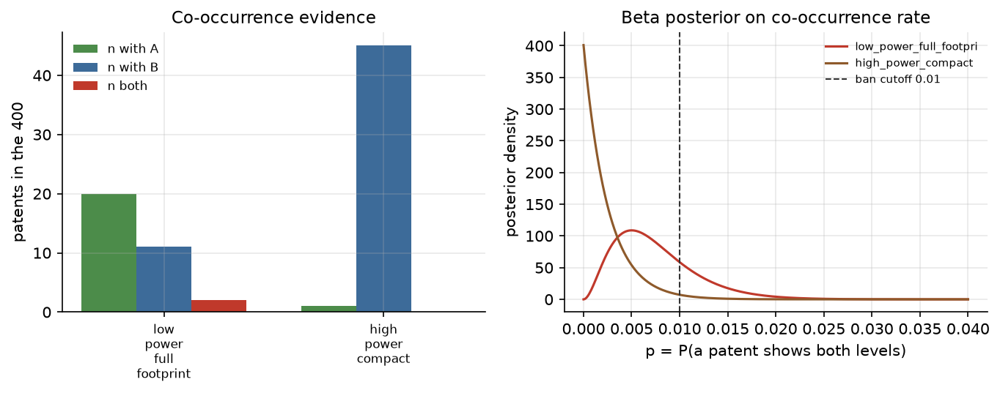

`high×compact` 공출현 0, 그러나 high 자체가 1건. 금지 확률 0.98은 **표본 부족**에 가깝다. `low×full`은 둘 다 2건, 사후가 컷 0.01을 걸친다.

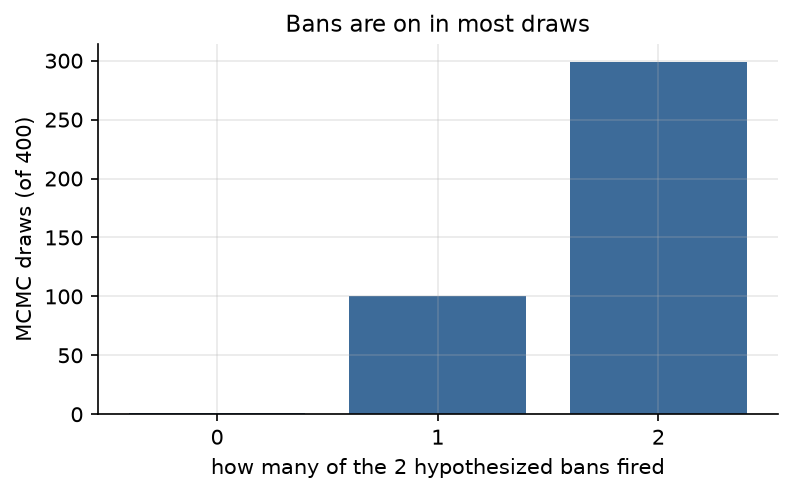

400 드로우 중 금지 2개 켜짐 299, 1개 100, 0개 1.

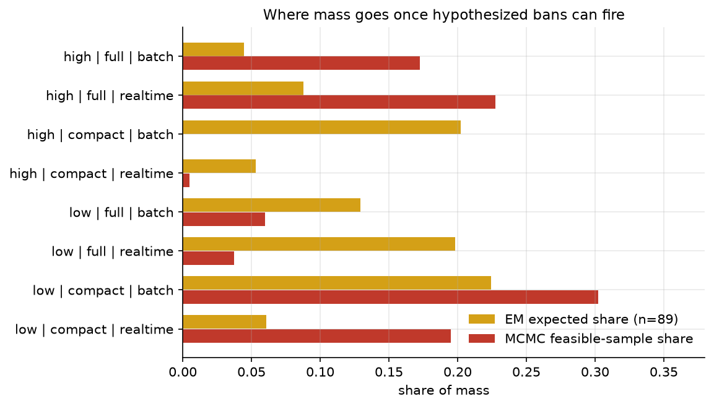

MCMC가 `high|compact|*` 를 거의 지우고 `low|compact`·`high|full` 로 질량을 민다. 미래 시나리오가 아니라, 가설 금지가 자주 켜진 결과다.

## 04 품질

| 파일 | 무엇인가 | 기대 |
|---|---|---|
| `04_quality.csv` | 세 소스의 Coverage/Balance/Diversity | 옆줄끼리 비교 |
| `04_missing_species.csv` | Chao1, Good-Turing | 지문 공간의 미관측 |
| `04_report.txt` | ASCII 한 장 | 먼저 이 파일 |

세 줄 비교가 이 골격의 최소 검증이다.

```
em_hard_nonempty              거친 점유 (89건)
em_expected_nonempty          소프트 점유 — 주결과
em_expected_all_incl_empty    빈 문서 균등 포함 — Balance가 가짜로 1에 가까움
mcmc_feasible_samples         제약 불확실성까지 넣은 점유
```

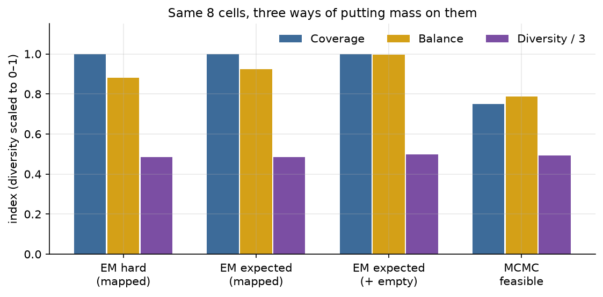

이번 실행: 주결과 Coverage=1, Balance=0.92 (89건). 빈 문서를 넣으면 Balance≈0.996 — 해석하지 않는다. MCMC Coverage=0.75는 `high|compact` 두 칸이 샘플에서 죽은 것.

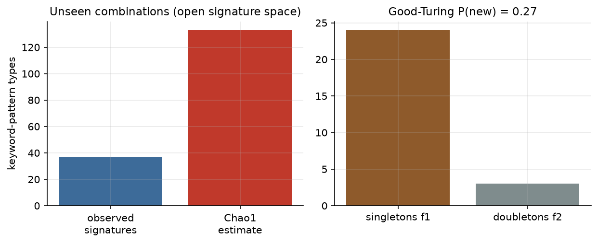

지문 37종, Chao1≈133, P(new)≈0.27. “키워드 조합을 400건이 다 못 봤다.” 셀 gap 133개가 아니다.

## 최소 합격 기준 (이 폴더)

다음이면 골격은 돈 것이다.

- `patents.csv` 400행
- EM loglik 이 첫 값보다 마지막 값이 큼
- occupancy 8행. 해석할 합은 `expected_occupancy_nonempty` ≈ 89. 빈 문서 포함 합 400은 균등 질량일 뿐
- constraint 표에 `n_both` 가 숫자로 있음
- `04_report.txt` 가 세 소스 지표를 인쇄

다음이면 해석을 보류한다.

- 키워드 히트 문서가 너무 적음 (사전 불일치)
- 빈 문서 때문에 coverage ≈ 1
- admixture trace 가 한 원천으로 흡수 (붕괴)
