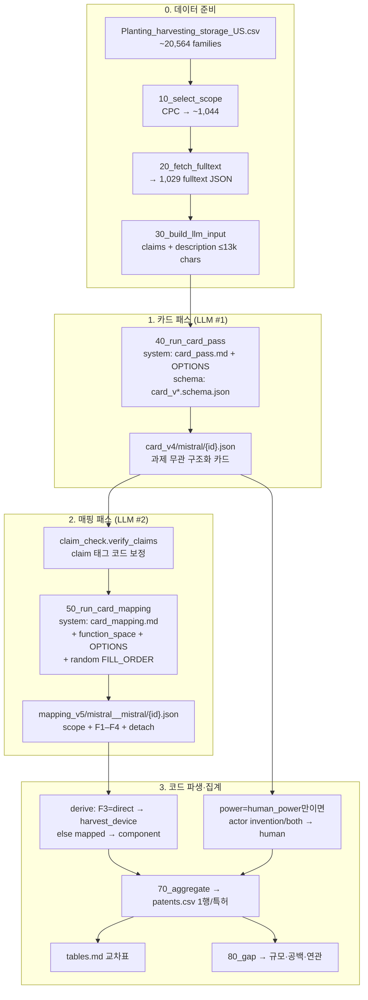
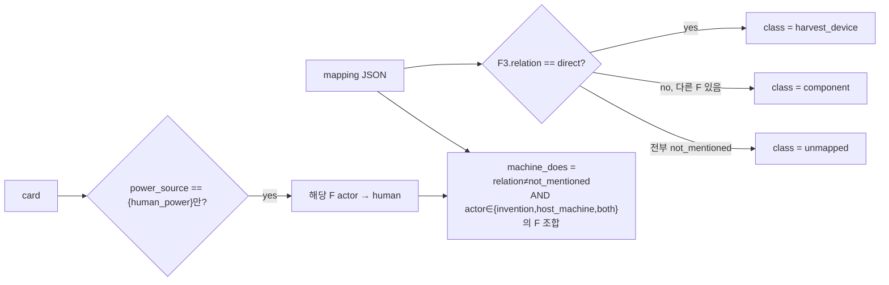

# 과일·채소 수확 매핑 파이프라인 (전체 흐름)

이 문서만으로 **입력 → LLM 카드 → LLM 매핑 → 코드 파생·집계**까지 이해할 수 있게 정리했다.  
실행 명령·경로 세부는 [`README.md`](README.md), 선택지 한글 정의는 [`prompts/v5/labels_v5_ko.md`](prompts/v5/labels_v5_ko.md), 알려진 편향은 [`known_issues.md`](known_issues.md).

**현재 전체 런 기준:** 카드 = `card_v4`(내용상 v5 카드와 동일) · 매핑 = `mapping_v5` · 모델 = Mistral · N = 1,029건.

---

## 0. 한눈에 보는 전체 파이프라인

| 단계 | 스크립트 | 누가 | 핵심 산출 |
|---|---|---|---|
| 범위·본문 | `10`–`30` | 코드 | `scope.csv`, `fulltext/`, LLM 입력 |
| 카드 | `40_run_card_pass` | LLM | 과제 무관 특허 카드 |
| 청구항 보정 | `claim_check` | 코드 | 매핑에 넘길 `card_used` |
| 매핑 | `50_run_card_mapping` | LLM | scope, F1–F4, 분리 원리 |
| 점검 | `60_check_output` | 코드 | 인용·구조·구분 파생 |
| 집계 | `70_aggregate` | 코드 | `patents.csv`, `tables.md` |
| 공백 | `80_gap` | 코드 | `gap.md` (규모·저개발·사다리) |

산출 루트: `05_data/agri/fv_harvest/llm_output/` (Git 제외).

---

## 1. 카드 패스 — 입력 / 지시 / 출력

**목적:** 연구 질문(F1–F4)과 무관하게, 특허가 *무엇을 하는 발명인지*를 고정 양식으로 기록한다. 이후 여러 분석에 재사용한다.

**입력:** 제목 + 독립청구항(`[C1]`…) + 본문(`[P0001]`…), 합쳐 최대 약 13,000자.  
**넣지 않는 것:** 초록, 종속항, **기능공간(F1–F4)**.

**시스템 프롬프트:** `prompts/v5/card_pass.md` + `{{OPTIONS}}`(`labels_v5.json`)  
**스키마:** `card_v5.schema.json` (실제 런은 `card_v4` 폴더; 카드 본문·동사 enum은 v5와 동일)

**출력 JSON 주요 필드:**  
`subject`, `host_machine`, `functions[]`, `components[]`, `problems[]`, `effects[]`, `target_objects`, `target_categories`, `form_factor`, `power_source`, `operating_environment`, `infrastructure_requirements`, `host_dependency`

### 동사 표준화 — 있음

`card_pass.md` 본문에는 동사 목록이 없고, 실행 시 `labels_*.json`의 **Hirtz et al. (2002) 축약 동사 45개**가 OPTIONS로 붙으며 스키마 `enum`으로도 강제된다. 맞는 하위 동사가 있으면 상위 일반 동사 대신 하위를 쓴다. 전체 목록·한글 의미는 [`labels_v5_ko.md`](prompts/v5/labels_v5_ko.md) §2.

### 카드에서 고르는 주요 선택지 (요약)

| 필드 | 허용값 (개요) |
|---|---|
| `subject.type` | apparatus / method / system / apparatus_and_method / other |
| `functions.verb` | 45개 Hirtz 동사 |
| `functions.flow` | material · energy · signal |
| `functions.actor` | invention · host_machine · human · both · not_specified (동력원 기준) |
| `functions.role` | main · auxiliary |
| `functions.claim` | `[C#]` 또는 `none` |
| `statement.type` | 노동·손상·처리량·정밀도·안전·신뢰성·적응성·에너지·other |
| `target_categories` | 나무과일·덩굴과일·열매채소·잎채소·뿌리… 등 13종 |
| `form_factor` | 손도구·밀고끄는·플랫폼·트랙터·자주식·로봇·고정·부품·불명 |
| `power_source` | 인력·배터리·내연·PTO/유압·계통·공압·other·불명 |
| 기타 | 환경·인프라·host_dependency → [`labels_v5_ko.md`](prompts/v5/labels_v5_ko.md) |

각 function: `id, verb, object(≤5단어), flow, actor, means, claim, role, evidence(인용 1개)`.

### 카드 단계 규칙 (요지)

- 독립청구항 = 발명 경계, 본문 = 부품이 하는 일·이유.
- 호스트 기계(수확기·트랙터 등)의 부품·동작은 발명의 구성요소가 아님. 그 동작의 actor는 `host_machine`.
- 배경기술의 선행 장치 동작은 코딩하지 않음. 발명이 극복한다고 한 문제는 `problems`에 기록.
- 문장에 없는 것은 추론하지 않음. evidence는 원문 5–20단어 인용.

---

## 2. 매핑 패스 — 입력 / 지시 / 출력

**목적:** 저장된 카드만으로 과제 기능공간(F0–F4)에 대응시킨다. 전문은 다시 읽지 않는다.

**매핑 직전 코드:** `claim_check.verify_claims` — 모델이 붙인 claim 태그를 원문 독립청구항과 대조해 보정. 보정 내역은 `claim_fixes`, 실제 입력 카드는 `card_used`.

**시스템 프롬프트:** `card_mapping.md` + `function_space_fv_harvest.md` + OPTIONS + **특허마다 무작위 `FILL_ORDER`**  
**스키마:** `mapping_fv_harvest_v5.schema.json`

**출력:** `scope`, `functions.F1`–`F4`, `detachment_principle`, `overall_confidence`, `note`  
기록 메타: `fill_order`, `card_version`, `card_run`

### 기능공간 (F0–F4)

| ID | 이름 | 하는 일 | 흐름 |
|---|---|---|---|
| F0 | 기계적 수확 | 상위 기능 | — |
| F1 | 수확 대상 식별 | 위치·상태(성숙·크기 등) 판별 | signal |
| F2 | 수확 위치 조정 | 분리부를 대상에 옮기거나 유지 | energy |
| F3 | 작물 분리·채취 | 식물·토양에서 분리 | material+energy |
| F4 | 수확물 수집·이송 | 모아 담거나 옮김 | material |

typical verbs는 힌트일 뿐; **동작이 작물·기구에 무엇을 하는가**로 판정.

### 각 하위 기능에 채우는 순서

1. `card_functions` — 해당 하위 기능을 수행하는 카드 function `id`들 (의미로 매칭, id 순서 아님)
2. `relation` — 청구항 발명의 역할
3. `actor` — 수행 주체 (연결 카드에서)
4. `evidence` — 연결 카드 인용 복사 (새로 쓰지 않음)

### `relation` (핵심)

| 값 | 의미 |
|---|---|
| `direct` | 연결 카드 기능의 `claim` ≠ `none`이고, **청구항 부품이 그 동작을 수행**. 손도구(칼날·훅·자루)도 포함 |
| `support` | 청구항 부품이 동작 자체는 안 하고, 사람/호스트가 하게 **도움** (장대·플랫폼 등) |
| `not_mentioned` | 그 외. 연결 기능이 전부 `claim=none`(호스트·사람·설명만)인 경우 포함 |

불확실하면 약한 쪽: support ≺ direct, not_mentioned ≺ support.

### v5 매핑에서 특히 강조하는 것

- 카드 `id`는 중요도·F번호가 **아님**. id=1을 F1 기본값으로 쓰지 말 것.
- 채움 순서 `FILL_ORDER`는 호출마다 무작위(위치 편향 완화).
- **F1:** sense/detect/measure/track/process처럼 위치·상태를 읽는 동작만. 모터·이동·절단·진동·수집은 F1이 아님. 없으면 `not_mentioned`가 정상.

### 매핑 쪽 기타 enum

| 필드 | 허용값 |
|---|---|
| `subfunction.actor` | invention · host_machine · human · both · not_specified |
| `scope.category` | fruit_or_vegetable_harvest · industrial_crop · grain_forage_or_grass · tree_nut_only · non_harvest_task · post_harvest_handling · unclear |
| `detachment_principle` | cutting · twisting · pulling · shaking_or_vibration · suction_or_pneumatic · digging_or_lifting · combing_or_stripping · other · not_specified · not_applicable |
| `overall_confidence` | high · medium · low |

`detachment_principle`: F3가 direct/support일 때만 원리 선택. F3가 not_mentioned이면 `not_applicable`만.

---

## 3. 코드가 만드는 파생 변수 → 집계

LLM에게 묻지 않고 `60_check_output.derive` / `70_aggregate` / `80_gap`이 계산한다.

### 파생 규칙

| 변수 | 규칙 |
|---|---|
| `class` | F3.`relation`==`direct` → `harvest_device`; 그 외 F가 하나라도 매핑됨 → `component`; 전부 not_mentioned → `unmapped` |
| `machine_does` (분업 방식) | relation≠not_mentioned **그리고** actor∈{invention, host_machine, both}인 F들의 조합. 예: `F1–F4`, `F2·F3·F4`, `기계 없음` |
| `human_does` | 위와 같되 actor==human |
| `actor_fixed` | 카드 동력이 `human_power`만인데 LLM이 invention/both로 적은 경우 → human으로 고침 |
| `crop_group` | 카드 `target_categories`가 아니라 `crop_groups.assign(대상이름, 본문)` 코드 사전. 여러 값이면 구체값 중 첫 값 |
| `detach` | 매핑 `detachment_principle.values`의 첫 구체 값 |
| 장치 규모 (`80_gap`만) | 아래 표 |

**장치 규모 (`80_gap.scale`)**

| 규모 | 규칙 |
|---|---|
| 대규모형 | form ∈ {트랙터부착, 자주식, 고정} **또는** power에 `tractor_pto_or_hydraulics` |
| 소농형 | form ∈ {손도구, 밀고끄는} (위 대규모 조건이 아닐 때) |
| 이동 로봇 / 작업자 플랫폼 | form 그대로 |
| 불명 | 그 외 |

### `70_aggregate` → `tables.md`

1. 매핑+카드(+scope.csv, fulltext) → **`patents.csv` 1행/특허**
2. `in_scope` = scope가 `fruit_or_vegetable_harvest`
3. 표:

| 표 | 모집단 | 내용 |
|---|---|---|
| 0 범위 | 전체 | scope 빈도 |
| 1 F 관계 | 범위 안 | F별 direct/support/not_mentioned + **기계 수행** 건수 |
| 2 장치/부품 | 범위 안 | class 빈도 |
| 3 분업 방식 | 수확 장치만 | machine_does 빈도 |
| 4-1~4-4 | 수확 장치 | 분업×작물군 / ×분리원리 / 작물군×원리 / 분업×형태 |
| 5 CPC | 범위 안 | CPC(explode)×class·작물군 (CPC는 LLM 아님, 대조용) |

**기계 수행:** relation≠not_mentioned ∧ actor∈기계.

### `80_gap` (집계 다음)

분업×속성 연관(크래머 V), 규모별 F 기계수행 비율, 저개발·사다리·규모 공백 → `gap.md`.

---

## 4. 산출물 위치 (현재 런)

| 종류 | 경로 |
|---|---|
| 카드 | `…/llm_output/card_v4/mistral/` |
| 매핑 | `…/llm_output/mapping_fv_harvest_v5/mistral__mistral/` |
| 집계 | `…/llm_output/aggregate_v5_mistral__mistral/tables.md`, `patents.csv` |
| 공백 | `…/llm_output/gap_v5_mistral__mistral/gap.md` |
| 표본 검증 | `…/llm_output/validate_v5_mistral__mistral/` |

`…` = `05_data/agri/fv_harvest`

---

## 5. 관련 문서

| 문서 | 내용 |
|---|---|
| [`README.md`](README.md) | 실행 순서, CPC 범위, 모델 문맥, 아직 할 일 |
| [`prompts/v5/labels_v5_ko.md`](prompts/v5/labels_v5_ko.md) | 17개 분류의 허용값·한글 의미 전체 |
| [`prompts/v5/card_pass.md`](prompts/v5/card_pass.md) | 카드 시스템 프롬프트 |
| [`prompts/v5/card_mapping.md`](prompts/v5/card_mapping.md) | 매핑 시스템 프롬프트 |
| [`prompts/v5/function_space_fv_harvest.md`](prompts/v5/function_space_fv_harvest.md) | F0–F4 정의·예시 |
| [`known_issues.md`](known_issues.md) | F1 순서 편향 등 |
| `01_paper/2026-winter/method.md` | 논문용 방법·기회공간 논리 |
