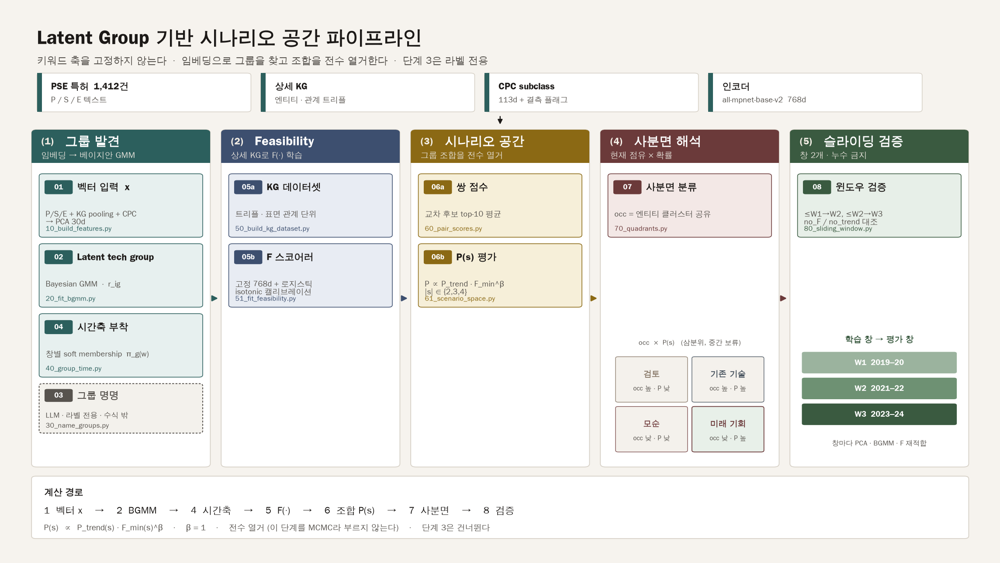

# scenario_pipeline — Latent Group 기반 시나리오 공간 파이프라인

> 상태: **단계 1–8 실행됨** (2026-09-03). 단계 8은 돌아갔으나 표본이 주장을 못 받침. 다음은 그룹 접힘 민감도와 표시 그래프 다양성.
> **이어 작업하는 에이전트는 `docs/04_run_status.md`를 먼저 읽는다.**
> 입력 데이터: `data/pse_knowlege_graph_modifiy/` (1,412건) + `data/knowlege_graph_entity_relation/`
> 실행 환경: conda `scenario-space`
> 한 장 계약: `docs/03_locked_spec.md`

키워드 사전으로 축·수준을 고정하지 않는다. 대신
**(1) 임베딩 → 베이지안 GMM으로 latent group 발견 → (2) 상세 KG로 feasibility 모델 학습 → (3) 그룹 조합으로 미래 시나리오 공간 생성 → (4) 사분면 해석 → (5) 슬라이딩 윈도우 검증** 순서로 간다.



기존 `em_mcmc/`(키워드·다항 EM 골격)와 `pilot_federated_learning/`(정규식 축)은 건드리지 않는다. 이 폴더는 별도 트랙이다.

## 1. 8단계와 스크립트 대응

| 단계 | 내용 | 스크립트 | 산출물 |
|---|---|---|---|
| 1 | 벡터 입력 $x$ 구성 (P/S/E 텍스트 + KG pooling + CPC + 차원축소) | `10_build_features.py` | `out/10_x.npy`, `out/10_index.csv` |
| 2 | 베이지안 GMM으로 latent tech group 발견 | `20_fit_bgmm.py` | `out/20_resp.npy`, `out/20_groups.csv` |
| 3 | LLM으로 그룹 명명 (대표 특허 기반) | `30_name_groups.py` | `out/30_group_names.csv`, `out/30_llm_log.jsonl` |
| 4 | 시간축 부착 (연/창 단위 soft membership) | `40_group_time.py` | `out/40_group_time.csv` |
| 5 | 상세 KG feasibility 모델 $F(\cdot)$ 학습·캘리브레이션 | `50_build_kg_dataset.py`, `51_fit_feasibility.py` | `out/50_triples.csv`, `out/51_model.npz`, `out/51_eval.json` |
| 6 | 그룹 조합 시나리오 공간 생성·확률 평가 | `60_pair_scores.py` **완료**, `61_scenario_space.py` **완료** | `out/60_pair_scores.csv`, `out/61_scenarios.csv` |
| 7 | 사분면 분류 (기존기술 / 모순 / 기회 / 검토) | `70_quadrants.py` **완료** | `out/70_quadrants.csv` |
| 8 | 슬라이딩 윈도우 검증 | `80_sliding_window.py` **완료** | `out/80_window_metrics.csv` |

단계 3은 수식에 영향이 없다(라벨 전용). 단계 1→2→4→5→6→7→8 이 계산 경로다. 진행 현황·다음 작업·금지사항은 `docs/04_run_status.md`.

## 2. 실행

### 환경 (2026-09-02 재검증)

```bash
conda activate scenario-space
pip install -r requirements.txt      # 이미 설치됨
```

| 항목 | 상태 |
|---|---|
| 인코더 | `all-mpnet-base-v2` 768d, GPU 로드·인코딩 검증 완료 |
| 실행 장치 | **GPU (RTX 4060)** — `torch==2.11.0+cu128`, 드라이버 CUDA 12.9 (576.88) |
| 인코딩 비용 | 1회만 수행하고 `out/10_blocks.npz`에 캐시. CPU 추정은 7,060개 약 7분 |
| **import 순서** | 스크립트는 `scipy` / `sklearn` 을 `torch` 보다 먼저 import 한다. 2.13.0+cu130 에서 보이던 `CXXABI_1.3.15` 충돌은 2.11.0+cu128 에서 재현되지 않음 |

`torch` 2.13.0은 cu128 휠이 없어 드라이버 12.9와 맞지 않았다. GPU를 다시 맞출 때는 `pip install --force-reinstall torch==2.11.0 --index-url https://download.pytorch.org/whl/cu128`.

### 파이프라인

```bash
cd /mnt/e/Scenario-Space-Construct/scenario_pipeline

python 10_build_features.py      # 단계 1
python 20_fit_bgmm.py            # 단계 2
python 30_name_groups.py         # 단계 3 (라벨 전용, Ollama mistral)
python 40_group_time.py          # 단계 4
python 50_build_kg_dataset.py    # 단계 5-a
python 51_fit_feasibility.py     # 단계 5-b
python 60_pair_scores.py         # 단계 6-a  (완료, 재현만)
python 61_scenario_space.py      # 단계 6-b  (완료, 재현만)
python 70_quadrants.py           # 단계 7    (완료, 재현만)
python 71_quadrant_kg.py         # 표시 KG   (완료, 점수 경로 아님)
python 80_sliding_window.py      # 단계 8    (완료, 재현만. 본결과 덮기 전에 04 읽을 것)
```

모든 파라미터는 `config.py` 한 곳에만 둔다. 스크립트 안에 숫자를 박지 않는다.

## 3. 디렉터리

```
scenario_pipeline/
├── README.md               # 이 파일
├── config.py               # 모든 결정값·경로·시드
├── docs/
│   ├── 00_data_facts.md    # 실측 데이터 사실 (모든 결정의 근거)
│   ├── 01_open_decisions.md# D1–D16 결정 로그 (닫힘)
│   ├── 02_stage_specs.md   # 단계별 입출력 계약·수식·검증 게이트
│   ├── 03_locked_spec.md   # 구현용 한 장 계약
│   └── 04_run_status.md    # 실행 상태·다음 에이전트 핸드오프 (여기부터)
├── out/                    # 표·모델 (단계 스크립트가 생성)
├── figures/                # 단계 스크립트가 만드는 그림
└── analysis/               # 결과 해석·논문용. 계산 경로에 들어가지 않음
    ├── README.md
    └── a20_soft_membership.py
```

## 4. 읽을 순서

**코드를 이어 짤 때:** `docs/04_run_status.md` → `config.py` → `02_stage_specs.md`의 다음 단계.

계약·근거를 볼 때:

1. `docs/03_locked_spec.md` — 구현 계약 (수식·단위·게이트만).
2. `docs/00_data_facts.md` — 1,412건의 실제 크기·시간 분포·KG 희소성.
3. `docs/01_open_decisions.md` — 왜 이 값인지, 원안과 어디서 갈라졌는지.
4. `docs/02_stage_specs.md` — 파일·컬럼·게이트 상세.

### 결정 상태 (2026-08-29 잠금, 2026-09-02 PoC 주석)

| 확정 | 값 |
|---|---|
| D1 | 현재 점유 = 엔티티 클러스터 공유 (단계 7). 6-a 후보 단위와 다름 |
| D4 | `all-mpnet-base-v2` 768d (**GPU**, 캐시 `out/10_blocks.npz`) |
| D8 | 고정 임베딩 + 로지스틱. PoC PR-AUC 0.29 → **관측 유사도**. relation 개선은 후속 |
| D10 | 쌍 top-10 평균, $F_{\min}$ 기본, isotonic |
| D11 | $\lvert s\rvert\in\{2,3,4\}$, 크기별 분리 |
| D12 | $P_{\mathrm{trend}}$ = 마지막 창 Dirichlet 스무딩 독립곱 |
| D13 | 전수 열거. 이 단계를 MCMC라 부르지 않는다 |
| D14 | PoC: 표면 엔티티 lift. **`entity_mapping` 정수 0–129를 클러스터로 쓰지 않음** |

D2·D3·D5·D6·D9·D15·D16은 2026-08-29 권고안을 그대로 잠갔다. D7(LLM 명명)만 계산 경로 밖.

## 5. 이 파이프라인이 원 설계와 다른 지점 (근거는 `00_data_facts.md`)

| 원안 | 실측 근거 | 조정 |
|---|---|---|
| K_max 30 | N=1,412 → diag 공분산 30차원에서 유효 K는 약 12 이하 | K_max=30은 DP 절삭용으로 유지, 유효 K 8~15 기대 |
| 연도별 membership 표 | filing 기준 2018년 이전이 55건(3.9%) | 시간축은 2019–2024, 2년 창 3개 |
| 상세 KG로 KGE 처음부터 학습 | v2 표면 엔티티 20,277종 중 70.7%가 1회 | 임베딩은 **기존 768d 고정**, 스코어러만 학습 |
| head/relation/tail 교체 negative | 50개 표준 관계 버킷에 `requires`와 `prevents`가 같이 들어감 | 관계 교체는 표면 관계(2,634종) 수준에서만 |
| MCMC로 조합 탐색 | K=15, 조합 크기 ≤4면 전체 후보 1,925개 | **전수 열거로 확정.** 이 단계를 MCMC라 부르지 않는다 (D13) |
| "현재 흔함 / 희귀"를 특허 단위로 셈 | GMM membership은 특허당 합=1이고 뾰족함 → 조합의 곱이 0으로 붕괴 | 현재 점유는 **엔티티 클러스터 공유**로 정의 (D1) |
