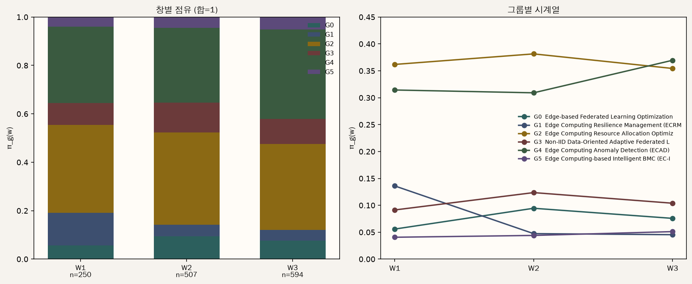
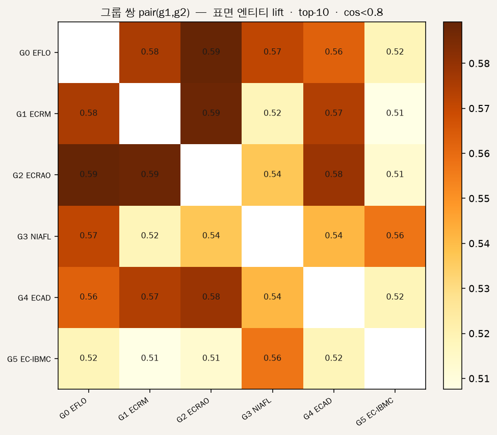
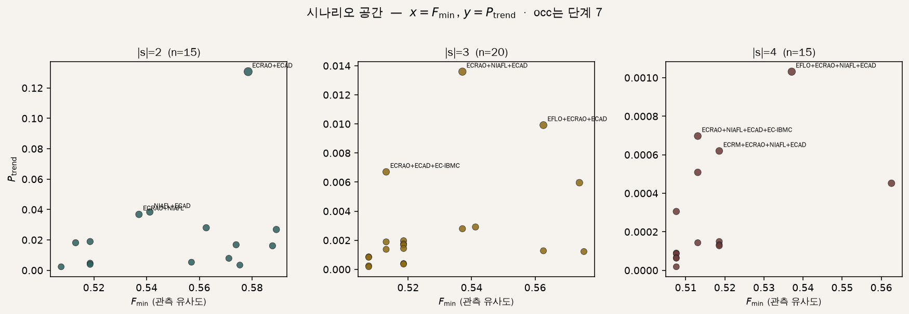
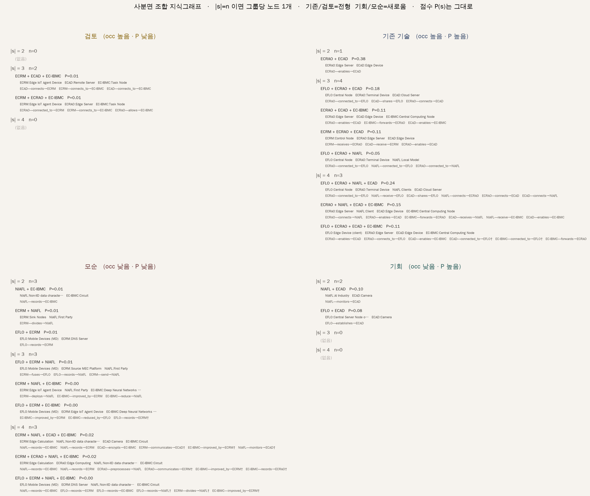
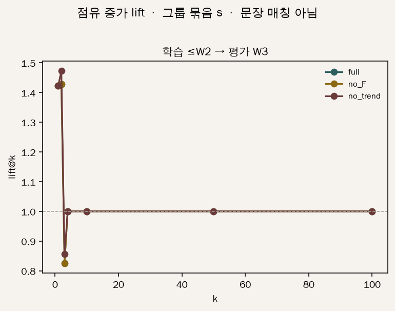

# 특허 기반 기술 시나리오 공간 — 목적 · 절차 · 주요 결과

> 파일럿 코퍼스: Edge AI 관련 특허 **1,412건** (출원 기준 주로 2019–2024)
> 산출 기준: `04_src/scenario_pipeline/` 1–8단계 실행 결과 (2026-09)

키워드 사전으로 기술 축을 미리 정하지 않습니다. 특허를 벡터로 놓고 **잠재 기술 그룹**을 찾은 뒤, 그룹 조합을 시나리오로 펼쳐 **이미 같이 쓰이는 조합**과 **앞으로 결합될 법한 조합**을 구분합니다.

---

## 1. 연구 목적

특허에서 기술 요소를 뽑아 조합 공간을 만들 때, 빈 칸을 모두 "기회"로 읽으면 안 됩니다. 같이 쓰기 어려운 **모순**과, 아직 안 쓰였지만 양립 가능한 **기회**를 나눠야 합니다.

본 연구는 두 축으로 시나리오를 4분면에 올립니다.

| 축 | 의미 |
|---|---|
| **결합 가능성 P** | 앞으로 같이 쓰일 법한 정도 (추세 × 지식그래프 결합 점수) |
| **현재 점유도 occ** | 지금 이미 같은 기술 요소를 공유하는 정도 |

| 칸 | P | occ | 읽는 법 |
|---|---|---|---|
| 기존 기술 | 높음 | 높음 | 이미 성숙한 조합 |
| **미래 기회** | 높음 | 낮음 | 아직 드문데 결합될 법함 |
| 모순 | 낮음 | 낮음 | 드물고 결합도 잘 안 맞음 |
| 검토 | 낮음 | 높음 | 실제로는 같이 쓰이는데 모형은 낮게 봄 |

---

## 2. 전체 절차

한 줄 흐름:

**특허(PSE + 지식그래프 + CPC) → 임베딩 → 베이지안 GMM(그룹) → 결합 점수 학습 → 그룹 조합 시나리오 → 4분면 → 시간창 검증**


| 단계 | 무엇을 하는가 | 산출물 |
|---|---|---|
| 입력 | 특허를 문제–해결–효과(PSE)와 상세 지식그래프로 구조화 | `05_data/pse_knowlege_graph_modifiy/` |
| ① 임베딩 | 텍스트·그래프·분류코드를 한 벡터로 합침 | 특허당 30차원 벡터 |
| ② 베이지안 GMM | 비슷한 특허끼리 **잠재 기술 그룹** 발견 | 유효 그룹 **6개** |
| ③ 그룹 명명 | LLM이 대표 특허를 읽고 이름만 붙임 (계산에는 안 들어감) | 아래 그룹 표 |
| ④ 시간축 | 출원 시점 창별 그룹 비중 | 시계열 그림 |
| ⑤ 결합 모형 | 상세 지식그래프로 "이 요소들이 같이 쓰일 법한가" 학습 | 그룹 쌍 점수 히트맵 |
| ⑥ 시나리오 공간 | 그룹 2·3·4개 조합을 전수 열거하고 확률 P(s) 부여 | 시나리오 **50개** |
| ⑦ 4분면 | P × occ로 칸 배치 | 사분면 산점도 |
| ⑧ 검증 | 과거 창으로 공간을 만들고 이후 창에서 점유가 오르는지 확인 | 슬라이딩 윈도우 곡선 |

---

## 3. 입력: PSE와 상세 지식그래프

한 특허는 두 층으로 표현됩니다.

- **PSE:** 문제 / 해결(기능·구조·구현) / 효과 — 자연어 5칸
- **상세 지식그래프(v2):** `(머리말) —관계→ (꼬리말)` 트리플. 코퍼스 전체 **약 2.1만** 개, 특허당 중위 **14**개

예시 (`US20230048920A1`, 연합학습 엔진):

| 층 | 내용 |
|---|---|
| 문제 | 사용자 환경마다 데이터가 적어 분산·연합학습이 비효율적이다 |
| 효과 | 분산 데이터와 계산 자원을 써서 모델 성능이 개선된다 |
| 그래프 예 1 | `Central Aggregator —controls→ Global Model Distribution` |
| 그래프 예 2 | `User Environment —provides→ Local Data` |
| 그래프 예 3 | `Mini Model —processes→ Local Data` |

이 그래프가 이후 **결합 가능성**을 배우는 재료입니다. 엔티티는 130개 표준 클러스터로도 접혀, 4분면의 현재 점유(occ)를 잴 때 씁니다.

---

## 4. 임베딩과 베이지안 그룹

### 임베딩

특허 하나 = 세 블록을 붙인 뒤 **30차원**으로 축소한 점.

| 블록 | 내용 | 역할 |
|---|---|---|
| 텍스트 | PSE 5칸을 `all-mpnet-base-v2` (768차원)로 인코딩 | 문제·해결·효과의 의미 |
| 지식그래프 | 트리플 벡터를 특허 단위로 평균 | 부품·관계 구조 |
| CPC | 서브클래스(113종) | 기술 분류 |

비슷한 특허는 가까운 점이 됩니다. 이 점구름에서 그룹을 찾습니다.

### 베이지안 GMM (잠재 기술 그룹)

그룹 수를 미리 6으로 정한 것이 아닙니다. 최대 30개 성분을 두고, 특허가 거의 붙지 않은 성분은 버린 결과 **유효 그룹 6개**가 남았습니다. 각 특허는 그룹별 소속 확률을 가지며, 가장 큰 확률로 "이 그룹 소속"으로 세면 아래와 같습니다.

시드만 바꿔도 군집이 크게 흔들리지 않는지(ARI 중위 **0.81**)를 확인했습니다.

### LLM 그룹 이름 (해석용)

이름은 계산에 들어가지 않습니다. 그룹 중심 근처의 대표 특허를 LLM이 읽고 붙인 라벨입니다.

| ID | 이름 | 한 줄 | 특허 수 | 비중 |
|---|---|---|---:|---:|
| G0 | 엣지 연합학습 최적화 (EFLO) | 엣지 기기에서 연합학습을 효율화 | 108 | 7.6% |
| G1 | 엣지 복원력 관리 (ECRM) | 엣지 환경의 서비스 연속성·복원 | 91 | 6.4% |
| G2 | 엣지 자원할당 최적화 (ECRAO) | 자원·대역·워크로드 배분 | **516** | **37%** |
| G3 | 비IID 적응 연합학습 (NIAFL) | 데이터 분포가 다른 환경의 연합학습 | 149 | 10.6% |
| G4 | 엣지 이상탐지 (ECAD) | 분산 IoT·시계열 이상 탐지 | **484** | **34%** |
| G5 | 지능형 BMC (EC-IBMC) | 서버 장애 탐지·복구·예측 | 64 | 4.5% |

큰 두 덩어리는 **자원할당(G2)** 과 **이상탐지(G4)** 입니다.

### 시간축

출원일을 2년 창 세 개로 나눕니다. W1=2019–20 (250건), W2=2021–22 (507건), W3=2023–24 (594건).



W3 기준 비중이 큰 그룹은 G4(이상탐지, 약 37%)와 G2(자원할당, 약 35%)입니다. G1(복원력)은 창이 지날수록 비중이 줄어듭니다. 이 창별 비중이 시나리오 확률의 **추세 항**이 됩니다.

---

## 5. 시나리오 공간과 확률 P(s)

그룹 하나를 시나리오라고 하지 않습니다. **그룹 여러 개가 같이 만드는 기술 묶음**이 시나리오입니다.

- 크기 2: 6개 중 2개 = 15개
- 크기 3: 6개 중 3개 = 20개
- 크기 4: 6개 중 4개 = 15개
- **합계 50개** (전수 열거)

각 시나리오 s의 확률은 대략

**P(s) ∝ P_trend × F_min**

- **P_trend**: 그 묶음에 들어 있는 그룹들의 최근 비중을 곱한 값 (추세)
- **F_min**: 그 묶음 안에서 가장 약한 그룹 쌍의 결합 점수 (지식그래프)

입니다. 결합 점수는 상세 지식그래프 트리플로 학습한 스코어러가, 두 그룹을 잇는 후보 관계의 상위 평균으로 줍니다.



지금 코퍼스에서 쌍 점수가 비교적 높은 쪽은 **EFLO–ECRAO**, **ECRM–ECRAO**, **ECRAO–ECAD** (연합학습·복원력·자원할당·이상탐지가 맞닿는 자리)입니다.



크기별로 따로 정규화하므로, "2개 묶음"과 "4개 묶음"을 한 순위로 섞지 않습니다. 현재 결과에서 크기별 1등은 다음과 같습니다.

| 크기 | 1등 시나리오 | P(s) (크기 안 비중) |
|---|---|---:|
| 2 | 자원할당 × 이상탐지 (G2+G4) | 0.38 |
| 3 | 자원할당 × 비IID 연합학습 × 이상탐지 (G2+G3+G4) | 0.24 |
| 4 | 연합학습 최적화 × 자원할당 × 비IID × 이상탐지 (G0+G2+G3+G4) | 0.24 |

큰 그룹(G2, G4)이 들어간 묶음이 추세 항 때문에 위로 올라가는 것은 자연스러운 현상입니다.

---

## 6. 4분면 결과

가로축에 가깝게 **현재 점유**, 세로에 **결합 확률**을 두고, 크기별로 상위/하위 1/3만 칸에 넣습니다. 중간 구간은 **보류**입니다. 네 칸을 억지로 채우지 않습니다. 아래 그림의 **점선**이 그 1/3 경계이고, 회색 띠는 중간 1/3입니다.


엔티티 공유로 잰 현재 결과 (50개 시나리오):

| 칸 | 개수 | 대표 예 |
|---|---:|---|
| 기존 기술 | 8 | **자원할당 × 이상탐지 (G2+G4)** — 이미 많이 겹치고, 앞으로도 같이 갈 법함 |
| **미래 기회** | **2** | **비IID 연합학습 × 이상탐지 (G3+G4)**, **연합학습 최적화 × 이상탐지 (G0+G4)** |
| 모순 | 9 | 복원력·연합학습·BMC처럼 점유도 낮고 결합 점수도 낮은 묶음 |
| 검토 | 2 | 실제 요소는 겹치는데 모형 점수는 낮은 묶음 → 예외 점검 |
| 보류 | 29 | 축 중 하나가 중간 구간 |

기회 칸이 두 개인 이유: "지금 드문데 점수는 높은" 자리는, 이 파일럿에서 **이상탐지(G4)와 연합학습 계열(G0, G3)의 쌍**에 해당합니다. 자원할당×이상탐지(G2+G4)는 이미 점유가 높아 **기존 기술**로 갑니다.

칸을 열면 그룹 사이를 잇는 지식그래프 다리를 볼 수 있습니다. 이 그림은 **해석용**이며, 확률 P(s) 자체를 바꾸지는 않습니다.



---

## 7. 시간으로 확인하기

과거 창의 특허만으로 그룹·확률·4분면을 다시 만든 뒤, 다음 창에서 그 묶음의 점유가 실제로 오르는지 봅니다.

- 학습 ≤ 2019–20 → 평가 2021–22
- 학습 ≤ 2021–22 → 평가 2023–24



현재 파일럿에서는 창을 자르면 유효 그룹이 크게 줄어 (한 창에서는 그룹 1개, 다른 창에서는 시나리오 4개) 기회 칸의 "실현율"을 안정적으로 재기 어렵습니다. 파이프라인은 돌아가지만, **"기회가 맞았다"고 숫자로 단정하기에는 표본이 부족**합니다. 전 기간 1–7단계의 공간 그림이 지금 보여줄 수 있는 주요 결과입니다.

---

## 8. 한눈에 보는 매핑

```text
특허 1,412건
  ├─ PSE 텍스트 5칸 ─────────────► 텍스트 임베딩 (768d × 5)
  ├─ 상세 KG 트리플 ~2.1만 ──────► KG 임베딩 + 결합 모형 F
  └─ CPC 서브클래스 ─────────────► 분류 벡터
           │
           ▼
     특허 벡터 (30d)
           │
           ▼
  베이지안 GMM → 그룹 6개 ──LLM──► 이름(해석 전용)
           │
           ├─ 시간창 비중 ──► 추세 P_trend
           └─ 그룹 쌍 F  ──► 결합 F_min
                      │
                      ▼
              시나리오 50개 P(s)
                      │
                      ▼
           occ × P  →  4분면
           (기존 / 기회 / 모순 / 검토)
                      │
                      ▼
              슬라이딩 윈도우 검증
```

| 보고 싶은 것 | 그림 | 표 |
|---|---|---|
| 전체 흐름 | `figures/pipeline_overview.png` | 이 문서 §2 |
| 그룹이 시간에 따라 얼마나 큰가 | `figures/40_group_time.png` | `out/20_groups.csv`, `out/30_group_names.csv` |
| 어느 그룹끼리 잘 붙는가 | `figures/60_pair_heatmap.png` | `out/60_pair_scores.csv` |
| 시나리오 확률 | `figures/61_scenario_scatter.png` | `out/61_scenarios.csv` |
| 4분면 | `figures/70_quadrants.png` | `out/70_quadrants.csv` |
| 칸별 지식그래프 | `figures/71_quadrant_kg_board.png` | `out/71_quadrant_kg.csv` |
| 시간 검증 | `figures/80_lift_curve.png` | `out/80_window_metrics.csv` |

경로 기준: `04_src/scenario_pipeline/`.
